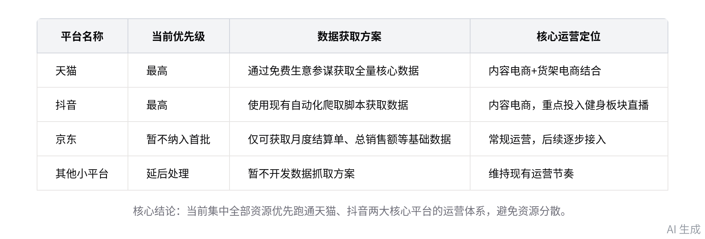
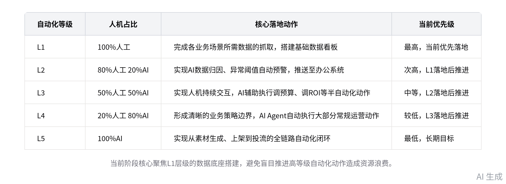
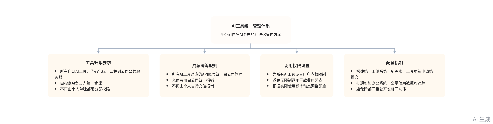

# 智能纪要：电商业务运营与数据体系规划 2026年9月16日

> 录音主题：电商业务运营与数据体系规划
> 
> 录音时间：2026年9月16日（周三） 10:46 \- 12:41 （GMT\+08）
> 
> 

> 智能纪要由 AI 生成，可能不准确，请谨慎甄别后使用
> 
> 

# 总结

音频围绕电商业务运营优先级、数据复盘体系、内容落地路径、AI工具统一管理展开研讨，明确各环节落地规则，内容如下：

- **核心业务与复盘体系规划**

    - **平台优先级确定**

        - 核心平台选择：明确以天猫、抖音为当前核心运营平台，两大平台业务规模最大，其余小平台后续逐步接入，避免资源分散。

        - 京东接入方案：京东自营未开放订单维度数据，仅可获取月度结算单、总销售额等基础数据，当前暂不纳入首批搭建范围。

    - **复盘体系规划**

        - 复盘周期设置：结合当前业务体量，确定以周度复盘为核心动作，无需开展日度复盘，减少无价值的重复数据处理工作。

        - 数据抓取规则：同步抓取日维度原始运营数据，搭建覆盖订单、推广两大核心维度的周度数据看板，支撑周度复盘分析需求。

    - **数据获取方案**

        - 天猫数据来源：天猫端运营、销售数据可直接通过免费的生意参谋获取，覆盖绝大多数所需维度，无需采购第三方付费接口。

        - 抖音数据方案：抖音端采用现有自动化数据爬取脚本接入，无需采购预测平台付费接口，首年15万、后续每年10万的费用暂不支出。

        - 聚水潭数据补充：聚水潭API接口数据不全，无法覆盖天猫全量销售数据，仅作为辅助数据来源，核心数据以平台官方后台抓取为准。

- **内容板块落地路径规划**

    - **内容优先级排序**

        - 增益优先级判定：明确内容板块的业务增益优先级高于自动化上架、自动化投流，当前优先投入资源落地内容侧提效与复盘机制。

        - AI生成视频节奏：当前AI原生生成视频技术成熟度不足，市面无成熟可直接复用的落地案例，暂不推进相关落地动作。

        - 混剪视频落地：现有批量混剪视频流程已完全跑通，每日可产出数十至上百条可用内容，可直接投入当前业务使用。

    - **素材标准化体系**

        - 唯一ID编码规则：所有图片、视频切片、成片均需设置唯一编码ID，编码包含日期、创作者编号、对应卖点、人群标签四类核心信息。

        - ID体系应用场景：切片ID用于素材库复用提效，图片、成片ID用于后续数据追溯，匹配对应订单、销售数据完成效果复盘。

    - **内容复盘机制**

        - 跨部门会议要求：明确建立素材部门与运营部门的固定周度复盘会议机制，由小天作为牵头负责人，统筹核心人员参会。

        - 复盘落地前提：素材与运营部门的对接SOP、固定会议机制跑通前，暂不推进素材数据追溯、内容效果归因等深度动作。

- **组织架构与业务分组规划**

    - **业务分组调整**

        - 分组逻辑切换：放弃原有按平台划分部门的逻辑，改为按品类拆分独立小组，分别为健身组、配饰组，跨平台统筹对应品类全渠道运营。

        - 资源倾斜规则：优先集中资源落地健身板块的内容电商体系，当前已规划男性、女性健身两个直播间，后续逐步按场景拆分更多直播间。

        - 配饰板块定位：配饰板块以货架电商为核心运营方向，不做直播、内容侧的额外投入，仅需保持现有运营节奏，作为核心现金流业务。

    - **人员产能现状**

        - 各部门人员规模：视觉部门共12人，内容部含拍剪、编导、固定模特共8人，其中固定模特2名、拍剪6名，可支撑当前内容产出需求。

        - 视觉部门产能：视觉部门人均每月可完成8套SPU的详情页制作，每套详情页对应约15张可用图片，由100张左右原始素材筛选产出。

- **AI工具体系统一管理规划**

    - **现有AI工具盘点**

        - 各部门应用现状：京东部门已有人员使用Workbody搭建SPU维度看板、AI经营助手，天猫部门仅使用对话类AI，抖音部门全员接触AI但应用较浅。

        - 核心自研工具情况：小天已搭建批量混剪视频、素材内容库等工具，Mimo已搭建生图工具、产品管理平台，当前均部署在个人服务器未统一管理。

    - **统一管理规则**

        - 工具归集要求：所有部门自研的AI工具、代码包需统一归集到公司公共服务器，由指定AI负责人统一管理，不再由个人单独部署分配权限。

        - 资源统筹规则：所有AI工具对应的API账号、充值费用均由公司统一报销管理，不再由个人自行充值报销，避免资源分散浪费。

        - 调用权限设置：为所有AI工具设置用户点数限制，避免无限制调用导致的费用超支，根据实际使用频率动态调整用户的点数额度。

    - **系统架构规划**

        - 系统层级划分：按AI自动化程度将所有业务场景划分为L1到L5共5个层级，从纯人工到全自动化梯度落地，当前优先落地L1层级的数据获取动作。

        - 系统对接规则：统一管理系统将与现有钉钉办公系统打通，所有工具的使用数据、调用记录均可追踪，直观评估各部门AI工具使用情况。

        - 工单流转机制：搭建统一的工单系统，各部门的新需求、工具更新申请均通过工单提交，由AI负责人统一审核排期，避免跨部门重复开发相同功能。

- **后续工作计划**

    - 完成全公司所有自研AI工具的代码包归集，搭建AI统一管理系统的基础框架

    - 由小天牵头组织首次素材与运营部门的跨部门复盘会议，跑通固定会议SOP

    - 完成健身、配饰两个独立业务小组的人员拆分，明确各小组的权责边界

    - 完成天猫、抖音两大平台的周度数据看板搭建，落地订单、推广维度的数据抓取

# 待办

* [ ] 抖音订单维度确认：与一航确认抖音订单维度的相关信息，用于无 API 场景下抖音后台订单维度数据的抓取工作

* [ ] 京东数据方案探索：因京东自营不向商家开放订单维度数据，先跑通天猫、抖音相关数据流程，同步探索京东自营数据获取方案

* [ ] 内容部门架构梳理：联合杨绍杰 \(JayJay\) 召集内容部门全体人员，梳理内容部门架构，先跑通流程，后续再根据实际情况调整人员配置

* [ ] 生图工具查看：查看说话人 2 自主开发的生图工具，待说话人 2 可访问局网后安排查看事宜

* [ ] 部门情况调研：查看京东后台及 AI 助手相关情况，实地调研天猫部门的 AI 工具使用现状，掌握各部门工具应用程度

* [ ] 核心诉求询问：向马克确认其计划将组织内所有内容从钉钉迁移至飞书的核心诉求，明确迁移的相关背景与目的（来自杨绍杰\(JayJay\)）

* [ ] 产品压缩包收集：收集小天目前已产出的所有产品的压缩包并提交（来自杨绍杰\(JayJay\)）

* [ ] 代码包整合：对接宁木，将所有 AI 产品的代码包整合为整份，同步给到杨绍杰 \(JayJay\)（来自杨绍杰\(JayJay\)）

# 智能章节

[00:00](https://tcn9uhyzkzod.feishu.cn/minutes/obcn2u4p9946webnfuzqop7o?t=0)**  各业务平台优先级划分及核心平台规划讨论**

> 本章节参会人员围绕业务拆解优先级展开讨论，否定了直接全量覆盖前后端全业务的思路，明确不同平台优先级有别，小平台可延后处理，确定优先抓盘子更大的天猫、抖音两大核心平台，杨绍杰提及的京东未被列入核心优先级，过程中还出现几句与核心议题关联度较低的零散对话内容。
> 
> 

[01:08](https://tcn9uhyzkzod.feishu.cn/minutes/obcn2u4p9946webnfuzqop7o?t=68000)**  抖音天猫运营两项推进动作的优先级讨论**

> 本章节杨绍杰提出抖音、天猫两大平台后续工作的两个方向，一是搭建日复盘看板整合两平台关联数据，二是围绕现有人群优化内容板块的素材、图片及达人合作，他认为优先选爬取数据的低成本方式做数据归集暂不采购年付接口，还临时联系阿杜索要项目看板远程演示链接。
> 
> 

[03:57](https://tcn9uhyzkzod.feishu.cn/minutes/obcn2u4p9946webnfuzqop7o?t=237000)**  现有第三方工具盘点及抖音天猫数据接入方案沟通**

> 本章节围绕现有采购及使用的第三方工具展开沟通，确认当前在用的相关工具包括免费的生意参谋、聚水潭，明确当前仅做抖音和天猫相关业务，现有天猫多数数据可从生意参谋获取，后续接入多平台数据后预测功能价值更大，抖音可调试已有自动化爬取脚本接入，同时提及聚水潭商家API数据获取不全，双方探讨了数据结合的相关方向。
> 
> 

[05:41](https://tcn9uhyzkzod.feishu.cn/minutes/obcn2u4p9946webnfuzqop7o?t=341000)**  讨论多平台店铺数据看板的优化拓展方案**

> 本章节围绕电商店铺数据抓取看板展开沟通，确认现有自动抓取程序可覆盖多数店铺，当前看板暂未做手机适配，现有抓取维度偏少。与会人员明确后续看板需设总览、切面、单品三大板块，细化多类分析维度，先推进天猫、抖音的日维度看板开发。
> 
> 

[11:25](https://tcn9uhyzkzod.feishu.cn/minutes/obcn2u4p9946webnfuzqop7o?t=685000)**  各平台订单数据抓取及项目推进优先级讨论**

> 本章节各方讨论多平台数据抓取及日复盘推进方案，明确平台订单数据不从聚水潭抓取、需从商家后台获取对应订单维度数据的规则，说明京东自营订单不向商家开放、仅能获取销售额等部分数据、暂无法按订单维度抓取，最终确定先聚焦跑通天猫、抖音相关项目，后续再推进阿里、京东相关内容，避免分散精力。
> 
> 

[13:44](https://tcn9uhyzkzod.feishu.cn/minutes/obcn2u4p9946webnfuzqop7o?t=824000)**  复盘增效节奏及内容相关业务推进讨论**

> 本章节明确复盘与增效行动同步推进，因团队体量有限，确定以周度为单位开展复盘，日常抓取日数据，数据维度涵盖订单、推广两类。经讨论优先推进内容相关事项，团队已跑通批量混剪视频流程，日产能可达数十上百条，全AI生成视频的技术暂不成熟、质量不佳，暂不纳入当前重点。
> 
> 

[19:00](https://tcn9uhyzkzod.feishu.cn/minutes/obcn2u4p9946webnfuzqop7o?t=1140000)**  素材标准化及数据追溯相关问题研讨**

> 本章节聚焦视频素材管理问题，指出当前仅有存放分发素材的平台，无对应数据看板、素材与订单无关联，素材标准化不足无法追溯订单，提出给图片、切片、成片设置唯一ID，分别用于经营追溯和生产提效，明确当前素材与运营部门存在断层，需先建立双方周度复盘机制，再推进相关追溯动作落地。
> 
> 

[32:32](https://tcn9uhyzkzod.feishu.cn/minutes/obcn2u4p9946webnfuzqop7o?t=1952000)**  讨论产品运营及多店铺放大推广相关事宜**

> 本章节明确当前核心目标之一是放大现有在售款销量，同时消化旧有库存，暂不涉及西明相关事宜。说明现有店铺布局：天猫有健身、配饰两家店，抖音现有男性健身、配饰两家店，一周内将新开女性健身店，健身和配饰业务面向不同人群，配饰是核心现金流业务。
> 
> 

[37:28](https://tcn9uhyzkzod.feishu.cn/minutes/obcn2u4p9946webnfuzqop7o?t=2248000)**  调整业务分组优先发展健身板块相关规划**

> 本章节讨论业务分组逻辑，明确摒弃原按天猫、抖音渠道划分的方式，改为按品类分健身、配饰两个小组，优先集中精力攻坚健身板块，健身走内容电商路线，设男女健身等直播间后续逐步扩容，配饰走货架电商路线暂不开播，后续再推进多店策略。
> 
> 

[41:10](https://tcn9uhyzkzod.feishu.cn/minutes/obcn2u4p9946webnfuzqop7o?t=2470000)**  商议内容部门架构梳理及会议牵头人安排**

> 本章节明确需梳理内容部门架构，针对此前内容部门复盘会因无牵头人难以推进的问题，敲定小天作为内容部门复盘会牵头负责人，统筹素材、抖音、视觉等相关板块人员，先推动跑通流程，后续再视情况提拔人员，杨绍杰将协助完成相关架构梳理工作。
> 
> 

[43:40](https://tcn9uhyzkzod.feishu.cn/minutes/obcn2u4p9946webnfuzqop7o?t=2620000)**  各相关业务部门人员数量及构成核对**

> 本章节为参会人员核对多个部门人员规模的沟通，确认素材部门此前5人，视觉部共12人，品牌内容部最终确认共8人，其中拍剪共5人、固定模特共2人另有兼职模特，后续还提及视觉部12人是因多平台、覆盖C/B端且产品SPU较多。
> 
> 

[46:01](https://tcn9uhyzkzod.feishu.cn/minutes/obcn2u4p9946webnfuzqop7o?t=2761000)**  美工部门考核机制及工位调整讨论**

> 本章节主要围绕美工生图相关考核机制展开，明确员工每月需完成8个SPU，每个SPU产出15张可用图以制作详情页，当前用自研生图工具生成百图挑15，同时敲定调整工位，将美工部门迁到方便沟通的区域，把沟通少的拼多多板块工位调整安置。
> 
> 

[50:49](https://tcn9uhyzkzod.feishu.cn/minutes/obcn2u4p9946webnfuzqop7o?t=3049000)**  企业数据流转落地及组织推进思路讨论**

> 本章节围绕公司内部数据流转问题展开讨论，指出当前公司无专人负责数据抓取或RPA相关工作，各部门数据分散在运营个人手中无法流通，即便开发相关数据工具也易因人员无使用习惯沦为摆设，各方认为需先解决组织问题，可先盯守固化动作，让人员感知价值，各部门先培养一名能认知数据与AI价值的核心人员。
> 
> 

[55:52](https://tcn9uhyzkzod.feishu.cn/minutes/obcn2u4p9946webnfuzqop7o?t=3352000)**  各部门AI应用使用情况梳理及统一管理规划**

> 本章节各部门汇报AI工具使用情况，京东团队用AI处理多平台数据、生成SPU可视化看板提效，天猫、抖音多为浅度对话类应用，1688仅1人浅用，拼多多未使用，内容部小天开发的批量视频工具、视觉部自研工具等由个人管控，后续将由AI负责人统一管理相关资源与报销。
> 
> 

[01:09:52](https://tcn9uhyzkzod.feishu.cn/minutes/obcn2u4p9946webnfuzqop7o?t=4192000)**  公司AI统一管理系统搭建逻辑及价值说明**

> 本章节围绕公司整合型系统搭建展开沟通，说明将按部门架构整合视频功能、统一报销等各场景能力模块，统一存储相关数据，配套工单流程管控需求上传与审核，系统将打通Workbody生成看板，便于管控全公司AI相关进度、匹配公司战略分配优先级、评优激励及输出优化建议。
> 
> 

[01:14:37](https://tcn9uhyzkzod.feishu.cn/minutes/obcn2u4p9946webnfuzqop7o?t=4477000)**  AI系统推进架构及钉钉飞书协同相关讨论**

> 本章节先讨论办公协同工具选择，认为飞书、钉钉均可，无需全量转飞书，需先确认马克要转飞书的核心诉求，随后杨绍杰讲解AI推进架构，明确人机协同的L1\-L5分级标准，说明AI落地从优先场景梳理拉取数据起步，逐步推进预警、人机交互直至全自动化闭环，要求各部门明确场景边界，由部门负责人跟进AI推进。
> 
> 

[01:21:47](https://tcn9uhyzkzod.feishu.cn/minutes/obcn2u4p9946webnfuzqop7o?t=4907000)**  AI部门统一掌管相关数据及划定各部门能力边界**

> 本章节明确AI部门需统一掌管相关权限与数据底座，按需为运营、素材、视觉等部门提供所需数据，支持自主生成看板，避免各部门分散重复建设AI相关功能，当前先明确各部门各场景的爬数范围，后续将推进全流程标准化，要求所有相关更新统一上传公司。
> 
> 

[01:24:14](https://tcn9uhyzkzod.feishu.cn/minutes/obcn2u4p9946webnfuzqop7o?t=5054000)**  讨论内部服务产品的点数限制设置逻辑**

> 本章节参会人员围绕公司级服务类产品的点数设置问题展开讨论，杨绍杰最初质疑没必要通过换算API消耗来设点数，后续了解到设点数是为了避免用户无节制滥用产生高额成本，还可根据用户使用情况灵活调整点数上限，参会人员均认可该限制方式合理。
> 
> 

[01:25:26](https://tcn9uhyzkzod.feishu.cn/minutes/obcn2u4p9946webnfuzqop7o?t=5126000)**  讨论工作台架构及公司统一资源管理相关事项**

> 本章节杨绍杰询问参会人看完相关内容后的疑问，参会人反馈信息量大，随后众人讨论工作台属性，确认其类似导航网站，关联的相关工具保持独立仅需接入、共享数据，后续明确接入后的数据共享与统一管理由对应人员负责，数据库、服务器均由公司统一采买，话题最后提及账号相关内容。
> 
> 

[01:26:15](https://tcn9uhyzkzod.feishu.cn/minutes/obcn2u4p9946webnfuzqop7o?t=5175000)**  交流AI工具使用情况及自研自动化工具功能**

> 本章节围绕Coder等AI工具账号使用规则、过往黑充导致账号被封的经历沟通，同步介绍了说话人1自研的财务审单自动化、多平台自动发内容、京东入仓配套程序等多款提效工具，双方提及这类工具后续可落地统一网页版、由公司提供服务器统一管理。
> 
> 

[01:35:06](https://tcn9uhyzkzod.feishu.cn/minutes/obcn2u4p9946webnfuzqop7o?t=5706000)**  交流自研运营BI看板及相关运营工具玩法**

> 本章节围绕说话人1自制的简易BI运营看板展开交流，该看板数据来自后台，维度细致，目前需手动点击触发数据下载，为避免反爬报错特意调慢下载速度，支持按SPU维度查看营业额等数据、生成优化建议与店铺情况分析，说话人1正逐步引导运营助理学习使用该看板，还用Codex快速熟悉新接的平台。
> 
> 

[01:40:24](https://tcn9uhyzkzod.feishu.cn/minutes/obcn2u4p9946webnfuzqop7o?t=6024000)**  仓库审单进销存工具开发及对接统一系统讨论**

> 本章节明确了为仓库开发的审单工具当前已跑通无大问题，可让仓库人员自行操作，将原本人工每日耗时两三个小时的进销存差异分析工作简化为一键完成，后续相关人员会回访跟进对接事宜，同时提及目前已有多个单点工具，后续可接入统一系统。
> 
> 

[01:41:43](https://tcn9uhyzkzod.feishu.cn/minutes/obcn2u4p9946webnfuzqop7o?t=6103000)**  讨论自研逆向插件及相关产品素材收集事宜**

> 本章节围绕一款网页场景下的力推插件展开，提及该插件原存在bug，相关人员借引导AI逆向学习达观的插件相关规则，个人开发复刻其界面、复用网页HTTP接口，未获官方授权，不涉及侵权，期间穿插闲聊内容，最后杨绍杰要求收集现有所有产品压缩包。
> 
> 

[01:47:41](https://tcn9uhyzkzod.feishu.cn/minutes/obcn2u4p9946webnfuzqop7o?t=6461000)**  研讨小田等人开发的AI内容库相关工具**

> 本章节围绕小田开发的AI切片视频内容库平台展开交流，演示了其下载文件、生图转视频、视频复刻、AI生图、分镜故事、无限画布等功能，提到该版本是通用版，小田持有更新版本，同时指出自研工具需参考该平台低理解成本、拆分NAS与服务器端的优势，还提及鹏哥做的简易生图工具及团队提示词相关研发方案。
> 
> 

[01:51:39](https://tcn9uhyzkzod.feishu.cn/minutes/obcn2u4p9946webnfuzqop7o?t=6699000)**  产品管理平台相关功能及使用场景交流**

> 本章节围绕产品管理平台展开介绍，该平台支持下载素材、资料，可打包外发内容并可选择隐藏成本等敏感信息，支持分享带对应货号的质检报告，方便内部人员取图。平台部分数据从钉钉库拉取，无需使用钉钉的代理也可通过该平台获取相关内容，目前平台仅上传了部分产品相关内容。
> 
> 

[01:54:11](https://tcn9uhyzkzod.feishu.cn/minutes/obcn2u4p9946webnfuzqop7o?t=6851000)**  商议整合所有已知AI产品代码包相关事宜**

> 本章节双方就公司所有AI产品的代码包整合工作沟通，杨绍杰提出需整合每一个已知产品的代码包，商议对接宁木完成该项工作，最终确定由说话人1转告宁木，杨绍杰询问相关内容今日能否给到自己，后续双方结束沟通准备去吃饭。
> 
> 

# 关键决策

- **关键决策**：公司所有 AI 工具统一由 AI 负责人管理，整合至公司统一系统，服务器、API 报销均由公司统一统筹。

    - **问题**：当前各部门 AI 工具分散在个人手中，存在管理混乱、资产分散、调用权限不统一的问题。

    - **讨论方案**：

        - 杨绍杰\(JayJay\)提出所有现有 AI 工具需交付给 AI 负责人统一管理，服务器、API 报销均由公司统一处理，工具更新需上传至公司统一系统。

        - 说话人1提出为避免用户无限制调用导致费用过高，可设置用户点数限制，根据使用情况动态调整额度。

        - 杨绍杰\(JayJay\)表示工具无需完全融合，仅需接入统一系统、共享数据即可，无需改动现有工具的独立运行逻辑。

    - **决策依据**：可避免各部门重复开发工具，统一数据底座，便于追踪各部门 AI 使用情况，合理分配资源优先级。

---

- **其他决策**：

    1. 业务优先聚焦抖音、天猫两大平台，暂不推进其他平台相关工作。

    2. 内容运营优先聚焦健身品类，配饰品类暂不做内容侧重点投入。

    3. 由小天牵头组织素材与运营部门的周度内容复盘会议，打通跨部门协作。

    4. 视觉部门搬迁至当前办公区，拼多多部门调整工位，提升跨部门沟通效率。

    5. 由 AI 负责人收集所有现有 AI 工具的代码包，完成整合前的信息归集。

# 金句时刻

「L1 是 100% 人，L2 是 80% 人，20% AI，L3 是 50% 人，50% AI，L4 是 30% 人，70% AI，或者 20% 人，80% AI，L5 是 100% AI。」

—— 清晰定义了 AI 化落地的不同阶段标准，为公司 AI 推进路径提供了明确的分级参考。

「每个信息都是掌握在各个运营自己的电脑里面和他自己的脑子里面，没有流通，如果这个运营他不复盘，那可能就他这个坑就又占住了，然后又没有能够继续往前走，这个情况在咱们公司特别严重。」

—— 点出了公司当前数据信息不流通、运营动作无法沉淀的核心痛点，切中业务效率提升的关键问题。

「你作为一个公司级的一个产品，你不是说自己一个单的产品你要拿出去卖，你是为公司做服务的呀。」

—— 明确了公司内部 AI 工具的定位，纠正了工具私有化、盈利化的错误导向，为统一管理提供了逻辑支撑。

# 相关链接

- 妙记：[电商业务运营与数据体系规划](https://tcn9uhyzkzod.feishu.cn/minutes/obcn2u4p9946webnfuzqop7o?from=ai_minutes)

- 文字记录

    - [电商业务运营与数据体系规划 2026年9月16日](https://tcn9uhyzkzod.feishu.cn/docx/EbaYd2hFEoB6NzxiWnLc2teInAf)

