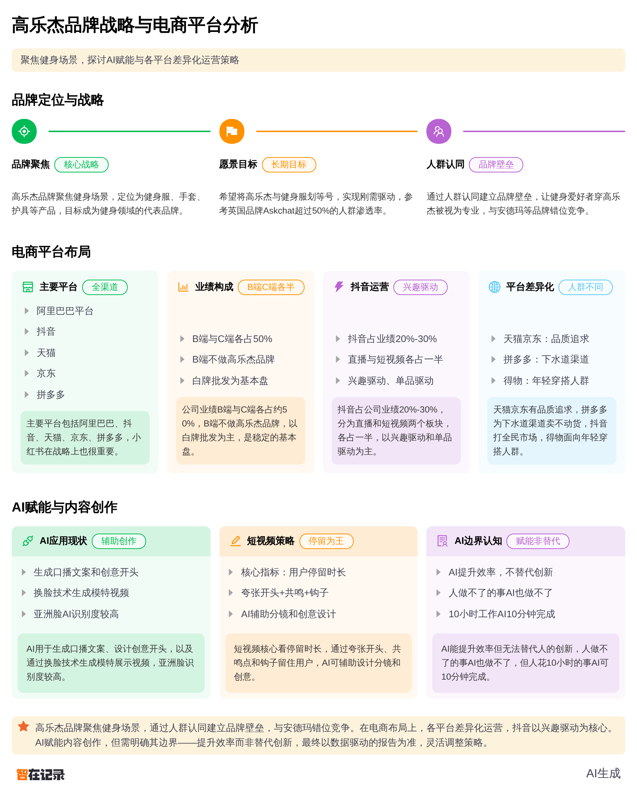

```cover
kicker: FDE 现场调研 · 客户拜访纪要
title: 电商平台与品牌战略
subtitle: E-commerce Platform & Brand Strategy · Customer Visit Minutes
company: 高乐捷 GOLOVE JOY · 内容经营项目组
company_en: FDE · Field Delivery Engineering
meta:
  用途: 现场拜访纪要排版稿（供内部复盘与方案引用）
  依据: 2026-09-18 客户拜访录音（时长 1 小时 01 分 45 秒）之 AI 总结与逐字稿
  版本: v1.0（内容取自 01-输入/sundries 同名 docx，逐字转换，未作增删）
  编制日期: 2026 年 10 月 21 日
  密级: 内部资料，请勿外传
footer_left: 电商平台与品牌战略 · 拜访纪要 v1.0
footer_right: 2026 年 10 月
running_footer: 高乐捷 GOLOVE JOY · 客户拜访纪要 · 2026-09-18
```


## 一、客户拜访交流基本信息

```html
<table style="table-layout:fixed"><colgroup><col style="width:26mm"><col></colgroup>
<thead><tr>
<th>项目</th>
<th>内容</th>
</tr></thead><tbody>
<tr><td>客户拜访交流主题</td><td>高乐捷品牌业务现状及AI赋能需求调研</td></tr>
<tr><td>时间</td><td>2026-09-18 09:44</td></tr>
<tr><td>人员</td><td>客户方：品牌负责人（主谈）、抖音运营（短视频）、直播运营；我方：销售团队（含邵杰团队）</td></tr>
<tr><td>核心讨论范围</td><td>高乐捷品牌定位、电商平台布局、抖音运营现状、AI赋能可能性</td></tr>
<tr><td>核心内容概述</td><td>客户详细介绍了高乐捷品牌从白牌到品牌化的转型历程，聚焦健身场景的品牌定位，以及抖音、天猫等平台的运营现状。双方就AI在短视频内容创作、直播赋能等场景的应用边界进行了深入探讨，客户对AI的期望务实，认为AI应作为效率工具而非创意替代品。</td></tr>
</tbody></table>
```

## 二、拜访过程

### 1、公司平台与部门概览

🔥 客户热情介绍公司覆盖阿里巴巴、抖音、天猫、京东、拼多多等主流平台，小红书战略地位重要。

客户强调财务、供应链、产品研发、客服等部门AI赋能深度尚浅，人事部门优先级靠后。

### 2、业务结构与品牌定位

🔥 客户清晰阐述B端与C端业绩各占50%，B端不做高乐捷品牌以维护价格管控。

高乐捷品牌分为中文（健身场景：健身服、手套、护具）和英文Goal of Joy（配饰：防晒袖套、滑雪手套等）。

🔥 客户明确AI赋能重心应在中文高乐捷（70%），但最终以AI团队出具的诊断报告为准。

### 3、品牌愿景与市场机会

🔥 客户激情阐述品牌愿景：对标英国健身品牌Askchat（人群渗透率超50%），希望高乐捷成为健身场景的刚需品牌，实现“健身服=高乐捷”的人群认同。

客户认为安德玛虽市占率高但品牌老化，Z世代存在生态位空缺，且价格带可错位竞争。

### 4、抖音运营现状与挑战

❄️ 客户介绍抖音占业绩20-30%，分为直播和短视频两大板块，直播与短视频占比约1:1。

🔥 客户坦承优秀主播难培养（如GXG主播苏苏年销数亿），因此战略上更倾向短视频增长。

直播团队每日复盘迭代，但问题追溯依赖人工经验。

### 5、AI赋能边界探讨

🔥 客户提出核心观点：“人做不到的事情，AI基本也做不到；但人花十小时的事，AI花十分钟就能干。” 此观点获销售方高度认可。

短视频运营提出AI辅助创意开头、口播文案的需求，但客户认为创意类工作仍需人主导，AI可放大想法。

客户展示AI换脸视频（欧美脸效果逼真，亚洲脸仍在优化），证明AI在素材生成上的可行性。

### 6、电商平台生态讨论

❄️ 客户与销售方就抖音、天猫、拼多多、京东的平台定位展开辩论。客户认为平台是生态，各承接不同任务（兴趣驱动vs刚需驱动），天猫GMV仍领先拼多多。

客户指出拼多多人群对店铺忠诚度低，天猫适合品牌化运营。

## 三、讨论要点

- 品牌聚焦健身场景：客户反复强调高乐捷已从“全品类运动”聚焦到“健身”细分赛道，对标英国Askchat，希望建立“健身服=高乐捷”的人群认同。这是品牌战略的核心，所有AI赋能需围绕此展开。
- AI赋能重心在中文高乐捷：客户明确70%的AI资源应投入中文高乐捷（健身场景），30%给Goal of Joy（配饰），但最终以AI团队的诊断报告为准。这体现了客户对专业判断的开放态度。
- 短视频是增长优先方向：客户认为优秀主播稀缺且难培养，短视频可自主控制内容质量，增长空间更大。这是AI赋能的直接切入点。
- AI是效率工具而非创意替代品：客户多次强调AI无法替代人的创意（如爆款开头），但可大幅提升效率（如生成分镜、口播文案）。这一认知边界需在后续方案中尊重。
- 价格管控与渠道区隔：客户明确拼多多作为“下水道”渠道，天猫才是真实控价参考。AI赋能需考虑不同渠道的货品策略。

## 四、隐藏商机 💡

- AI短视频内容生成系统：客户短视频运营已在使用AI生成口播文案，但痛点在于创意枯竭。可提供AI驱动的“爆款开头生成+分镜设计”工具，结合竞品爆款数据抓取，降低内容创作门槛。对应客户痛点：创意枯竭、人力成本高。潜在预算：10-30万/年（SaaS订阅）。
- AI直播复盘与话术优化：客户直播团队每日复盘但依赖人工经验，可提供AI直播数据智能分析系统，自动识别话术问题、流量波动原因，并生成优化建议。对应客户痛点：复盘效率低、问题追溯难。潜在预算：15-25万/年。
- AI模特换脸与素材批量生成：客户已展示AI换脸技术，但亚洲脸效果待优化。可提供定制化AI模特库，支持品牌自有模特素材训练，实现低成本、高频率的素材产出。对应客户痛点：模特拍摄成本高、素材更新慢。潜在预算：20-50万（一次性开发+年维护）。
- 全渠道AI智能定价与控价系统：客户对拼多多、天猫有明确渠道区隔，但人工控价难度大。可提供AI价格监测与智能调价系统，自动识别乱价行为并预警。对应客户痛点：渠道价格管控难。潜在预算：10-20万/年。

## 五、后续待办

- 针对客户对AI赋能边界的清晰认知（🔥“人做不到的事，AI也做不到”），在方案中明确AI定位为“效率放大器”而非“创意替代品”，避免过度承诺引发信任危机。
- 针对客户反复强调的“短视频是增长优先方向”，准备一份AI短视频内容创作工具方案，包含爆款开头生成、分镜设计、竞品数据抓取等功能，并附成功案例（如GXG主播苏苏的AI建模设想）。
- 针对客户展示的AI换脸视频（亚洲脸效果待优化），收集并整理亚洲脸AI换脸的最新技术进展和成功案例，下次沟通时进行演示，打消客户顾虑。
- 针对客户提出的“AI赋能重心以诊断报告为准”，安排团队对高乐捷品牌进行深度数据调研（各平台GMV、用户画像、竞品分析），形成书面诊断报告，作为后续方案的基础。
- 针对客户提到的“优秀主播难培养”痛点，探索AI数字人直播的可能性，准备一份技术可行性分析报告（含成本对比），作为长期合作选项。
- 针对客户对拼多多渠道的“下水道”定位，在方案中明确AI赋能将优先聚焦天猫和抖音渠道，尊重客户渠道策略。
- 收集英国Askchat品牌的人群渗透率数据（客户提及超50%），以及安德玛的品牌老化数据，作为品牌定位论证的支撑材料。

## 六、会后洞察 🔍

### 1、客户痛点归纳

- 品牌认知度不足：高乐捷作为新品牌，在健身场景尚未建立“刚需”认知，需突破人群认同壁垒。
- 优秀主播稀缺：直播增长受限于主播能力，培养成本高、周期长，难以规模化复制。
- 创意内容枯竭：短视频运营面临创意瓶颈，爆款开头和口播文案的产出不稳定。
- 渠道价格管控难：多平台运营导致价格体系复杂，拼多多渠道存在乱价风险。
- AI应用落地迷茫：客户对AI能力有认知，但缺乏系统化的落地路径和可量化的ROI评估。

### 2、潜台词解码

- 客户：“我们目前赋能的深度还比较少”

情绪能量：❄️ 平稳，略带遗憾。

解码：客户承认AI应用处于浅层，但未明确拒绝。潜台词是“我们愿意尝试，但需要看到实际效果”。

博弈建议：提供轻量级POC（如AI短视频开头生成），快速验证价值，降低决策风险。

- 客户：“最终还是以你们做出来的那种报告为准”

情绪能量：🔥 开放但保留决策权。

解码：客户将决策权交给AI团队，但隐含“你们需要拿出有说服力的数据”的要求。这是典型的“授权式”潜台词，既给机会也设门槛。

博弈建议：报告需包含竞品分析、ROI测算、分阶段实施路径，用数据说话。

- 客户：“人做不到的事情，AI基本也做不到”

情绪能量：🔥 自信且坚定。

解码：客户对AI有清醒认知，拒绝“万能AI”的营销话术。潜台词是“别忽悠我，我要看到实际价值”。

博弈建议：方案中明确AI的边界和适用场景，用“效率提升”而非“颠覆创新”作为核心卖点。

- 客户：“那得问他们（指团队）”

情绪能量：❄️ 回避具体问题。

解码：客户对抖音运营的具体数据（如直播占比）不掌握，或不愿在销售面前暴露内部信息。潜台词是“这个问题我不负责，或者不想深入”。

博弈建议：后续沟通中直接对接抖音运营负责人（如房哥、凡哥），获取一手数据。

### 3、沟通能量对比

- 话权占比：客户约60%，销售约40%。客户主导了品牌介绍和观点输出，销售主要扮演提问和引导角色。
- 能量状态：能量开放。客户主动分享品牌战略、运营痛点、AI认知，未出现防御性闭合。销售未强行推销，而是以“了解需求”为主，客户愿意深入探讨。
- 关键转折点：当销售展示AI换脸视频时，客户兴趣明显提升（🔥），从“理论探讨”转向“实际应用验证”，能量达到峰值。

### 4、竞情

本次拜访没有涉及到相关竞情。

## 七、辅助工具

### 1、本次拜访总体评价

A. 突破型（高能量/高进展）

判断理由：

- 成功触达品牌负责人，客户全程高能量参与，主动分享品牌战略和运营细节。
- 客户明确表示“以AI团队的诊断报告为准”，给出了清晰的下一步动作（出具报告）。
- 双方就AI赋能边界达成共识（效率工具而非替代品），为后续方案奠定了信任基础。
- 客户展示了AI换脸视频，证明已有初步尝试，合作意愿真实。

### 2、销冠教练：优化建议 🏆

反思点：

- 未深入挖掘竞品信息：客户提及安德玛、Askchat等品牌，但销售未追问客户对竞品AI应用情况的了解，错失获取竞争情报的机会。
- 未锁定关键决策人：客户多次提到“得问凡哥”“得问刘航”，但销售未主动要求对接抖音运营负责人，后续沟通可能需绕路。
- 未量化AI价值：客户对AI效率提升有认知，但销售未给出具体数据（如“AI可减少50%的素材制作时间”），导致价值感知不够强烈。

闪光点：

- 精准捕捉客户认知边界：销售在客户提出“AI无法替代创意”时，立即表示认同并升华（“这是金句”），建立了认知共鸣。
- 现场演示AI能力：销售主动展示AI换脸视频，将抽象概念具象化，极大提升了客户兴趣和信任。
- 保持轻松氛围：销售在客户团队人员变动时（如保安被叫来）及时调节气氛（“不要搞得正儿八经”），维持了沟通的开放性。

杀手锏建议 🚀：

为高乐捷定制一个“AI短视频爆款工厂”POC：在两周内，利用AI工具为客户生成10条不同风格的健身服短视频（含爆款开头、口播文案、AI模特换脸），并在客户抖音账号上测试投放。用实际数据（播放量、转化率）证明AI的价值，直接推动决策。

### 3、供参考的拜访后微信回复内容：

王总，今天下午的交流非常愉快，感谢您和团队毫无保留的分享。您对高乐捷“健身服=高乐捷”的品牌愿景，以及“AI是效率工具而非替代品”的认知，让我们对合作方向更加清晰。特别是您提到的短视频增长优先策略，以及优秀主播稀缺的痛点，我们已经在构思一套“AI短视频内容工厂”方案，希望能帮您解决创意枯竭和素材产出效率的问题。下周我们会整理一份初步诊断报告，包含各平台数据分析和AI赋能路径建议，届时再向您汇报。祝高乐捷早日成为健身人群的“刚需首选”！

## 八、附：现场主要问答

#### 问题1： 客户（销售方）问：“那你们有分析过那那几个款为什么打爆吗？”

- **客户情绪/态度标签：**　❄️ 平稳，带有探究性。

- **应答概述：**　客户回答：爆款原因包括卖点突出（让男士更显身材）、价格认知不足（品牌价格段定位不清晰）。

- **结果评估：**　✅ 认可。客户坦诚回答了问题，未表现出防御。

#### 问题2： 客户（销售方）问：“那你认为就是这种，这这属于传统的，就是说货架电商是吧？现在一些新媒体电商，像抖音，他们这些群体和这些拼多多啦、天猫啦、京东啦又有什么区别呢？”

- **客户情绪/态度标签：**　❄️ 平稳，引导性提问。

- **应答概述：**　客户回答：抖音是兴趣驱动、单品驱动，分为商品卡和直播/短视频两个板块；天猫、京东是品质追求型；拼多多是刚需低价型。

- **结果评估：**　✅ 认可。客户回答详尽，并主动区分了抖音内部板块。

#### 问题3： 客户（销售方）问：“我们直播现在占比大概有多少？”

- **客户情绪/态度标签：**　❄️ 平稳，但回答者非主谈。

- **应答概述：**　抖音运营回答：直播和短视频占比约一半一半。

- **结果评估：**　✅ 认可。数据明确，未引发争议。

#### 问题4： 客户（销售方）问：“那他现在复盘过来有做迭代的动作吗？”

- **客户情绪/态度标签：**　❄️ 平稳，探究性。

- **应答概述：**　抖音运营回答：每场直播都会复盘，根据数据迭代话术、背景等。

- **结果评估：**　✅ 认可。回答具体，显示团队有复盘机制。

#### 问题5： 客户（销售方）问：“那你们现在是怎么追溯这个问题原因的？就是说，是因为哪个话说有问题啊？”

- **客户情绪/态度标签：**　❄️ 平稳，追问细节。

- **应答概述：**　抖音运营回答：根据数据追溯，但具体方法未展开（“数据的话，还是他们了解我”）。

- **结果评估：**　⚠️ 部分化解。回答较模糊，未展示系统化追溯方法，存在隐患（客户可能认为复盘不够精细）。

#### 问题6： 客户（销售方）问：“那你，你既然是实操的这个短视频那里，你有你是用什么方法来为听众的？就比如我现在到你直播间了。”

- **客户情绪/态度标签：**　❄️ 平稳，引导性。

- **应答概述：**　抖音运营回答：用夸张或反差的开头留住用户，再用共鸣和钩子（福利、活动）促进转化。

- **结果评估：**　✅ 认可。回答具体，展示了实操方法论。

#### 问题7： 客户（销售方）问：“如果说 AI 对我们短视频帮助，就是我想， AI 能不能就是帮我想一个有意思的开头，把用户留住，然后我再往下去介绍我们产品。”

- **客户情绪/态度标签：**　🔥 兴奋，主动提出需求。

- **应答概述：**　客户（品牌负责人）回答：AI可帮想创意开头，但创意本身仍需人主导，AI是放大工具。

- **结果评估：**　✅ 认可。客户对AI边界有清晰认知，未产生不切实际的期望。

#### 问题8： 客户（销售方）问：“就是，就是讲衣服，讲啊……就是一件衣服，我就是我买来，它其实是穿不上的……然后通过AI做主图，让它穿上了，而且穿的很好看，那啊，我想说的就是，嗯。我觉得还是，就是如果像我们服装的话，还是，呃，就是拍真人比较好。”

- **客户情绪/态度标签：**　🔴 抵触，带有道德顾虑。

- **应答概述：**　客户（品牌负责人）和销售方回应：核心是预算问题，如果有预算找真人模特，当然更好；AI换脸是成本优化手段。

- **结果评估：**　⚠️ 部分化解。客户顾虑未完全消除（“核心还是没有钱”），但销售方将问题归因于预算，降低了道德压力。

#### 问题9： 客户（销售方）问：“我们现在直播，呃，抖音这块现在有找达人什么的吗？”

- **客户情绪/态度标签：**　❄️ 平稳，信息收集。

- **应答概述：**　抖音运营回答：有，KOC和KOL都在做，有三个商务负责。

- **结果评估：**　✅ 认可。信息明确。

#### 问题10： 客户（销售方）问：“我有一个，呃，这个电商逻辑问题，想去问一下。啊，你说，就是一般来说，你阶段性越往后的公司，肯定是抖音占大头。”

- **客户情绪/态度标签：**　❄️ 平稳，但带有试探性。

- **应答概述：**　客户（品牌负责人）回答：这是身边案例的问题，并非行业规律。平台是生态，各承接不同任务（兴趣驱动vs刚需驱动），高乐捷希望成为刚需品牌。

- **结果评估：**　✅ 认可。客户用数据和逻辑反驳，并升华到品牌愿景。

#### 问题11： 客户（销售方）问：“那将来会不会给那种什么即刻Keep这些合作呢？”

- **客户情绪/态度标签：**　❄️ 平稳，带有联想性。

- **应答概述：**　客户（品牌负责人）回答：Keep有自营产品，但模式与高乐捷不同（Keep是品牌直营，非贴牌授权）。

- **结果评估：**　✅ 认可。客户清晰区分了品牌直营和贴牌模式。

#### 问题12： 客户（销售方）问：“哎，得物你没了解过吗？”

- **客户情绪/态度标签：**　❄️ 平稳，信息补充。

- **应答概述：**　客户回答：有在做，得物用户注重穿搭和运动，粘性强但受众相对较小。

- **结果评估：**　✅ 认可。信息明确。

#### 问题13： 客户（销售方）问：“那我们公司现在对于直播跟短视频，就战略上面，是想我是想发展哪一块？”

- **客户情绪/态度标签：**　❄️ 平稳，但回答者非主谈。

- **应答概述：**　客户（品牌负责人）回答：得问刘凡（凡哥），但个人认为短视频增长空间更大，因为优秀主播难培养。

- **结果评估：**　⚠️ 部分化解。客户未给出明确战略方向，但提供了个人判断，需后续与凡哥确认。

#### 问题14： 客户（销售方）问：“哎，我们现在会用AI生成视频吗？”

- **客户情绪/态度标签：**　🔥 兴奋，带有展示欲。

- **应答概述：**　客户（品牌负责人）回答：会用，但很艰难。随后展示AI换脸视频（欧美脸效果逼真，亚洲脸待优化）。

- **结果评估：**　✅ 认可。客户主动展示成果，合作意愿强烈。

---

## 附录　录音原文逐字稿（523 句）

> 本表按时间轴原样收录 2026-09-18 录音逐字稿，未做润色与纠错；正文各条结论均可在此回溯。说话人编号沿用转写件原称呼，未与姓名对应。

> 创建时间：2026-09-18 10:46:01　·　录音时长：1小时 01分 45秒　·　录音录制时间：2026-09-18 09:44:04

```html
<style>
.tsrc { table-layout: fixed; line-height: 1.45; }
.tsrc th, .tsrc td { padding: 1.0mm 2.2mm; }
.tsrc td:first-child, .tsrc th:first-child { white-space: nowrap; }
</style>
```

```html
<table class="tsrc" style="table-layout:fixed"><colgroup><col style="width:15mm"><col style="width:20mm"><col></colgroup>
<thead><tr>
<th>时间</th>
<th>发言人</th>
<th>内容</th>
</tr></thead><tbody>
<tr><td>00:00</td><td>发言人1</td><td>我们主要的几个平台，一个是阿里巴巴平台，哦，然后嗯，抖音、天猫、京东、拼多多，就这这么几个平台，这是主要的平台。</td></tr>
<tr><td>00:14</td><td>发言人2</td><td>主平主要平台都有啊。</td></tr>
<tr><td>00:16</td><td>发言人1</td><td>啊，就之前还那还有几个小平台，那不重要哈。小红书，小红书目前我们在战略方面也挺重要的。</td></tr>
<tr><td>00:25</td><td>发言人2</td><td>种草这个，你们将来也是重点。</td></tr>
<tr><td>00:28</td><td>发言人1</td><td>对，对对对。</td></tr>
<tr><td>00:29</td><td>发言人2</td><td>只是，只是可以，就是这个普能比较低。</td></tr>
<tr><td>00:34</td><td>发言人1</td><td>对，然后呢，然后重要的一些部门啊，财务部门，就是这个我觉得 AI 可以很快的助赋能的一个是很多部门，但是目前赋能的深度还比较少。啊，啊，然后供应链部门，对供应链，然后产品研发部门。</td></tr>
<tr><td>00:58</td><td>发言人2</td><td>研发。</td></tr>
<tr><td>00:58</td><td>发言人1</td><td>客服部门，客服部门，对，这些都是非业务端的一些，还有还有人事部门，像人事部门呢，我觉得可以稍微往后稍一稍啊，嗯我我也不知道 A I 能帮人事做什么东西。</td></tr>
<tr><td>01:16</td><td>发言人2</td><td>哦哦哦哦。</td></tr>
<tr><td>01:17</td><td>发言人1</td><td>也不知道这种事情，啊。就主要是这，然后，呃，我们公司的业绩，业绩划分就是我们B端跟C端大概各50%。</td></tr>
<tr><td>01:33</td><td>发言人2</td><td>To B, 哦哦哦, To B跟 To C, 哦, 我知道.</td></tr>
<tr><td>01:36</td><td>发言人1</td><td>To B我们是不做高乐捷这个品牌的，To B就批发我们是不做高乐捷品牌做做摆盘儿摆盘对哦哦哦，因为客户他可能有不不同的需求，他可能要做自己的品牌。</td></tr>
<tr><td>01:50</td><td>发言人3</td><td>哦。</td></tr>
<tr><td>01:51</td><td>发言人1</td><td>对，而且也是为了我们自己能够对高乐杰这个品牌能够做到更好的价格管控，所以不在比短去做的高乐杰品牌。</td></tr>
<tr><td>02:02</td><td>发言人2</td><td>哦。我明白，明白。</td></tr>
<tr><td>02:05</td><td>发言人1</td><td>对，然后我们跟少杰之前沟通，我们谈到的要求是，我们目前 To B 那段先不做，先先你们先，重心不是对他们的，啊，对，因为他们是属于白牌，而且那一盘的生意是是我们的基本盘，也很稳定啊。</td></tr>
<tr><td>02:24</td><td>发言人2</td><td>哦，对，但。</td></tr>
<tr><td>02:25</td><td>发言人1</td><td>想提升，难度也非常非常大。然后，我们的高乐捷品牌是这两年才立的。下。</td></tr>
<tr><td>02:33</td><td>发言人2</td><td>哦哦哦。</td></tr>
<tr><td>02:34</td><td>发言人1</td><td>对，之前也是当白牌去打，随便做一个平台去打。对，这两年它立的像，然后高乐节品牌也分两个，一个是中文的高乐节，一个是英文的，Gulof Joy。中文的高乐节，我们是主打健身这个这个场景的哦，健身服，然后一些健身的手套，然后健身的护具这一些。哦，然后英文的高乐节，Goal of Joy呢，我们是做配饰的，就比如夏季是防晒袖套、防晒面罩。</td></tr>
<tr><td>03:12</td><td>发言人2</td><td>哦。</td></tr>
<tr><td>03:12</td><td>发言人1</td><td>就养猫。对哦，对，就就是那个是割肉交易的，然后还有冬季的一些滑雪手套，呃，滑雪速干衣。滑雪面罩，还有保暖的，各个那都是各各老交易在打。然后，但是你们要去赋能，就是更多的肯定是要来赋能，就是高乐杰这个品牌，中文的，就是健身场景，健身场景这这个板块。嗯。然后，Goal of Joy那个板块呢，可能你可能你们要要需要去分，可能70%在高乐杰，然后30%在在在配饰那一段。啊，对。对，这个要要。</td></tr>
<tr><td>03:58</td><td>发言人1</td><td>可能就是需要，也是需要你们对我们公司进行深度了解之后，如果说你们发现那边的业务更容易提升啊，啊，更容易能够帮到我们，那肯定也打那边，最终还是以你们做出来的那种报告为准。对，然后你就跟拿那个报告去跟我们老板，你去说服他们，对吧？就我们自己，可能在这方面就是剖析的也不是很细，我们是愿望是想，肯定是想把高乐杰这个品牌做好，因为高乐杰这个品牌，我们目前推推理出来不是，我们也开过很多很多共创的会议啊，就是高乐就是我们之前就是品牌定位是做一个。</td></tr>
<tr><td>04:50</td><td>发言人1</td><td>是想做运动这个非常大的这个市场，就是运动市场的品牌定位。就这个定位就非常不会聚焦，运动什么运动？我们想做全品类运动啊，就跟安踏一样嘛。对对，想想想做里面安踏那种，我就想做那个法国的那个叫什么，就是来一个。</td></tr>
<tr><td>05:11</td><td>发言人2</td><td>打过什么？亚瑟是，哈哈，啊，现在就是主要，主要聚焦了，然后聚焦这个运动健身。</td></tr>
<tr><td>05:31</td><td>发言人1</td><td>啊，对，就是，就是，呃，现在就是，我们就把那个高乐杰这个品牌就做到更聚焦，我们只做健身这种。</td></tr>
<tr><td>05:43</td><td>发言人2</td><td>啊，就类似于就是会上说的那个卢卢雷姆，嗯，对，它是针对普拉提瑜伽嘛，嗯。</td></tr>
<tr><td>05:51</td><td>发言人1</td><td>对对对，他针对他的，对，我们就做健身。这然后我们做健身有几个理由，就是对于中国这块市场来讲，就是健身是。呃，我们是觉得有机会的，因为目前没有哪个品牌，就是比如说像健身服代表那个品牌，人家第一就想到那个品牌，那中国没有，啊，中国目前有安德玛，他在健身领域就呃做的就是市占率慧笔较好嘛。</td></tr>
<tr><td>06:21</td><td>发言人2</td><td>哦哦哦，渗透为。</td></tr>
<tr><td>06:22</td><td>发言人1</td><td>也会相对好一点，但是安德玛，就是他太，他他太老套了。</td></tr>
<tr><td>06:31</td><td>发言人2</td><td>啊，对他老。</td></tr>
<tr><td>06:32</td><td>发言人1</td><td>对对对，很老气，所以在年轻，就是Z时代这个人群里面啊，那我们就可以，就我们是有机会的。</td></tr>
<tr><td>06:42</td><td>发言人3</td><td>去占领这个生态位。</td></tr>
<tr><td>06:43</td><td>发言人1</td><td>对对，而且我们可也可以去打，我们自己是一个国产的品牌，对，然后从价格带方面，我们也可以跟安德玛去错分开，对，嗯，所以在这个领域竞争对手不多，少，对，跟跟安德玛也是错位竞争的嘛，对，所以，然后而且我们在国外。是有有很好的这种案例的，就是在英国，它那个 Askchat 这个品牌是，我们也是因为看到它这个案例，哎，就觉得这个市场是可以去打。哦，好，我们目前从各个平台扒的数据，健身服的需求不大。</td></tr>
<tr><td>07:29</td><td>发言人3</td><td>嗯。就是我之前听那个少爷说过，你们这边现在还是配饰的业绩占大头，对吧？</td></tr>
<tr><td>07:35</td><td>发言人1</td><td>那肯定，那肯定，我们健身，健身，呃，我们是到了，我们是在今年的五月六月开始来聚焦这个事情。嗯，对，对，之但是之前也有几个爆款，但是不是那那个，就是因为那也是因为那几个爆款打成功了，啊，就我们觉得这个这个，就我们完不是完全零基础，我们是有几个款去支撑的，这个。突然一下信息太多啊，哦，没那么好接受的，就吸收可能有点难。</td></tr>
<tr><td>08:17</td><td>发言人3</td><td>那你们有分析过那那几个款为什么打超吗？</td></tr>
<tr><td>08:21</td><td>发言人1</td><td>有肯定有，肯肯定有，嗯，对，呃，首先第一原因是那个那几个款的定位是比较好的，它的卖点，它的卖点就是呃让男士更显身材嘛。对，就那几个卖点慧笔较突出，然后在在价格方面的，哎，我们在价格方面，我们的这个认知其实一直不太够，就是在我们在价格段，我们品牌的这个价格段的认知不太够。</td></tr>
<tr><td>08:58</td><td>发言人2</td><td>我看了一下那个拼多多上，呃，价格主要是在八十七十五、八十到一百二之间，是是真实的。</td></tr>
<tr><td>09:07</td><td>发言人1</td><td>价值吗？对你别看拼多多。</td></tr>
<tr><td>09:09</td><td>发言人2</td><td>哦啊，拼多多比较离谱些，是吧？</td></tr>
<tr><td>09:11</td><td>发言人1</td><td>不是拼多多，它平台会有补贴。</td></tr>
<tr><td>09:15</td><td>发言人2</td><td>好像不是真实的商品价格。</td></tr>
<tr><td>09:17</td><td>发言人1</td><td>对，不是我们真实的控价，我们真实控价看天猫就好了。</td></tr>
<tr><td>09:21</td><td>发言人2</td><td>Oh.</td></tr>
<tr><td>09:24</td><td>发言人1</td><td>而且拼多多，我们在货品上面是有是有明确区分的。</td></tr>
<tr><td>09:30</td><td>发言人2</td><td>啊，有有，针对渠道渠道吗？</td></tr>
<tr><td>09:34</td><td>发言人1</td><td>是的。</td></tr>
<tr><td>09:35</td><td>发言人2</td><td>啊，就是拼多多明显就是这边客户比较偏，比较就是比较喜欢那个。</td></tr>
<tr><td>09:42</td><td>发言人1</td><td>拼多多是咱们公司的下水道，卖不动的货。</td></tr>
<tr><td>09:49</td><td>发言人2</td><td>直销的群里面辛苦。</td></tr>
<tr><td>09:51</td><td>发言人1</td><td>对对，平时都是这个功能，对。</td></tr>
<tr><td>09:54</td><td>发言人2</td><td>啊，我明白你意思了。</td></tr>
<tr><td>09:57</td><td>发言人1</td><td>另外都是不好不好的货，对，然后我们就放弃了控制那那盘货的价格，所以才会放到拼多多里面。</td></tr>
<tr><td>10:05</td><td>发言人2</td><td>哦哦，其实是不是好多的品牌，都把拼多多当成这样一个渠道？</td></tr>
<tr><td>10:10</td><td>发言人1</td><td>是的呀，是的呀，因为他那个他那个平台的人群他就这样，他不需要好东西，他需要便宜东西，他更多的还是刚需的需求。</td></tr>
<tr><td>10:20</td><td>发言人2</td><td>对对对，就是基本上就是刚需人群去多嘛。</td></tr>
<tr><td>10:24</td><td>发言人1</td><td>对，对，像天猫、京东，它会有一些品质追求的。对对对。</td></tr>
<tr><td>10:36</td><td>发言人2</td><td>那你，那你认为就是这种，这这属于传统的，就是说货架电商是吧？现在一些新媒体电商，像抖音，他们这些群体和这些拼多多啦、天猫啦、京东啦又有什么区别呢？</td></tr>
<tr><td>10:51</td><td>发言人1</td><td>抖音是吗？</td></tr>
<tr><td>10:53</td><td>发言人2</td><td>对呀，你们做了吗？现在。</td></tr>
<tr><td>10:55</td><td>发言人1</td><td>我们抖音是也是我们很大的一个一个渠道啊。</td></tr>
<tr><td>10:58</td><td>发言人2</td><td>哦哦，已经在做了，是吧？</td></tr>
<tr><td>11:00</td><td>发言人1</td><td>对呀。</td></tr>
<tr><td>11:00</td><td>发言人2</td><td>他们这个。</td></tr>
<tr><td>11:02</td><td>发言人1</td><td>抖音这部门都在这儿。</td></tr>
<tr><td>11:03</td><td>发言人2</td><td>他十多个人，他们那个主播。</td></tr>
<tr><td>11:05</td><td>发言人1</td><td>确实都没。</td></tr>
<tr><td>11:05</td><td>发言人2</td><td>啊，我他们这个特点和另外的三四个平台。</td></tr>
<tr><td>11:12</td><td>发言人1</td><td>什么特点？嗯。</td></tr>
<tr><td>11:14</td><td>发言人2</td><td>不一样人是完成的。</td></tr>
<tr><td>11:16</td><td>发言人1</td><td>嗯，成交量啊，这些啊，成交量抖音能占20%，二三十吧，二三十。</td></tr>
<tr><td>11:25</td><td>发言人2</td><td>群体更年轻一点，也感兴趣多一点。</td></tr>
<tr><td>11:29</td><td>发言人1</td><td>对，呃。</td></tr>
<tr><td>11:30</td><td>发言人3</td><td>也不一定。</td></tr>
<tr><td>11:31</td><td>发言人1</td><td>我觉得抖音打的是全民的，没有没有说男男性会更，也没有说女性会更多。抖音它主要是兴趣驱动，而且它是单品驱动。对，单品驱动，就是，它抖音就是我们在做，呃，我们在做抖音的时候，就是，抖音也分两个板块，哦，一个是商品卡，一个是直播。短视频，对这两个板块也不一样，或者换我一谈去讲。</td></tr>
<tr><td>12:13</td><td>发言人3</td><td>我我们现在，短直播的那个，在抖音这一块的业绩占比是占多少？</td></tr>
<tr><td>12:22</td><td>发言人1</td><td>那得问他们。</td></tr>
<tr><td>12:23</td><td>发言人2</td><td>哦哦。</td></tr>
<tr><td>12:24</td><td>发言人1</td><td>啊，辛苦了。对，我不是因为我知道我不是公司业务总监，我知道。</td></tr>
<tr><td>12:29</td><td>发言人2</td><td>哦哦，明白明白。哎，其实商品卡应该不多吧。</td></tr>
<tr><td>12:33</td><td>发言人1</td><td>保安，保安，来，采访你，来，出来，给你烟抽，我小老弟。</td></tr>
<tr><td>12:49</td><td>发言人2</td><td>不要有压力啊，我们只是。</td></tr>
<tr><td>12:51</td><td>发言人3</td><td>交流啊，都我就是随便。</td></tr>
<tr><td>12:53</td><td>发言人1</td><td>没事，凉到谁我就我就可以跟人家解释。是我们公司人都非常好说话，把那刘航不在，我问一下。</td></tr>
<tr><td>13:08</td><td>发言人2</td><td>那就是你刚才的问题，再说一遍。</td></tr>
<tr><td>13:10</td><td>发言人3</td><td>我们现在在抖音这块。</td></tr>
<tr><td>13:13</td><td>发言人2</td><td>就等于有两块业务，一个是。</td></tr>
<tr><td>13:14</td><td>发言人1</td><td>哦，买便宜啊！啊。</td></tr>
<tr><td>13:18</td><td>发言人2</td><td>明卡。</td></tr>
<tr><td>13:18</td><td>发言人3</td><td>你戒了直播，戒了短视频。</td></tr>
<tr><td>13:22</td><td>发言人2</td><td>不要看到你来问啊！就。</td></tr>
<tr><td>13:24</td><td>发言人1</td><td>除了这只之外，这。</td></tr>
<tr><td>13:25</td><td>发言人2</td><td>等一等，等一会儿，咱们不要那么搞得正儿八经的，咱们可以是一个比较轻松愉快的啊。</td></tr>
<tr><td>13:32</td><td>发言人4</td><td>还有一个直播运营。</td></tr>
<tr><td>13:34</td><td>发言人1</td><td>问你就好了。</td></tr>
<tr><td>13:35</td><td>发言人2</td><td>我就上个卫生间。</td></tr>
<tr><td>13:37</td><td>发言人1</td><td>就问你这行业不是很深入。</td></tr>
<tr><td>13:39</td><td>发言人2</td><td>对，就是稍微了解一下啊，今天就是稍微谈一下啊。</td></tr>
<tr><td>13:45</td><td>发言人3</td><td>那抖音这块的话，有三个渠道嘛，一个是直播，然后一个是商品卡，一个是短视频嘛，然后图文的话，基本上基本等于零的嘛。</td></tr>
<tr><td>13:54</td><td>发言人4</td><td>嗯，货架还是交给天猫。</td></tr>
<tr><td>13:57</td><td>发言人3</td><td>对，现在这三块我们都有去打嘛。</td></tr>
<tr><td>14:00</td><td>发言人4</td><td>没没有，主要是短视频和直播。</td></tr>
<tr><td>14:03</td><td>发言人3</td><td>主要是短视频，就是。</td></tr>
<tr><td>14:04</td><td>发言人4</td><td>嗯，后架在在上面卡没打。</td></tr>
<tr><td>14:08</td><td>发言人3</td><td>那我们直播现在占比大概有多少？</td></tr>
<tr><td>14:11</td><td>发言人4</td><td>直播占比一半一半嘛，跟短视频对。</td></tr>
<tr><td>14:19</td><td>发言人1</td><td>他们只不过时好时。</td></tr>
<tr><td>14:20</td><td>发言人4</td><td>就是赋能的。</td></tr>
<tr><td>14:21</td><td>发言人1</td><td>啊，售后嘛。</td></tr>
<tr><td>14:22</td><td>发言人4</td><td>短视频赋能直播，然后直播也是赋能短视频。</td></tr>
<tr><td>14:27</td><td>发言人3</td><td>呃，商会引流的。</td></tr>
<tr><td>14:28</td><td>发言人4</td><td>嗯，对。</td></tr>
<tr><td>14:37</td><td>发言人3</td><td>短视频，我感觉在我们这一块，如果体验。</td></tr>
<tr><td>14:41</td><td>发言人4</td><td>你你是做什么？我是做调。</td></tr>
<tr><td>14:44</td><td>发言人3</td><td>我之前是做天猫的。</td></tr>
<tr><td>14:46</td><td>发言人4</td><td>哦，你是想问就是短视频怎么赋能你们天猫？</td></tr>
<tr><td>14:50</td><td>发言人3</td><td>啊不不不，我我现在到这边之后也要玩抖音。</td></tr>
<tr><td>14:54</td><td>发言人1</td><td>哦，你不知道他是干嘛的，是吗？</td></tr>
<tr><td>14:55</td><td>发言人4</td><td>啊哦，我不知道目的。</td></tr>
<tr><td>14:58</td><td>发言人1</td><td>嗯，你知道少杰他少杰吗？</td></tr>
<tr><td>15:02</td><td>发言人4</td><td>邵杰，听过。</td></tr>
<tr><td>15:04</td><td>发言人1</td><td>啊，就是他们是少杰那个团队跟我们公司合作的，来给我们公司去在AI方面去做赋能的。</td></tr>
<tr><td>15:14</td><td>发言人4</td><td>哦。</td></tr>
<tr><td>15:15</td><td>发言人1</td><td>对，所以他要赋能，他需要了解到每一个。每一个板块的业绩情况，就是他他们他们这样的维度会会更会更高一点嘛？就是来看咱们这盘业绩，在哪个地方赋能呀？对吧？或者就是在在哪个地去剖剖析，去把你们的，去把我们的那个业绩去切分切分开，然后一个个的点对点的去突破呀。懂吗？懂，最简单的懂。</td></tr>
<tr><td>15:46</td><td>发言人4</td><td>嗯，就每个部门还是就。</td></tr>
<tr><td>15:49</td><td>发言人1</td><td>各部门，每每个部门，就是就是，所以他要要了解咱们，每个部门的业绩情况，啊。</td></tr>
<tr><td>15:58</td><td>发言人3</td><td>那我们现在做直播的话，我们是有我们的这个盯盘频率是多少？有去盯盘吗？</td></tr>
<tr><td>16:06</td><td>发言人4</td><td>盯盘的话，房根每天都可以盯盘，他会盯到很晚，就是晚上我们会直播到十二点一点，然后他下播之后，我们主播都会复盘。</td></tr>
<tr><td>16:18</td><td>发言人3</td><td>啊，这个。</td></tr>
<tr><td>16:20</td><td>发言人4</td><td>对，房哥会盯着他们服。</td></tr>
<tr><td>16:25</td><td>发言人3</td><td>是结束呃，整个直播过程，对它的数据都有都。</td></tr>
<tr><td>16:30</td><td>发言人4</td><td>对对也会盯，包括那个平哥也会就是盯着直播。</td></tr>
<tr><td>16:36</td><td>发言人3</td><td>那他有做。</td></tr>
<tr><td>16:38</td><td>发言人4</td><td>有做记录，有做记录，对，每每场直播都会做记录。</td></tr>
<tr><td>16:42</td><td>发言人3</td><td>那他现在复盘过来有做迭代的动作吗？</td></tr>
<tr><td>16:46</td><td>发言人4</td><td>嗯，会有的，肯定要迭代，就是要对每场直播的数据分析一下，对比上一场嘛，然后做嗯迭代，然后哪里不对改哪里嘛。就如果嗯话术有问题就改话术嘛，如果背景有问题我今天也去改背景，就是哪里有问题就去改。</td></tr>
<tr><td>17:12</td><td>发言人3</td><td>那你们现在是怎么追溯这个问题原因的？就是说，是因为哪个话说有问题啊？</td></tr>
<tr><td>17:18</td><td>发言人4</td><td>呃，根据数据嘛，都有一个数据的。</td></tr>
<tr><td>17:22</td><td>发言人3</td><td>啊，就比如说你直播可能。在在这五分钟。</td></tr>
<tr><td>17:27</td><td>发言人4</td><td>数据的话，还是他们了解我，因为我是做短视频的嘛，短视频的话。</td></tr>
<tr><td>17:33</td><td>发言人1</td><td>那讲那种短视频，那叫。</td></tr>
<tr><td>17:34</td><td>发言人4</td><td>短视频主要看点击，点击转化停留，然后现在的话，现在短视频我觉得主要看停留吧，因为抖音现在主要就是在用户流失这方面，就是想把用户留下来，然后让他买这个产品，主要今年主要我觉得主要做的就是停留。就是怎么把用户留在抖音上面？是。</td></tr>
<tr><td>18:07</td><td>发言人2</td><td>那你，你既然是实操的这个短视频那里，你有你是用什么方法来为听众的？就比如我现在到你直播间了。</td></tr>
<tr><td>18:16</td><td>发言人4</td><td>就。</td></tr>
<tr><td>18:16</td><td>发言人2</td><td>或者是我当。</td></tr>
<tr><td>18:17</td><td>发言人4</td><td>我们短视频基本都有框架的，就是，嗯，想一个很夸张或者很有反差的开头，开头把你留住。然后再嗯说一个共鸣吧，就是我如果卖这个拖鞋的话啊，就是很多人穿上就会，就是比方说脚臭，很多人穿了别的拖鞋脚臭。我就是做错了那个。</td></tr>
<tr><td>18:47</td><td>发言人2</td><td>亲子老师。</td></tr>
<tr><td>18:48</td><td>发言人4</td><td>对我就是说出了他这个共鸣，他可能就会停留，停留下来看我接下来怎么介绍这个产品，穿着不讲求。</td></tr>
<tr><td>18:57</td><td>发言人2</td><td>哦哦哦哦。</td></tr>
<tr><td>18:57</td><td>发言人4</td><td>哦，然后再用一些钩子嘛。</td></tr>
<tr><td>19:01</td><td>发言人2</td><td>啊。</td></tr>
<tr><td>19:01</td><td>发言人4</td><td>可以说是那个我们产品，嗯，有什么福利送什么，或者什么活动嘛？用一个钩子把他们留下来，或者是嗯，其实嗯就是短视频要看很多的，要看模特的网感，还有口播的一个感觉，然后再看一个。就是表达的形式嘛，就是现在短视频有各种各样，但是他们都能把，就是用户，他们用各种方式都能把用户留下来。</td></tr>
<tr><td>19:42</td><td>发言人2</td><td>哦哦哦哦。</td></tr>
<tr><td>19:43</td><td>发言人4</td><td>如果说 AI 对我们短视频帮助，就是我想， AI 能不能就是帮我想一个有意思的开头，把用户留住，然后我再往下去介绍我们产品。</td></tr>
<tr><td>19:58</td><td>发言人3</td><td>就是帮你设计这个分镜啊，钩子啊。</td></tr>
<tr><td>20:01</td><td>发言人4</td><td>帮我想一个有创意、有意思的开头，把他们留住。开头，这样我们就可以往下介绍我们产品了，把我们产品卖出去。就跟那。</td></tr>
<tr><td>20:12</td><td>发言人2</td><td>但是具体这个视频其实其实还是你们自己去做的，是吧？</td></tr>
<tr><td>20:16</td><td>发言人4</td><td>嗯，对。</td></tr>
<tr><td>20:17</td><td>发言人2</td><td>哦哦哦！就是相当于这个内容设计，你们需要的是AI可以做一个内容的设计。</td></tr>
<tr><td>20:24</td><td>发言人4</td><td>对，呃，就是怎么夸张都好，就跟那个拼多多那个马扁的那个图一样，啊，这么大一个字，大大大就是大，但是我们短视频，就是要把主图上面那啊些夸张的内容表现出来。</td></tr>
<tr><td>20:41</td><td>发言人3</td><td>愿望很美好。</td></tr>
<tr><td>20:42</td><td>发言人2</td><td>嗯，对，这个确实已经是。</td></tr>
<tr><td>20:46</td><td>发言人4</td><td>嗯，就。</td></tr>
<tr><td>20:46</td><td>发言人2</td><td>他其实已经不是AI。</td></tr>
<tr><td>20:48</td><td>发言人3</td><td>李耀文。</td></tr>
<tr><td>20:50</td><td>发言人2</td><td>啊，因为AI现在已经，呃，各种各样了，就是你现在你是怎么用AI解决这个事情的？</td></tr>
<tr><td>20:58</td><td>发言人4</td><td>呃，我平时用AI就是想一些口播的文案，想一些夸张一点，因为夸张的开头能把用户留下来。</td></tr>
<tr><td>21:09</td><td>发言人2</td><td>其实你也积累了一些，比如什么。</td></tr>
<tr><td>21:12</td><td>发言人4</td><td>呃，包括现在投放就。</td></tr>
<tr><td>21:15</td><td>发言人1</td><td>我都八弟他了，我这跟你讲啊，你目前就这样想就好了。人做不到的事情，啊，AI基本也做不到。那我，但是人，如果做这个事情要花十个小时，哎，AI可能就花十分钟，嗯，就给你干了。但是这个事情如果，你你人想不出来，这个要怎么去做一个开头，你别指望AI帮你想。</td></tr>
<tr><td>21:45</td><td>发言人2</td><td>这句话可以当一个宗旨，真的是金句，真的，嗯，这个就是其实你你对AI的边界，这个就是AI一个很好的边界，就是悟空说的。可以说是真理。</td></tr>
<tr><td>22:01</td><td>发言人4</td><td>呃呃，我听就是我看见网上有很多人说，就是他们说AI只能就是赋能赋能人，不能替替代，是吗？就是不他不能替代人，只能就是帮助赋能。</td></tr>
<tr><td>22:19</td><td>发言人1</td><td>那个那个人说的有点绝对。他他说的有点。</td></tr>
<tr><td>22:24</td><td>发言人4</td><td>还是能替代人的是吧？</td></tr>
<tr><td>22:26</td><td>发言人1</td><td>那肯定，肯定在很多工作，就是如果说这个人他每天干的活，他不用动脑子，那也也也也，他不能替代人的脑子。啊，它目前目前对目前很难啊。</td></tr>
<tr><td>22:40</td><td>发言人4</td><td>对，就是我，比方说，我现在立马在这里拉屎，AI绝对想不到，是吧？</td></tr>
<tr><td>22:47</td><td>发言人2</td><td>对，这是你这对这。</td></tr>
<tr><td>22:48</td><td>发言人1</td><td>人也人也想不到了。</td></tr>
<tr><td>22:51</td><td>发言人4</td><td>就是我们短视频，就是他会有很多稀奇古怪的想法，就会那个爆，就会爆。</td></tr>
<tr><td>23:00</td><td>发言人1</td><td>再联系一下。</td></tr>
<tr><td>23:00</td><td>发言人4</td><td>对AI项目的。</td></tr>
<tr><td>23:02</td><td>发言人1</td><td>他他也不敢想这个事情。</td></tr>
<tr><td>23:05</td><td>发言人4</td><td>就是。</td></tr>
<tr><td>23:06</td><td>发言人2</td><td>其实AI的创新，是我认为是，最近以我对AI的了解，它是不如人的。</td></tr>
<tr><td>23:14</td><td>发言人1</td><td>可能创新其实这些的。</td></tr>
<tr><td>23:17</td><td>发言人3</td><td>现在好像那个吧，OpenAI把那个那个十大千禧题给。</td></tr>
<tr><td>23:22</td><td>发言人2</td><td>那不是那那不是创新，那不是创新。但是它能寻找一些人不能寻找那些规律，就比如元元那个元素派是吧，三点1415926 ，人也可以算，只是说它要非常非常长的时间，人呢又没有这个那么多时间，没有那么多工具，哎，交给机器的话，它就很快。</td></tr>
<tr><td>23:49</td><td>发言人3</td><td>就相当于，他只能达到你的上限。</td></tr>
<tr><td>23:52</td><td>发言人2</td><td>说是AA，是技术评选吗？就是，他只是把，你原来不懂技术，哎，你可以拉到和这种相对来说懂技术的这些人，哎，差不多的一个维度。</td></tr>
<tr><td>24:07</td><td>发言人1</td><td>就你说你刚刚所提的那个需求啊，我跟你讲，我我我举个类比哈，比如说像梵高的画，啊，对吧？那这画你要让 AI 去画一幅，然后然后让很多追求艺术的人去认可，他画不出来的，嗯，这画只能是有非常高艺术造诣的人来画，因为他没有逻辑可循。它是艺术类的，不是逻辑类的东西。但是如果你说像，像，清明上河图这种画。而且，他瞬间可以给干出来。那人那那他们就是可能花十年画一幅清明上河。嗯，AI。</td></tr>
<tr><td>24:53</td><td>发言人4</td><td>因为清明上河图是写实的嘛，就是。</td></tr>
<tr><td>24:56</td><td>发言人1</td><td>对对，它是写实的，它是用尺子画出来的东西，是。所以你你说的那个，比如创意类的那种开头。得人去想。人去想 AI 可以把你的想法放大，嗯，啊，就是你这本来自己要去做一个这样的东西啊，嗯，那可以借助 AI 来帮你去生成各种各样的分镜，但这在未来可能会生成更好啊。</td></tr>
<tr><td>25:23</td><td>发言人4</td><td>就是有时候在想创业的时候，也会创意，就是枯竭了，就是也不知道怎么去拍这个东。</td></tr>
<tr><td>25:33</td><td>发言人1</td><td>那你我我觉得可以让 AI 去抓取你整个平台上面的各个，就我们要就是在这一类的，我是更更去想做敢为天下之后的这么一个，就是不要敢为天下先，感觉平台就是别人出手，我讲的更直白一点，别人有什么爆款资源，拿过来直接复制就好。</td></tr>
<tr><td>25:59</td><td>发言人3</td><td>哎，对。</td></tr>
<tr><td>26:00</td><td>发言人1</td><td>你不要说我想做一个，嗯，就是整个抖音上面都没有的这么一个爆款开头，嗯，去吸引。</td></tr>
<tr><td>26:07</td><td>发言人4</td><td>嗯，哎，就是不够啊，我方。</td></tr>
<tr><td>26:10</td><td>发言人1</td><td>肯定是最快的啊。</td></tr>
<tr><td>26:11</td><td>发言人4</td><td>就是我，我们公司就是美国那边啊，我嗯这半年一直在想一个问题，就是我们产品是就是穿在人身上的，如果去AI一个主动的话，那如果我这双鞋明明我是穿不上的，但是AI让我穿上，那这算不算欺骗用户？就是。</td></tr>
<tr><td>26:36</td><td>发言人1</td><td>是什么意思？</td></tr>
<tr><td>26:38</td><td>发言人4</td><td>就是。</td></tr>
<tr><td>26:39</td><td>发言人1</td><td>就是讲衣服，讲啊。</td></tr>
<tr><td>26:40</td><td>发言人4</td><td>对一件衣服，我就是我买来，它其实是穿不上的，为什么就有点紧，就是它版型设计也好，还是什么设计也好，啊，但是穿不上的，啊，然后通过AI做主图，让它穿上了，而且穿的很好看，那啊，我想说的就是，嗯。我觉得还是，就是如果像我们服装的话，还是，呃，就是拍真人比较好。</td></tr>
<tr><td>27:14</td><td>发言人1</td><td>哦，那个就。</td></tr>
<tr><td>27:15</td><td>发言人3</td><td>出这个钱就好了呗。</td></tr>
<tr><td>27:16</td><td>发言人4</td><td>嗯，没。</td></tr>
<tr><td>27:17</td><td>发言人1</td><td>你们有这样的需求？</td></tr>
<tr><td>27:18</td><td>发言人4</td><td>没。</td></tr>
<tr><td>27:19</td><td>发言人3</td><td>这个不是我找模特是吧？我有问一下，这个不是供应链里面的问题吗？</td></tr>
<tr><td>27:24</td><td>发言人4</td><td>不是不是，就是我说第二个问题，不是，就说我，嗯，一就是一个东西啊，就是嗯。</td></tr>
<tr><td>27:34</td><td>发言人1</td><td>我觉得你说这话，这特别好。</td></tr>
<tr><td>27:37</td><td>发言人4</td><td>不是，就是，嗯，就。</td></tr>
<tr><td>27:41</td><td>发言人2</td><td>我感觉你不是说不是的问题了，我感觉悟空说的这个确实有道理的，嗯，就这就是个很好的点儿，你可以试一下。</td></tr>
<tr><td>27:49</td><td>发言人1</td><td>不是啊。</td></tr>
<tr><td>27:51</td><td>发言人2</td><td>就是你，你现在要解决一个问题，就是啊，没有预算，可能是是吧？这个就我知道这个痛点在哪。</td></tr>
<tr><td>27:58</td><td>发言人1</td><td>核心还是没有你说的啊，是吧？那假如我们所有，假如就是这方面，就是找人拍，不用花钱。对吧？那干嘛不找？是不是就等？假如不用花钱，我我天天就我还用AI来搞这个东西，天天去搞找找人去拍就好了嘛，反正也不用花钱。人家还是花钱的呀，你找一个模特拍一个一天得多少钱？或者咱们现在自己有模特，找他拍好了呀。</td></tr>
<tr><td>28:30</td><td>发言人3</td><td>啊，我们公司自己内部有模特。</td></tr>
<tr><td>28:32</td><td>发言人1</td><td>两个啊，对，或者去找合作的模特都。</td></tr>
<tr><td>28:37</td><td>发言人2</td><td>我感觉你都可以啊。</td></tr>
<tr><td>28:38</td><td>发言人3</td><td>嗯，没有。</td></tr>
<tr><td>28:40</td><td>发言人1</td><td>对，他们那当然的帅的哦。</td></tr>
<tr><td>28:48</td><td>发言人4</td><td>那个我。</td></tr>
<tr><td>28:49</td><td>发言人3</td><td>我们现在直播，呃，抖音这块现在有找达人什么的吗？</td></tr>
<tr><td>28:54</td><td>发言人4</td><td>呃，有的，嗯，KOC KOL都在做，就是有三个商务在做。</td></tr>
<tr><td>29:01</td><td>发言人3</td><td>呃。</td></tr>
<tr><td>29:02</td><td>发言人4</td><td>对，就对接一些直播，还有短视频这些。</td></tr>
<tr><td>29:05</td><td>发言人1</td><td>啊，对，都有。后面就就如果你们在这方面想去了解，都都有相对应的人。</td></tr>
<tr><td>29:12</td><td>发言人3</td><td>Okay.</td></tr>
<tr><td>29:15</td><td>发言人4</td><td>那那我先去。</td></tr>
<tr><td>29:16</td><td>发言人1</td><td>我下次不要看到你抽烟，啊啊啊啊！</td></tr>
<tr><td>29:21</td><td>发言人4</td><td>确定吗？如果看到怎。</td></tr>
<tr><td>29:23</td><td>发言人1</td><td>被我看到这一杯咖啡，好啊，嗯，给我小老弟。</td></tr>
<tr><td>29:32</td><td>发言人3</td><td>我有一个，呃，这个电商逻辑问题，想去问一下。啊，你说，就是一般来说，你阶段性越往后的公司，肯定是抖音占大头。</td></tr>
<tr><td>29:47</td><td>发言人1</td><td>哎，为什么呢？为什么？为什么？肯定是抖音在拉头。</td></tr>
<tr><td>29:53</td><td>发言人3</td><td>因为就现在的社会环境来说，你谁会去看，对吧？天猫天猫的带货。</td></tr>
<tr><td>30:01</td><td>发言人2</td><td>我感觉也不至于，像我我基本上很少，可能我比较老份吧，就是我我我没有在抖音上买过东西，我也没有在微信小店上买过东西。</td></tr>
<tr><td>30:12</td><td>发言人3</td><td>我也没买过。</td></tr>
<tr><td>30:13</td><td>发言人1</td><td>呃，这就是我我我想先，呃，听你你刚应该没说完吧。</td></tr>
<tr><td>30:18</td><td>发言人3</td><td>嗯，因为我现在了解过来的一些电商公司，但凡是做大一点的，他的抖音板块肯定是占占大头了。我想知道是这是，呃，是因为我的身边样例的问题，还是电商情电商行业就是这个情况？</td></tr>
<tr><td>30:35</td><td>发言人1</td><td>你身边案例的问题。</td></tr>
<tr><td>30:37</td><td>发言人3</td><td>啊！</td></tr>
<tr><td>30:38</td><td>发言人1</td><td>对，呃，其实会有非常非常多的反例，来来来去反驳你，你你得出的这个结论，非常多的，比如说很多品牌啊，嗯。那你知道买那种大型家电的，它是抖音在打。</td></tr>
<tr><td>31:06</td><td>发言人2</td><td>我已预测到你的预测了，你要说啥了？果然是跟我一样的。</td></tr>
<tr><td>31:10</td><td>发言人1</td><td>啊，小型家电。</td></tr>
<tr><td>31:11</td><td>发言人2</td><td>他的那个悟空的意思是你还是要看品类，像家电你也不会在抖音上买，像手机你也不会在抖音上买，你最不记最不记也那是拼多多。</td></tr>
<tr><td>31:21</td><td>发言人1</td><td>得快消品，嗯，对，就如果说这一类产品是可以被兴趣驱动的，那我觉得抖音可能会在打通。对，如果说这一类蓝产品是被刚需驱动，或者是被更高的理智来做决策的，它可能会在在线下店也好，会在天猫也好，京东也好，这个每个平台它承接的这个任务是不一样。它既然能够生存，它承承接的不一样。就如果说每一个，如果说。</td></tr>
<tr><td>31:55</td><td>发言人2</td><td>嗯。</td></tr>
<tr><td>31:56</td><td>发言人1</td><td>或者说，绝大多数的品类，抖音真淘真的会占大头，天猫一定会会消亡，某个品类也一定会消亡，对，因为它会。</td></tr>
<tr><td>32:07</td><td>发言人2</td><td>啊，你的意思它其实是个完整的池子，是一个生态链。啊，对生态链，你不可能所有的平台。</td></tr>
<tr><td>32:14</td><td>发言人1</td><td>用户全吃了，不是，是它就是一个生态，对啊，它是一个生态，对。目前来讲，不可能，就是没不是不可能，目前来讲是没有说所有的用户都能够，就是抖音能够满足所有用户的所有需求，目前没。</td></tr>
<tr><td>32:30</td><td>发言人3</td><td>但是对于我们高乐吉来说，这个逻辑是成立的。</td></tr>
<tr><td>32:33</td><td>发言人1</td><td>呃。</td></tr>
<tr><td>32:34</td><td>发言人3</td><td>其实是可以抖抖音那边去扩张的。</td></tr>
<tr><td>32:39</td><td>发言人2</td><td>也不见得，也不也这个我不能做这个决定啊，因为啥呢？我是这样想的，就是我一个男性啊，男性在抖音上停留的时间，买东西。</td></tr>
<tr><td>32:54</td><td>发言人1</td><td>呃，我。</td></tr>
<tr><td>32:54</td><td>发言人2</td><td>是不是一个备用？我不知道，没有验证过。</td></tr>
<tr><td>32:59</td><td>发言人1</td><td>这个逻辑，我想，想想。</td></tr>
<tr><td>33:01</td><td>发言人2</td><td>这个需要数据去验证。</td></tr>
<tr><td>33:04</td><td>发言人1</td><td>这个逻辑上面。</td></tr>
<tr><td>33:05</td><td>发言人2</td><td>你在抖音上就能买东西吗？</td></tr>
<tr><td>33:07</td><td>发言人3</td><td>我从来不在。</td></tr>
<tr><td>33:07</td><td>发言人1</td><td>我我走不像你那个逻辑，对，不管是数学。</td></tr>
<tr><td>33:13</td><td>发言人2</td><td>经常在抖音上买东西吗？</td></tr>
<tr><td>33:15</td><td>发言人1</td><td>很少，这。</td></tr>
<tr><td>33:16</td><td>发言人2</td><td>一九一九。</td></tr>
<tr><td>33:17</td><td>发言人1</td><td>开吧，我。</td></tr>
<tr><td>33:18</td><td>发言人2</td><td>在，我在。</td></tr>
<tr><td>33:19</td><td>发言人1</td><td>哦，现在是即时零售变为主。我就是目前平时的消费啊，每个月的消费就可能在点咖啡，点外卖我是基本不点。对，点咖啡这种事情，然后还有一些就是我买东西我会看，就慧笔如说我先打开我我如果想买一个充电充电器充电头啊。我不会去去淘宝去那些官方旗舰店去看，我会在那个闪购里面去看，或者在美团里面去看，因为我当时买，他当时就就过半个小时一个小时。</td></tr>
<tr><td>33:54</td><td>发言人2</td><td>就还给我送过来。</td></tr>
<tr><td>33:55</td><td>发言人1</td><td>或者是我想买一个礼物什么的，因为公司有过生日啊。</td></tr>
<tr><td>34:01</td><td>发言人2</td><td>哦，我想给他买一个礼物，但是我。</td></tr>
<tr><td>34:02</td><td>发言人1</td><td>我有时候经常是当天我才知道他的经营故事。然后晚上要去参加他生日的聚会。</td></tr>
<tr><td>34:09</td><td>发言人2</td><td>啊，我明白了。那那那那，咱们咱们再说一个比较贴近就是包了一个产品，就是比如说我买个衣，就比如就买这个衣服啊啊，你必须是网上，你不能说我去那么万达广场店里面编一个，不是，你现在要买。</td></tr>
<tr><td>34:24</td><td>发言人1</td><td>嗯，我买。这抖音跟天猫，抖音跟天猫，然后，然后。</td></tr>
<tr><td>34:30</td><td>发言人2</td><td>在京东，其实会去抖音的是吧？</td></tr>
<tr><td>34:32</td><td>发言人1</td><td>然后有部分人群也会用京东嘛，嗯，对，像北京那那块的区域的人，是更就是京东会更他们会用的更多，哦哦哦，北京那一块，哦。</td></tr>
<tr><td>34:49</td><td>发言人2</td><td>地域还是有差异的。</td></tr>
<tr><td>34:51</td><td>发言人1</td><td>呃，上海那一块也会，就一线城市周边，它会用的会更多一点。北京那一块最明显。京东买衣服，我感觉还是挺少的吧。</td></tr>
<tr><td>35:02</td><td>发言人3</td><td>我我去买京东的话，一般就是我觉得京东这个平台慧笔淘宝、天猫会更有保障。</td></tr>
<tr><td>35:10</td><td>发言人2</td><td>呃。哎，其实其实我也是分了这个，像白色家电，刚才我白色家电了，我需要快了，我基本上都是，你看我购物平台主要就是京东、拼多多，就这两个平台，什么抖音我都没上过。</td></tr>
<tr><td>35:29</td><td>发言人1</td><td>我是跟人。</td></tr>
<tr><td>35:30</td><td>发言人2</td><td>我我玩过，但是不会去买东西。</td></tr>
<tr><td>35:32</td><td>发言人1</td><td>人群不一样，对，有的人就他就是这个这个 app 的那个忠实。</td></tr>
<tr><td>35:37</td><td>发言人2</td><td>但是有些时候会买，买些啥呢？很少啊，就是一年可能很少很少。我可能买哎，卫生纸很便宜啊，是吧？哎，买卷卫生纸提过来，就是比较小额的，大部分都是一九九块钱以下的，对对对，都在可能会去考虑一下抖音。</td></tr>
<tr><td>35:55</td><td>发言人1</td><td>拼多多其实解决一个什么问题呢？拼多多其实它现在越来越多，它不是解决一个低价的问题，啊，它是解决一个懒的问题，就懒，嗯，对，就是一个便捷的问题。因为你如果能在拼多多上，比如说看看一个纸巾，啊，如果你能在拼多多上找到一个非常便宜的纸巾，啊，你在天猫跟抖音上大概率都能找到，啊。大概率都能找。</td></tr>
<tr><td>36:27</td><td>发言人2</td><td>其实我跟你看我跟我同学在一起也聊拼多多啊，嗯，其实拼多多的贡献，我们那边的共识是啥？我们在上海那边，我们可能谈的也不是说维度更高一点啊，就是其实拼多多对国家最大的贡献是啥？就说就是他把他是把国家印的这些钱，把老百姓手里的钱切切实实的掏了出来，然后。要不然这些钱就是一棵树子，平时解决的是这种问题，其实对高层来说是吧？</td></tr>
<tr><td>37:11</td><td>发言人3</td><td>那不是，那应该不至于上升到这么这个吧。上升不了，上升不到这个。他只是一个商家。</td></tr>
<tr><td>37:18</td><td>发言人1</td><td>关键，你说的那个，那其实是房地产解决的。嗯，是房地产解决的这个事。</td></tr>
<tr><td>37:24</td><td>发言人2</td><td>哎，不是，不是。</td></tr>
<tr><td>37:26</td><td>发言人1</td><td>其实就是真不是拼多多，因为你看每个人的消费，每个家庭的消费好了。嗯。中国每一个家庭最大的消费，基本就是房子跟车。啊，你要说你在拼多多花在房子上面那么多的钱，啊，对每个家庭来讲，可能极少极少。哦。</td></tr>
<tr><td>37:49</td><td>发言人2</td><td>对吧？哦，其实就是你想把一个家庭。</td></tr>
<tr><td>37:51</td><td>发言人1</td><td>的钱给掏出来，在这个社会上流通。</td></tr>
<tr><td>37:55</td><td>发言人2</td><td>啊。</td></tr>
<tr><td>37:55</td><td>发言人1</td><td>那肯定是房子和车子，而不是拼多多。</td></tr>
<tr><td>37:58</td><td>发言人2</td><td>其实现在，你像房子、车子都是萎缩的一个状态啊。</td></tr>
<tr><td>38:02</td><td>发言人1</td><td>啊，但他萎缩，但是他也掏了呀，他也在掏。</td></tr>
<tr><td>38:05</td><td>发言人2</td><td>就他再萎缩。</td></tr>
<tr><td>38:07</td><td>发言人1</td><td>他也在淘，对对吧？这个还是中国传统的这个概念里面的这个刚需。</td></tr>
<tr><td>38:12</td><td>发言人2</td><td>就是你看现在为什么哎，拼多多把这个京东跟天猫干的，我操都干干干的快没人用了是吧？他是有他的打法的。</td></tr>
<tr><td>38:25</td><td>发言人3</td><td>那也不至于啊，因为我个人来说，我从来没用过天哥。</td></tr>
<tr><td>38:28</td><td>发言人1</td><td>不是，呃，你们看数据就好，这东西看数据啊。嗯，对。呃，天猫，就是你，拼多多，不管是从呃日活用户也好，啊，还是从整个平台的GMV也好，啊，那都是不如天猫的，都是不如天猫，那肯定是。</td></tr>
<tr><td>38:47</td><td>发言人2</td><td>可能是。</td></tr>
<tr><td>38:48</td><td>发言人1</td><td>但是你还说，你说那个公司市值，啊，就是上市公司的市值啊，这个东西它影响的因素非常多，它市值只是代表这一群购买股票的人对这个。</td></tr>
<tr><td>39:02</td><td>发言人2</td><td>他的期望平台的。</td></tr>
<tr><td>39:04</td><td>发言人1</td><td>希望。</td></tr>
<tr><td>39:04</td><td>发言人2</td><td>啊。</td></tr>
<tr><td>39:05</td><td>发言人1</td><td>啊，不代表你平台就就多多哈，这个一点关系没有，看多了股票就知道啊，那个股票市值的高低跟那个股票真实的经营状况不是两回事，是。</td></tr>
<tr><td>39:19</td><td>发言人2</td><td>完全是两完全是两回事儿啊！当时那个去就去去年年底进行放出嘛，就装修生都去了以后啊，拼多多嘛啊，就是直接打回去了，把北京给打回去了。</td></tr>
<tr><td>39:31</td><td>发言人3</td><td>哦。</td></tr>
<tr><td>39:32</td><td>发言人2</td><td>这个事儿，你知道把把北京。</td></tr>
<tr><td>39:33</td><td>发言人3</td><td>打回去了什么意思？北京派过去的人。</td></tr>
<tr><td>39:37</td><td>发言人2</td><td>这个事儿很严，很我靠，被封杀了吗？</td></tr>
<tr><td>39:41</td><td>发言人3</td><td>什么事？我没听过。</td></tr>
<tr><td>39:44</td><td>发言人2</td><td>就是中央巡视组，然后到这个拼多多这边进行，就是拼多多好像是因为啥呀？</td></tr>
<tr><td>39:52</td><td>发言人1</td><td>啊。</td></tr>
<tr><td>39:54</td><td>发言人2</td><td>呃，那今天是一是猝死了，第二是什么？呃，什么倾销吧，啥这一类的就就出项一个啊啊，然后呢，最后呃就是就就是拼多多配合嘛啊，然后所以把那个中央银行给打回去了啊啊，然后这个事儿最后不是罚了几个亿嘛？其实罚了几个亿对拼多多来说，我操，九牛一毛。所以说，也当时知道一些后面的一些东西，就比如拼多多怎么起来的这些黑历史，我们当时挖了一下，这这也都是一些黑话，以后咱们可以慢慢去分享。</td></tr>
<tr><td>40:34</td><td>发言人1</td><td>就是，那我反正是从各个平台公开的GMV来说也好，还是我们自己，因为我在义乌这么久了，就是认识的公司非常的多啊，极少极少有哪家公司是GMV是拼多多是超过天猫的，如果说这家公司做得好啊。极少，就有可能会有什么情况呢？就是十个人以内的小公司，那就只干拼多多，那。</td></tr>
<tr><td>41:06</td><td>发言人2</td><td>看看，听听，然后。可能还要看品类，就比如我一个同学，他是做自己创业，他是他搞那个花。</td></tr>
<tr><td>41:16</td><td>发言人1</td><td>对，我说就是你说的。</td></tr>
<tr><td>41:17</td><td>发言人2</td><td>啊，他本来这个东西很便宜。</td></tr>
<tr><td>41:19</td><td>发言人1</td><td>极少，就是就除非那十个人以下的那小团队，他只做拼多多，或者说就是他两个平台都做，但是他觉得拼多多来钱快，他就把重心都放在拼多多。</td></tr>
<tr><td>41:30</td><td>发言人3</td><td>就是你想做大的话，肯定是。</td></tr>
<tr><td>41:32</td><td>发言人1</td><td>但是，你超过了五十个人以上的那种公司。</td></tr>
<tr><td>41:36</td><td>发言人3</td><td>啊。</td></tr>
<tr><td>41:37</td><td>发言人1</td><td>就是你各个平台都开，投入一样的人力资源跟财务预算在里面，基本上都是天猫大鱼平台起的，哦哦哦，对，而且是遥遥领先的，遥遥领先，对。</td></tr>
<tr><td>41:49</td><td>发言人2</td><td>京东更忽略不计，是吧？</td></tr>
<tr><td>41:51</td><td>发言人1</td><td>那也没有。</td></tr>
<tr><td>41:52</td><td>发言人2</td><td>其实你要看地域，我听他意思是。</td></tr>
<tr><td>41:55</td><td>发言人3</td><td>哦，那就是说我刚才说的那套逻辑，如果是在同一个平台系的话，它其实是成可以成立的，是吧？就比如都是平台系，或者多都属于新媒体。这这套其实是可以成立的。</td></tr>
<tr><td>42:09</td><td>发言人1</td><td>对对对对。</td></tr>
<tr><td>42:10</td><td>发言人3</td><td>但你要说平台系跟新媒体的占比的话，这个还要看具体的品类品类。</td></tr>
<tr><td>42:14</td><td>发言人1</td><td>对，看产品是不是被兴趣驱动，还是被。</td></tr>
<tr><td>42:17</td><td>发言人2</td><td>刚需驱动。哎，你这个维度区分的很好。其实，呃，就是拼多多，不不是拼多多，就是抖音，抖音这种流媒体、新媒体吧，叫更多的是兴趣驱动的吧。对啊，对啊，对。然后呢，高乐级可能以后也要转为兴趣驱动，是不是这个意思啊？</td></tr>
<tr><td>42:40</td><td>发言人1</td><td>呃，呃。</td></tr>
<tr><td>42:42</td><td>发言人2</td><td>然后，更多的去投放那些。</td></tr>
<tr><td>42:44</td><td>发言人1</td><td>我说。假如说去看更更远的愿景的话，我们是肯定希望高乐杰是刚需驱动。</td></tr>
<tr><td>42:56</td><td>发言人2</td><td>刚需驱动，刚需驱动其实就是其实还是抖呃，不是抖音为主，还是天猫为主。</td></tr>
<tr><td>43:02</td><td>发言人1</td><td>嗯，就是哪个平台为主，我觉得不重要。呃，我为什么会讲刚需驱动呢？我们的未来的愿景就是这个人，他买了一张健身卡，那我现在需要健身了，健身我需要的，我现在就需要一件衣服。</td></tr>
<tr><td>43:20</td><td>发言人3</td><td>那还是就是那个要成为名牌品牌的问题，是吧？</td></tr>
<tr><td>43:23</td><td>发言人1</td><td>对我们希望能把高乐节就是。就伟大的愿景啊，一个宏很宏大的愿景，就是把高乐姐跟健身服呃跟健身服划等号的。</td></tr>
<tr><td>43:37</td><td>发言人3</td><td>嗯，就是绑定。</td></tr>
<tr><td>43:38</td><td>发言人1</td><td>对，就绑定，所以在这个角度看，一定是刚需驱动的。对我们希望把它变成一个刚需。</td></tr>
<tr><td>43:46</td><td>发言人2</td><td>哦哦哦哦，对。就。</td></tr>
<tr><td>43:51</td><td>发言人1</td><td>嗯，就好比你要买无人机，就得想到大家，这是。</td></tr>
<tr><td>43:57</td><td>发言人2</td><td>啊，是是的，是的。</td></tr>
<tr><td>43:58</td><td>发言人1</td><td>对，而不是说大江会给你产生了这样的兴趣。是你对无人机有兴趣？</td></tr>
<tr><td>44:05</td><td>发言人2</td><td>这样的话，其实就能突破平台的壁垒。</td></tr>
<tr><td>44:09</td><td>发言人1</td><td>是的。</td></tr>
<tr><td>44:09</td><td>发言人2</td><td>是吧？所以，我我知道，妈，我去抖音也在这帮买大江，我去京东也是买大江。</td></tr>
<tr><td>44:14</td><td>发言人1</td><td>以前我也是买大件。</td></tr>
<tr><td>44:16</td><td>发言人2</td><td>反正。</td></tr>
<tr><td>44:16</td><td>发言人1</td><td>呃，因。</td></tr>
<tr><td>44:17</td><td>发言人2</td><td>啊，是吧？欧洲，欧。</td></tr>
<tr><td>44:19</td><td>发言人1</td><td>周来说，基本上它有它这个渗透率分两种。一个是市占率，一个叫人，一个一个是叫市场占有率，一个叫人群渗透率。就是，呃，Askchat，它就是英国的那个健身品牌，它在人群渗透率这个维度，它是公开数据是超过50%的。</td></tr>
<tr><td>44:47</td><td>发言人2</td><td>我靠。</td></tr>
<tr><td>44:48</td><td>发言人1</td><td>所以这是一个非常非常夸张的一个数据。</td></tr>
<tr><td>44:51</td><td>发言人2</td><td>是的啊。</td></tr>
<tr><td>44:51</td><td>发言人1</td><td>就是去健身房，你一眼看去，十个人有五个人在穿这个上，这是我们的愿景。就我去就是，然后我们做这个是由我们支撑的啊，就是其实去健身房的人，他很需要有一个一个呃人群认同的这么一个概念的，很多新手。他如果你穿了一件安踏去，或者你穿了一件鸿星尔克，或甚至你穿了一件 Nike 去，人家会觉得你不专业，哦，对吧？这种就是篮球鞋来讲，我们打篮球啊，好了啊，就如果你去打篮球，你你现在你穿着一一双那个匡威去，或者是。</td></tr>
<tr><td>45:39</td><td>发言人2</td><td>啊，对。</td></tr>
<tr><td>45:40</td><td>发言人1</td><td>对吧？人家真是。</td></tr>
<tr><td>45:41</td><td>发言人2</td><td>是吧？</td></tr>
<tr><td>45:42</td><td>发言人1</td><td>对，你穿一件老北京布鞋，你穿，人家不觉得你，你。</td></tr>
<tr><td>45:46</td><td>发言人3</td><td>太不专业了，这是不是两回事啊？一个是牌子，一个是这个品类啊。</td></tr>
<tr><td>45:52</td><td>发言人1</td><td>就人群认同，这个是人群认同，就这个人群他是认同你的，就是人会人是会追求人群认同的这么个事儿。比如说像你登山好了，我觉得健身跟登山其实是一样的呀，对吧？登山的，就是他登山服，他可能就不适合，他就那么几个品牌，对吧？你其他的，你还是做的，你哪怕做的更专业，但是你不是被这个人群认同的。人家会觉得你不专业。</td></tr>
<tr><td>46:22</td><td>发言人3</td><td>这个我懂，这个我懂。</td></tr>
<tr><td>46:23</td><td>发言人1</td><td>就是我们希望高乐节也是未来也是能做一个人群认同的这个，更多的是就是这个是品牌定位的形式。就是那天九哥讲那个新四P嘛，就是我们其实一直有一点没讲，就是这个人群认同的这个概念。就是你未来走进健身房，就是哎你一穿高乐节，这人专业的，专业健身的，还穿这高乐节呢。如果你穿个安德玛，你是老登。是吧？或者你穿穿个Nike，或者你穿个李宁、安踏，这不专业。你这就是来来来体验两下玩票的那种。</td></tr>
<tr><td>47:03</td><td>发言人2</td><td>哦哦哦哦，我明白你意思啊。那将来会不会给那种什么即刻Keep这些合作呢？</td></tr>
<tr><td>47:10</td><td>发言人1</td><td>呃，Keep自己，他有在做产品。</td></tr>
<tr><td>47:15</td><td>发言人2</td><td>有在做，但是他的他的产品，我我理解是不是都是贴牌的，就合作的，做白牌，什么去跟他合作，就是聊一些闲话之间。</td></tr>
<tr><td>47:26</td><td>发言人1</td><td>啊，那我们不是贴牌吗？</td></tr>
<tr><td>47:30</td><td>发言人2</td><td>我我的意思。</td></tr>
<tr><td>47:30</td><td>发言人1</td><td>那我们跟贴牌有什么区别？</td></tr>
<tr><td>47:33</td><td>发言人2</td><td>不不，我不是。</td></tr>
<tr><td>47:34</td><td>发言人1</td><td>因为我因为好多人跟我说贴牌这个事儿啊，我我也从来没跟他就是贴牌这个事儿是是一个什么意思，我不是很理解。</td></tr>
<tr><td>47:43</td><td>发言人2</td><td>贴牌就是，其实像小米。大家对他的认知就是，我靠，他是个。</td></tr>
<tr><td>47:50</td><td>发言人1</td><td>从装上。啊 Nike 是贴牌。</td></tr>
<tr><td>47:56</td><td>发言人2</td><td>那是我理解不是。</td></tr>
<tr><td>47:57</td><td>发言人1</td><td>那那那，那 keep 它为什么就是它两个有什么区别呢？ Nike 跟 keep 有什么区别呢？就 keep 出一件衣服， Nike 也出一件。</td></tr>
<tr><td>48:08</td><td>发言人2</td><td>我认为是啥呢？我认为就是K股大概率是走的，呃，也不能说是南极人模式，就是他呢，他走的应该是小米模式吧，就是他有固定的人群，哎，我的全部都是健身的，爱健身的。</td></tr>
<tr><td>48:22</td><td>发言人1</td><td>啊。</td></tr>
<tr><td>48:23</td><td>发言人2</td><td>啊。</td></tr>
<tr><td>48:23</td><td>发言人1</td><td>不是，我就我不是，我聊比较精确，我聊的是贴牌这个事儿。</td></tr>
<tr><td>48:27</td><td>发言人2</td><td>呃，然后呢，他就他就细分了，就是他能够细分出来，有的人需要手表，有的人需要需要骑行服务，有的人需要什么健身服，哎，他就定制了，应该说就定制吧，叫。</td></tr>
<tr><td>48:41</td><td>发言人4</td><td>哦。</td></tr>
<tr><td>48:42</td><td>发言人2</td><td>就定制了，就比如哎，我把我的骑行的这一笔款，哎，下我给你找了几个去做，或者是我找两三个。</td></tr>
<tr><td>48:51</td><td>发言人1</td><td>Nike也是这样啊。</td></tr>
<tr><td>48:52</td><td>发言人2</td><td>那个也是，是吧？</td></tr>
<tr><td>48:54</td><td>发言人1</td><td>对，那他 Nike 他衣服鞋子他他他自己又没工厂的，全都在中国做的嘛。</td></tr>
<tr><td>49:01</td><td>发言人2</td><td>其实也是自己的牌子，K五也是自己牌子。</td></tr>
<tr><td>49:03</td><td>发言人1</td><td>是的呀，是的呀，所以没区别。南极人，他是做品牌授权的，不一样。</td></tr>
<tr><td>49:10</td><td>发言人2</td><td>啊，对，那个是纯粹是卖卖我自己的牌子。</td></tr>
<tr><td>49:13</td><td>发言人1</td><td>对他把牌子卖出去啊，南极人，像还有家电类的，像飞利浦，这种这种可能。</td></tr>
<tr><td>49:22</td><td>发言人2</td><td>还有一个叫即刻，即刻健身。</td></tr>
<tr><td>49:24</td><td>发言人1</td><td>就就就就这一类的意思吧，keep，keep不太是。</td></tr>
<tr><td>49:34</td><td>发言人2</td><td>对我来说。</td></tr>
<tr><td>49:35</td><td>发言人1</td><td>对他不太，他更多都是自己品牌直营，自己品牌直营，只是他找了更多的一个渠道去帮他去生产这些东西。</td></tr>
<tr><td>49:48</td><td>发言人2</td><td>哎，得物你没了解过吗？</td></tr>
<tr><td>49:50</td><td>发言人1</td><td>我们有在做。</td></tr>
<tr><td>49:51</td><td>发言人2</td><td>没有在做，有在做，有在做，都我看都在这些Z新时代的啊。这还不是Z时代，甚至就是有点，这叫阿尔法时代了，叫。啊，衣领部的这种。人群中好像他们对这个德物还挺感兴趣的。</td></tr>
<tr><td>50:15</td><td>发言人3</td><td>但是，一般买的都是品牌吧。</td></tr>
<tr><td>50:18</td><td>发言人1</td><td>呃，都有，都有，也有不是，也有不是那种大家认知的那个知名品牌。</td></tr>
<tr><td>50:25</td><td>发言人3</td><td>啊啊。</td></tr>
<tr><td>50:27</td><td>发言人1</td><td>对，因为得物很多人他他的需求很很多人是，一个是爱运动的人，这个肯定是的啊，然后还有的是注重穿搭的人。</td></tr>
<tr><td>50:37</td><td>发言人3</td><td>嗯。</td></tr>
<tr><td>50:38</td><td>发言人1</td><td>因为得物上，他在穿搭这一类的种草啊，分享特别多。</td></tr>
<tr><td>50:43</td><td>发言人3</td><td>嗯，对。还有什么球鞋收藏？</td></tr>
<tr><td>50:47</td><td>发言人1</td><td>啊，对，这种搞搜索，哪怕像像手表类的都也多，就穿搭类的手表，而不是那种那种高高价值的机械腕表之类的。</td></tr>
<tr><td>50:58</td><td>发言人2</td><td>啊，其实你们也也是有一定的数据。</td></tr>
<tr><td>51:02</td><td>发言人1</td><td>但是，其实会对这个平台有认知。</td></tr>
<tr><td>51:04</td><td>发言人2</td><td>有认知，但是他的受众群体毕竟还是小富是吧？</td></tr>
<tr><td>51:09</td><td>发言人1</td><td>咱们对比对比天猫，什么意思？</td></tr>
<tr><td>51:14</td><td>发言人2</td><td>但是忠诚度很高。</td></tr>
<tr><td>51:16</td><td>发言人3</td><td>粘性很强。</td></tr>
<tr><td>51:20</td><td>发言人2</td><td>就跟拼多多这种，是用的人很多。</td></tr>
<tr><td>51:22</td><td>发言人1</td><td>拼多多的忠诚度那是一定高。</td></tr>
<tr><td>51:26</td><td>发言人2</td><td>但是有一个跟他差不多的，或者是比他更便宜的，立马就跑过了。</td></tr>
<tr><td>51:32</td><td>发言人1</td><td>因为他他对平台的忠诚度高，但他对店铺的忠诚度几乎没有，就拼多多。可以对。</td></tr>
<tr><td>51:40</td><td>发言人2</td><td>是的，对，对他，因为他毕竟，就是比如我搜一个什么安踏鞋，我都不知道这个店是什么，我就买了。对，嗯，就是呃，其实拼多多我打法确实挺阴险的，他就是弱化你们店铺的一个影响力，非常厉害。</td></tr>
<tr><td>52:07</td><td>发言人1</td><td>是因为做，他不是他平台的打法，是他的这个人群需求决定了他店铺是做不了营销力的。买拼多多多的人，他追求的就是他不要那种虚假。</td></tr>
<tr><td>52:26</td><td>发言人2</td><td>啊，嗯，对他，对，你看我在。</td></tr>
<tr><td>52:29</td><td>发言人1</td><td>他他其实也有品质追求，但是他分辨不出来，淘宝，跟拼多多在品质上面有什么区别，对吧？比如我拿一件衣服来讲，那拼多多的成本可能是三十块，淘宝的成本可能是三十五块，但拼多多三十块的成本，它可能就卖四十，淘宝三十五的成本可能就卖到一百。就淘宝，它可能它品质会更高一点，就苹果品质可能更低一点，但是消费者他也不知道啊，他不知道你你这成本，我们卖东西不会把成本告诉消费者的。</td></tr>
<tr><td>53:11</td><td>发言人2</td><td>对对对。</td></tr>
<tr><td>53:12</td><td>发言人1</td><td>但是他通过图片，没有哪一家光看图片能看得出来这件衣服质量不好。目前来讲是看不出来，对吧？没有哪一个人做图的时候就把这个图片做差了呀。</td></tr>
<tr><td>53:24</td><td>发言人2</td><td>嗯，对，是的，是吧？</td></tr>
<tr><td>53:29</td><td>发言人3</td><td>那我们公司现在对于直播跟短视频，就战略上面，是想我是想发展哪一块？</td></tr>
<tr><td>53:40</td><td>发言人1</td><td>那得问他们。得问刘凡，凡哥啊，得问凡哥，都想发展呀。</td></tr>
<tr><td>53:49</td><td>发言人2</td><td>别别搞那么正太正经了，咱们咱们都想发展，咱们随便聊聊。</td></tr>
<tr><td>53:54</td><td>发言人3</td><td>就是哪一块可能增长空间会大一点。</td></tr>
<tr><td>53:56</td><td>发言人1</td><td>那那那我哪知道？那房哥可能知道。我就我觉得呃这么说吧，呃，可能不是很严谨啊。我觉得短视频肯定增长会更大。</td></tr>
<tr><td>54:10</td><td>发言人3</td><td>我你你对。</td></tr>
<tr><td>54:11</td><td>发言人2</td><td>这个任务我没听到。</td></tr>
<tr><td>54:12</td><td>发言人1</td><td>我觉得短视频增长最大。</td></tr>
<tr><td>54:14</td><td>发言人3</td><td>自然会大一点。</td></tr>
<tr><td>54:15</td><td>发言人1</td><td>对，哦哦，我讲个我的理由。</td></tr>
<tr><td>54:20</td><td>发言人3</td><td>嗯。</td></tr>
<tr><td>54:22</td><td>发言人1</td><td>直播，对于这个主播的要求非常高。</td></tr>
<tr><td>54:28</td><td>发言人3</td><td>嗯。</td></tr>
<tr><td>54:29</td><td>发言人1</td><td>一个好的主播，他但他的上限会非常非常高，对吧？你比如说我如果拿叫叫那个那个董宇辉来给我做一场直播，他一天给我卖好几百万，对吧？嗯，那这种人我们追求不到。</td></tr>
<tr><td>54:52</td><td>发言人2</td><td>啊。</td></tr>
<tr><td>54:53</td><td>发言人1</td><td>是吧？我们可能就跟他们合作一场。那一场给我们卖卖多少？那我们平时自己招的主播，我们招不到那么牛逼的。</td></tr>
<tr><td>55:04</td><td>发言人2</td><td>就是素人，其实。</td></tr>
<tr><td>55:05</td><td>发言人1</td><td>肯定都素人，对，都素人。那 GX 七 GXG 有个主播叫苏苏，这个主播就非常厉害，他一他一个人一年干好几个亿呢，他做直播。</td></tr>
<tr><td>55:18</td><td>发言人3</td><td>哦，GS七是什么？</td></tr>
<tr><td>55:20</td><td>发言人1</td><td>GSG, G X G.</td></tr>
<tr><td>55:22</td><td>发言人2</td><td>你可能哎，SSE你不知道啊。</td></tr>
<tr><td>55:25</td><td>发言人3</td><td>是不是一个品牌？</td></tr>
<tr><td>55:26</td><td>发言人2</td><td>记是吧？</td></tr>
<tr><td>55:27</td><td>发言人1</td><td>一个男装品牌。</td></tr>
<tr><td>55:28</td><td>发言人2</td><td>杰那杰杰克·琼斯，JXG，咱们店铺都在并排了。</td></tr>
<tr><td>55:33</td><td>发言人3</td><td>哦。</td></tr>
<tr><td>55:33</td><td>发言人2</td><td>啊，还有什么太平鸟、peacebird这些，你看这个不停的年龄段，还。</td></tr>
<tr><td>55:44</td><td>发言人3</td><td>就就这个这个主播。</td></tr>
<tr><td>55:46</td><td>发言人5</td><td>这个。</td></tr>
<tr><td>55:46</td><td>发言人1</td><td>我的非常厉害。</td></tr>
<tr><td>55:48</td><td>发言人5</td><td>OK吗？监督住他哦，他叫王思博。绰号，你们叫的小蛋糕。</td></tr>
<tr><td>55:58</td><td>发言人1</td><td>哦, all right, 啊啊, 那这光靠.</td></tr>
<tr><td>56:00</td><td>发言人6</td><td>嗯，你们叫的小蛋糕儿啊，你们叫的环保小萝莉不是我，是她啊。快点快点，我要憋不住了。</td></tr>
<tr><td>56:09</td><td>发言人1</td><td>憋不住了。啊，他跟打他打了一个。</td></tr>
<tr><td>56:13</td><td>发言人7</td><td>想看小蛋糕？行，马上给你们看。你们帮我监督一下啊，一分钟我就回来，然后你帮我开完一分钟，你们帮我数一下掉了多少人，请不请？</td></tr>
<tr><td>56:22</td><td>发言人2</td><td>但是，关键是。</td></tr>
<tr><td>56:23</td><td>发言人7</td><td>掉一个人就滋，掉两个人就滋滋，掉三个人就滋滋。</td></tr>
<tr><td>56:29</td><td>发言人3</td><td>健身机啊。</td></tr>
<tr><td>56:30</td><td>发言人2</td><td>他不像这种，哎，我随时随地，后天早上就换掉，我换。</td></tr>
<tr><td>56:34</td><td>发言人7</td><td>然后顺便帮我监督一下。</td></tr>
<tr><td>56:36</td><td>发言人2</td><td>直播间现在。</td></tr>
<tr><td>56:38</td><td>发言人7</td><td>有八百个人，他能卖几单？嗯，知道吧？顺便帮我监督一下直播间八百个人，他能卖几单？帮我数下掉了几个人。</td></tr>
<tr><td>56:46</td><td>发言人2</td><td>像。</td></tr>
<tr><td>56:47</td><td>发言人7</td><td>帮我数一下他卖了几单啊。</td></tr>
<tr><td>56:49</td><td>发言人2</td><td>我不相信八百个人，他穿这件衣服一单不出吧？这不。</td></tr>
<tr><td>56:54</td><td>发言人6</td><td>不太可能吧？你看，他是外套。帮我数一下他卖了几单啊。</td></tr>
<tr><td>56:57</td><td>发言人2</td><td>是，有有。</td></tr>
<tr><td>57:01</td><td>发言人6</td><td>帮我数一下，我一分钟我就回来了啊！嗯，不要讲衣服，你讲衣服他们不爱听。</td></tr>
<tr><td>57:05</td><td>发言人3</td><td>没他们家。</td></tr>
<tr><td>57:07</td><td>发言人2</td><td>主播多虑了。</td></tr>
<tr><td>57:08</td><td>发言人6</td><td>不要讲衣服，讲衣服，都不安全。</td></tr>
<tr><td>57:11</td><td>发言人2</td><td>别高兴。</td></tr>
<tr><td>57:12</td><td>发言人6</td><td>那我带走了哦。</td></tr>
<tr><td>57:13</td><td>发言人2</td><td>我讲我也不会讲啊。</td></tr>
<tr><td>57:15</td><td>发言人1</td><td>我们这个打造的东西都是被精心设计的，我们也有女主播呀，我们咋留不住呢？就我我说什么意思呢？就是当当我们的主播的这个人，就是就是就这个是硬性的需求，我们培养不出来一个好的，非常像像他那样的好的主播，培养不出来。</td></tr>
<tr><td>57:41</td><td>发言人2</td><td>这个需要是不是需要天时地利人和，是吧？</td></tr>
<tr><td>57:45</td><td>发言人1</td><td>对，就。</td></tr>
<tr><td>57:46</td><td>发言人2</td><td>是，所以你在。</td></tr>
<tr><td>57:47</td><td>发言人1</td><td>你在这方人员需求满足不了的情况下，我们只能退而求其次，去把短视频，就是这个短视频这个东西，那那咱们。</td></tr>
<tr><td>57:59</td><td>发言人3</td><td>可以自己定的，对啊，可以自己决定这个上线什么。</td></tr>
<tr><td>58:03</td><td>发言人1</td><td>对啊，咱们也可以建个跟苏苏差不多的一样，一样的建模建出来，然后让他走两圈，对吧？就是这个不受限，因为AI啊，因为有AI了，所以它不受限。</td></tr>
<tr><td>58:14</td><td>发言人3</td><td>哎，我们现在会用AI生成视频吗？</td></tr>
<tr><td>58:17</td><td>发言人1</td><td>会用，但是，很很艰难。</td></tr>
<tr><td>58:21</td><td>发言人3</td><td>我觉得对于我高乐杰来说，是不是AI生视频这个东西，呃，不太适合作为一个策略啊？因为好像年轻人好像其实不太喜欢看。如果你是你的主打年龄人群是那种老年人。年轻人能看出来。</td></tr>
<tr><td>58:37</td><td>发言人1</td><td>呃，看不出来。</td></tr>
<tr><td>58:39</td><td>发言人2</td><td>你都看不出来是什么？看不出来是是。</td></tr>
<tr><td>58:41</td><td>发言人1</td><td>就这个视频是AI生的，看不出来。</td></tr>
<tr><td>58:45</td><td>发言人2</td><td>你建模建到这么逼真了？</td></tr>
<tr><td>58:48</td><td>发言人3</td><td>是整段视频，还是说只是前面的开头？</td></tr>
<tr><td>58:52</td><td>发言人2</td><td>我给你们看。眼见为实啊！哦。</td></tr>
<tr><td>58:58</td><td>发言人4</td><td>云台宝鸡啊。</td></tr>
<tr><td>59:00</td><td>发言人2</td><td>你做的吧？不是，就是小天做的啊！小天做的，哎，我以为这个产这个工具是你做的。</td></tr>
<tr><td>59:28</td><td>发言人3</td><td>那这种确实外外国人的面孔的话，确实大家其实不太看得出来。对，那如果如果是用对吧亚洲人，什么就会感觉很容易看出来是AI了。对你这个。</td></tr>
<tr><td>59:44</td><td>发言人2</td><td>不是那个专业的，已经很好了。对啊，看不出来，对。</td></tr>
<tr><td>59:50</td><td>发言人3</td><td>我们都是用这种亚洲脸吗？呃，我这种。</td></tr>
<tr><td>59:53</td><td>发言人2</td><td>我们做亚洲的做的很少。</td></tr>
<tr><td>59:56</td><td>发言人3</td><td>啊。</td></tr>
<tr><td>59:56</td><td>发言人2</td><td>好多品牌其实。</td></tr>
<tr><td>59:58</td><td>发言人3</td><td>我感觉都是这个样子。</td></tr>
<tr><td>59:59</td><td>发言人1</td><td>确实很少。</td></tr>
<tr><td>60:01</td><td>发言人3</td><td>嗯，就是找这种模特，一般都是用欧洲脸，是吧？</td></tr>
<tr><td>60:05</td><td>发言人1</td><td>嗯，我们亚洲的也用，也有在用，但是用的很少，也是最近在，就是我们把自己的模特，就是用用自己的模特的素材去，对，就我们公司小美。</td></tr>
<tr><td>60:23</td><td>发言人2</td><td>有玩玩来看看。</td></tr>
<tr><td>60:25</td><td>发言人1</td><td>哦，这个。</td></tr>
<tr><td>60:26</td><td>发言人2</td><td>这就是实。</td></tr>
<tr><td>60:26</td><td>发言人1</td><td>人是吧？这个这个就。</td></tr>
<tr><td>60:28</td><td>发言人2</td><td>就就咱们公司自己做的。</td></tr>
<tr><td>60:30</td><td>发言人1</td><td>啊好，这也是AI做的，就是换了个脸。</td></tr>
<tr><td>60:44</td><td>发言人3</td><td>做了去了，现在现在是做成了系统吗？还是说他自己一个人做成系统，做成系统了。对。</td></tr>
<tr><td>60:58</td><td>发言人2</td><td>可以啊，这样一弄，其实怎么说呢？就是其实你们的这些工具啊，工具。</td></tr>
<tr><td>61:05</td><td>发言人1</td><td>啊，这是另外一个视频，这是。</td></tr>
<tr><td>61:07</td><td>发言人2</td><td>哦，这是，哦，这这就是。</td></tr>
<tr><td>61:09</td><td>发言人1</td><td>欧美人的脸啊。这种人就这种就更难看出来了。基本看不出来，我们就说我们自己是拍的，谁能？</td></tr>
<tr><td>61:17</td><td>发言人3</td><td>这必须得。</td></tr>
<tr><td>61:19</td><td>发言人1</td><td>一针一针的这样的感觉，嗯，可能都很难。</td></tr>
<tr><td>61:22</td><td>发言人3</td><td>然后国内其实对AI，对识别它是不是AI，其实看亚洲脸，还是。识别的比较多，不过也确实看不出来。</td></tr>
<tr><td>61:38</td><td>发言人1</td><td>行吧，我带你们去。OK，定位。走走啊。</td></tr>
</tbody></table>
```
