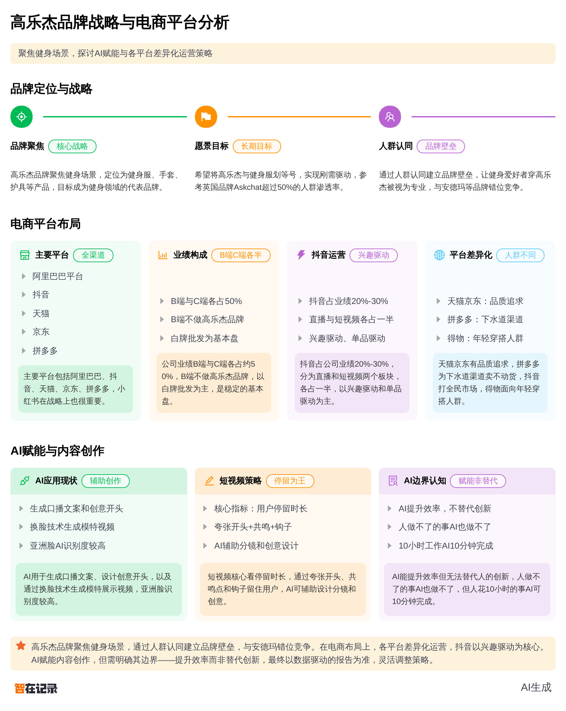

```cover
kicker: FDE 现场调研 · 客户拜访纪要
title: 电商平台与品牌战略
subtitle: E-commerce Platform & Brand Strategy · Customer Visit Minutes
company: 高乐捷 GOLOVE JOY · 内容经营项目组
company_en: FDE · Field Delivery Engineering
meta:
  用途: 现场拜访纪要排版稿（供内部复盘与方案引用）
  依据: 2026-09-18 客户拜访录音（时长 1 小时 01 分 45 秒）之 AI 总结与逐字稿
  版本: v1.0（内容取自 01-输入/sundries 同名 docx，逐字转换，未作增删）
  编制日期: 2026 年 10 月 21 日
  密级: 内部资料，请勿外传
footer_left: 电商平台与品牌战略 · 拜访纪要 v1.0
footer_right: 2026 年 10 月
running_footer: 高乐捷 GOLOVE JOY · 客户拜访纪要 · 2026-09-18
```


## 一、客户拜访交流基本信息

```html
<table style="table-layout:fixed"><colgroup><col style="width:26mm"><col></colgroup>
<thead><tr>
<th>项目</th>
<th>内容</th>
</tr></thead><tbody>
<tr><td>客户拜访交流主题</td><td>高乐捷品牌业务现状及AI赋能需求调研</td></tr>
<tr><td>时间</td><td>2026-09-18 09:44</td></tr>
<tr><td>人员</td><td>客户方：品牌负责人（主谈）、抖音运营（短视频）、直播运营；我方：销售团队（含邵杰团队）</td></tr>
<tr><td>核心讨论范围</td><td>高乐捷品牌定位、电商平台布局、抖音运营现状、AI赋能可能性</td></tr>
<tr><td>核心内容概述</td><td>客户详细介绍了高乐捷品牌从白牌到品牌化的转型历程，聚焦健身场景的品牌定位，以及抖音、天猫等平台的运营现状。双方就AI在短视频内容创作、直播赋能等场景的应用边界进行了深入探讨，客户对AI的期望务实，认为AI应作为效率工具而非创意替代品。</td></tr>
</tbody></table>
```

## 二、拜访过程

### 1、公司平台与部门概览

🔥 客户热情介绍公司覆盖阿里巴巴、抖音、天猫、京东、拼多多等主流平台，小红书战略地位重要。

客户强调财务、供应链、产品研发、客服等部门AI赋能深度尚浅，人事部门优先级靠后。

### 2、业务结构与品牌定位

🔥 客户清晰阐述B端与C端业绩各占50%，B端不做高乐捷品牌以维护价格管控。

高乐捷品牌分为中文（健身场景：健身服、手套、护具）和英文Goal of Joy（配饰：防晒袖套、滑雪手套等）。

🔥 客户明确AI赋能重心应在中文高乐捷（70%），但最终以AI团队出具的诊断报告为准。

### 3、品牌愿景与市场机会

🔥 客户激情阐述品牌愿景：对标英国健身品牌Askchat（人群渗透率超50%），希望高乐捷成为健身场景的刚需品牌，实现“健身服=高乐捷”的人群认同。

客户认为安德玛虽市占率高但品牌老化，Z世代存在生态位空缺，且价格带可错位竞争。

### 4、抖音运营现状与挑战

❄️ 客户介绍抖音占业绩20-30%，分为直播和短视频两大板块，直播与短视频占比约1:1。

🔥 客户坦承优秀主播难培养（如GXG主播苏苏年销数亿），因此战略上更倾向短视频增长。

直播团队每日复盘迭代，但问题追溯依赖人工经验。

### 5、AI赋能边界探讨

🔥 客户提出核心观点：“人做不到的事情，AI基本也做不到；但人花十小时的事，AI花十分钟就能干。” 此观点获销售方高度认可。

短视频运营提出AI辅助创意开头、口播文案的需求，但客户认为创意类工作仍需人主导，AI可放大想法。

客户展示AI换脸视频（欧美脸效果逼真，亚洲脸仍在优化），证明AI在素材生成上的可行性。

### 6、电商平台生态讨论

❄️ 客户与销售方就抖音、天猫、拼多多、京东的平台定位展开辩论。客户认为平台是生态，各承接不同任务（兴趣驱动vs刚需驱动），天猫GMV仍领先拼多多。

客户指出拼多多人群对店铺忠诚度低，天猫适合品牌化运营。

## 三、讨论要点

- 品牌聚焦健身场景：客户反复强调高乐捷已从“全品类运动”聚焦到“健身”细分赛道，对标英国Askchat，希望建立“健身服=高乐捷”的人群认同。这是品牌战略的核心，所有AI赋能需围绕此展开。
- AI赋能重心在中文高乐捷：客户明确70%的AI资源应投入中文高乐捷（健身场景），30%给Goal of Joy（配饰），但最终以AI团队的诊断报告为准。这体现了客户对专业判断的开放态度。
- 短视频是增长优先方向：客户认为优秀主播稀缺且难培养，短视频可自主控制内容质量，增长空间更大。这是AI赋能的直接切入点。
- AI是效率工具而非创意替代品：客户多次强调AI无法替代人的创意（如爆款开头），但可大幅提升效率（如生成分镜、口播文案）。这一认知边界需在后续方案中尊重。
- 价格管控与渠道区隔：客户明确拼多多作为“下水道”渠道，天猫才是真实控价参考。AI赋能需考虑不同渠道的货品策略。

## 四、隐藏商机 💡

- AI短视频内容生成系统：客户短视频运营已在使用AI生成口播文案，但痛点在于创意枯竭。可提供AI驱动的“爆款开头生成+分镜设计”工具，结合竞品爆款数据抓取，降低内容创作门槛。对应客户痛点：创意枯竭、人力成本高。潜在预算：10-30万/年（SaaS订阅）。
- AI直播复盘与话术优化：客户直播团队每日复盘但依赖人工经验，可提供AI直播数据智能分析系统，自动识别话术问题、流量波动原因，并生成优化建议。对应客户痛点：复盘效率低、问题追溯难。潜在预算：15-25万/年。
- AI模特换脸与素材批量生成：客户已展示AI换脸技术，但亚洲脸效果待优化。可提供定制化AI模特库，支持品牌自有模特素材训练，实现低成本、高频率的素材产出。对应客户痛点：模特拍摄成本高、素材更新慢。潜在预算：20-50万（一次性开发+年维护）。
- 全渠道AI智能定价与控价系统：客户对拼多多、天猫有明确渠道区隔，但人工控价难度大。可提供AI价格监测与智能调价系统，自动识别乱价行为并预警。对应客户痛点：渠道价格管控难。潜在预算：10-20万/年。

## 五、后续待办

- 针对客户对AI赋能边界的清晰认知（🔥“人做不到的事，AI也做不到”），在方案中明确AI定位为“效率放大器”而非“创意替代品”，避免过度承诺引发信任危机。
- 针对客户反复强调的“短视频是增长优先方向”，准备一份AI短视频内容创作工具方案，包含爆款开头生成、分镜设计、竞品数据抓取等功能，并附成功案例（如GXG主播苏苏的AI建模设想）。
- 针对客户展示的AI换脸视频（亚洲脸效果待优化），收集并整理亚洲脸AI换脸的最新技术进展和成功案例，下次沟通时进行演示，打消客户顾虑。
- 针对客户提出的“AI赋能重心以诊断报告为准”，安排团队对高乐捷品牌进行深度数据调研（各平台GMV、用户画像、竞品分析），形成书面诊断报告，作为后续方案的基础。
- 针对客户提到的“优秀主播难培养”痛点，探索AI数字人直播的可能性，准备一份技术可行性分析报告（含成本对比），作为长期合作选项。
- 针对客户对拼多多渠道的“下水道”定位，在方案中明确AI赋能将优先聚焦天猫和抖音渠道，尊重客户渠道策略。
- 收集英国Askchat品牌的人群渗透率数据（客户提及超50%），以及安德玛的品牌老化数据，作为品牌定位论证的支撑材料。

## 六、会后洞察 🔍

### 1、客户痛点归纳

- 品牌认知度不足：高乐捷作为新品牌，在健身场景尚未建立“刚需”认知，需突破人群认同壁垒。
- 优秀主播稀缺：直播增长受限于主播能力，培养成本高、周期长，难以规模化复制。
- 创意内容枯竭：短视频运营面临创意瓶颈，爆款开头和口播文案的产出不稳定。
- 渠道价格管控难：多平台运营导致价格体系复杂，拼多多渠道存在乱价风险。
- AI应用落地迷茫：客户对AI能力有认知，但缺乏系统化的落地路径和可量化的ROI评估。

### 2、潜台词解码

- 客户：“我们目前赋能的深度还比较少”

情绪能量：❄️ 平稳，略带遗憾。

解码：客户承认AI应用处于浅层，但未明确拒绝。潜台词是“我们愿意尝试，但需要看到实际效果”。

博弈建议：提供轻量级POC（如AI短视频开头生成），快速验证价值，降低决策风险。

- 客户：“最终还是以你们做出来的那种报告为准”

情绪能量：🔥 开放但保留决策权。

解码：客户将决策权交给AI团队，但隐含“你们需要拿出有说服力的数据”的要求。这是典型的“授权式”潜台词，既给机会也设门槛。

博弈建议：报告需包含竞品分析、ROI测算、分阶段实施路径，用数据说话。

- 客户：“人做不到的事情，AI基本也做不到”

情绪能量：🔥 自信且坚定。

解码：客户对AI有清醒认知，拒绝“万能AI”的营销话术。潜台词是“别忽悠我，我要看到实际价值”。

博弈建议：方案中明确AI的边界和适用场景，用“效率提升”而非“颠覆创新”作为核心卖点。

- 客户：“那得问他们（指团队）”

情绪能量：❄️ 回避具体问题。

解码：客户对抖音运营的具体数据（如直播占比）不掌握，或不愿在销售面前暴露内部信息。潜台词是“这个问题我不负责，或者不想深入”。

博弈建议：后续沟通中直接对接抖音运营负责人（如房哥、凡哥），获取一手数据。

### 3、沟通能量对比

- 话权占比：客户约60%，销售约40%。客户主导了品牌介绍和观点输出，销售主要扮演提问和引导角色。
- 能量状态：能量开放。客户主动分享品牌战略、运营痛点、AI认知，未出现防御性闭合。销售未强行推销，而是以“了解需求”为主，客户愿意深入探讨。
- 关键转折点：当销售展示AI换脸视频时，客户兴趣明显提升（🔥），从“理论探讨”转向“实际应用验证”，能量达到峰值。

### 4、竞情

本次拜访没有涉及到相关竞情。

## 七、辅助工具

### 1、本次拜访总体评价

A. 突破型（高能量/高进展）

判断理由：

- 成功触达品牌负责人，客户全程高能量参与，主动分享品牌战略和运营细节。
- 客户明确表示“以AI团队的诊断报告为准”，给出了清晰的下一步动作（出具报告）。
- 双方就AI赋能边界达成共识（效率工具而非替代品），为后续方案奠定了信任基础。
- 客户展示了AI换脸视频，证明已有初步尝试，合作意愿真实。

### 2、销冠教练：优化建议 🏆

反思点：

- 未深入挖掘竞品信息：客户提及安德玛、Askchat等品牌，但销售未追问客户对竞品AI应用情况的了解，错失获取竞争情报的机会。
- 未锁定关键决策人：客户多次提到“得问凡哥”“得问刘航”，但销售未主动要求对接抖音运营负责人，后续沟通可能需绕路。
- 未量化AI价值：客户对AI效率提升有认知，但销售未给出具体数据（如“AI可减少50%的素材制作时间”），导致价值感知不够强烈。

闪光点：

- 精准捕捉客户认知边界：销售在客户提出“AI无法替代创意”时，立即表示认同并升华（“这是金句”），建立了认知共鸣。
- 现场演示AI能力：销售主动展示AI换脸视频，将抽象概念具象化，极大提升了客户兴趣和信任。
- 保持轻松氛围：销售在客户团队人员变动时（如保安被叫来）及时调节气氛（“不要搞得正儿八经”），维持了沟通的开放性。

杀手锏建议 🚀：

为高乐捷定制一个“AI短视频爆款工厂”POC：在两周内，利用AI工具为客户生成10条不同风格的健身服短视频（含爆款开头、口播文案、AI模特换脸），并在客户抖音账号上测试投放。用实际数据（播放量、转化率）证明AI的价值，直接推动决策。

### 3、供参考的拜访后微信回复内容：

王总，今天下午的交流非常愉快，感谢您和团队毫无保留的分享。您对高乐捷“健身服=高乐捷”的品牌愿景，以及“AI是效率工具而非替代品”的认知，让我们对合作方向更加清晰。特别是您提到的短视频增长优先策略，以及优秀主播稀缺的痛点，我们已经在构思一套“AI短视频内容工厂”方案，希望能帮您解决创意枯竭和素材产出效率的问题。下周我们会整理一份初步诊断报告，包含各平台数据分析和AI赋能路径建议，届时再向您汇报。祝高乐捷早日成为健身人群的“刚需首选”！

## 八、附：现场主要问答

#### 问题1： 客户（销售方）问：“那你们有分析过那那几个款为什么打爆吗？”

- **客户情绪/态度标签：**　❄️ 平稳，带有探究性。

- **应答概述：**　客户回答：爆款原因包括卖点突出（让男士更显身材）、价格认知不足（品牌价格段定位不清晰）。

- **结果评估：**　✅ 认可。客户坦诚回答了问题，未表现出防御。

#### 问题2： 客户（销售方）问：“那你认为就是这种，这这属于传统的，就是说货架电商是吧？现在一些新媒体电商，像抖音，他们这些群体和这些拼多多啦、天猫啦、京东啦又有什么区别呢？”

- **客户情绪/态度标签：**　❄️ 平稳，引导性提问。

- **应答概述：**　客户回答：抖音是兴趣驱动、单品驱动，分为商品卡和直播/短视频两个板块；天猫、京东是品质追求型；拼多多是刚需低价型。

- **结果评估：**　✅ 认可。客户回答详尽，并主动区分了抖音内部板块。

#### 问题3： 客户（销售方）问：“我们直播现在占比大概有多少？”

- **客户情绪/态度标签：**　❄️ 平稳，但回答者非主谈。

- **应答概述：**　抖音运营回答：直播和短视频占比约一半一半。

- **结果评估：**　✅ 认可。数据明确，未引发争议。

#### 问题4： 客户（销售方）问：“那他现在复盘过来有做迭代的动作吗？”

- **客户情绪/态度标签：**　❄️ 平稳，探究性。

- **应答概述：**　抖音运营回答：每场直播都会复盘，根据数据迭代话术、背景等。

- **结果评估：**　✅ 认可。回答具体，显示团队有复盘机制。

#### 问题5： 客户（销售方）问：“那你们现在是怎么追溯这个问题原因的？就是说，是因为哪个话说有问题啊？”

- **客户情绪/态度标签：**　❄️ 平稳，追问细节。

- **应答概述：**　抖音运营回答：根据数据追溯，但具体方法未展开（“数据的话，还是他们了解我”）。

- **结果评估：**　⚠️ 部分化解。回答较模糊，未展示系统化追溯方法，存在隐患（客户可能认为复盘不够精细）。

#### 问题6： 客户（销售方）问：“那你，你既然是实操的这个短视频那里，你有你是用什么方法来为听众的？就比如我现在到你直播间了。”

- **客户情绪/态度标签：**　❄️ 平稳，引导性。

- **应答概述：**　抖音运营回答：用夸张或反差的开头留住用户，再用共鸣和钩子（福利、活动）促进转化。

- **结果评估：**　✅ 认可。回答具体，展示了实操方法论。

#### 问题7： 客户（销售方）问：“如果说 AI 对我们短视频帮助，就是我想， AI 能不能就是帮我想一个有意思的开头，把用户留住，然后我再往下去介绍我们产品。”

- **客户情绪/态度标签：**　🔥 兴奋，主动提出需求。

- **应答概述：**　客户（品牌负责人）回答：AI可帮想创意开头，但创意本身仍需人主导，AI是放大工具。

- **结果评估：**　✅ 认可。客户对AI边界有清晰认知，未产生不切实际的期望。

#### 问题8： 客户（销售方）问：“就是，就是讲衣服，讲啊……就是一件衣服，我就是我买来，它其实是穿不上的……然后通过AI做主图，让它穿上了，而且穿的很好看，那啊，我想说的就是，嗯。我觉得还是，就是如果像我们服装的话，还是，呃，就是拍真人比较好。”

- **客户情绪/态度标签：**　🔴 抵触，带有道德顾虑。

- **应答概述：**　客户（品牌负责人）和销售方回应：核心是预算问题，如果有预算找真人模特，当然更好；AI换脸是成本优化手段。

- **结果评估：**　⚠️ 部分化解。客户顾虑未完全消除（“核心还是没有钱”），但销售方将问题归因于预算，降低了道德压力。

#### 问题9： 客户（销售方）问：“我们现在直播，呃，抖音这块现在有找达人什么的吗？”

- **客户情绪/态度标签：**　❄️ 平稳，信息收集。

- **应答概述：**　抖音运营回答：有，KOC和KOL都在做，有三个商务负责。

- **结果评估：**　✅ 认可。信息明确。

#### 问题10： 客户（销售方）问：“我有一个，呃，这个电商逻辑问题，想去问一下。啊，你说，就是一般来说，你阶段性越往后的公司，肯定是抖音占大头。”

- **客户情绪/态度标签：**　❄️ 平稳，但带有试探性。

- **应答概述：**　客户（品牌负责人）回答：这是身边案例的问题，并非行业规律。平台是生态，各承接不同任务（兴趣驱动vs刚需驱动），高乐捷希望成为刚需品牌。

- **结果评估：**　✅ 认可。客户用数据和逻辑反驳，并升华到品牌愿景。

#### 问题11： 客户（销售方）问：“那将来会不会给那种什么即刻Keep这些合作呢？”

- **客户情绪/态度标签：**　❄️ 平稳，带有联想性。

- **应答概述：**　客户（品牌负责人）回答：Keep有自营产品，但模式与高乐捷不同（Keep是品牌直营，非贴牌授权）。

- **结果评估：**　✅ 认可。客户清晰区分了品牌直营和贴牌模式。

#### 问题12： 客户（销售方）问：“哎，得物你没了解过吗？”

- **客户情绪/态度标签：**　❄️ 平稳，信息补充。

- **应答概述：**　客户回答：有在做，得物用户注重穿搭和运动，粘性强但受众相对较小。

- **结果评估：**　✅ 认可。信息明确。

#### 问题13： 客户（销售方）问：“那我们公司现在对于直播跟短视频，就战略上面，是想我是想发展哪一块？”

- **客户情绪/态度标签：**　❄️ 平稳，但回答者非主谈。

- **应答概述：**　客户（品牌负责人）回答：得问刘凡（凡哥），但个人认为短视频增长空间更大，因为优秀主播难培养。

- **结果评估：**　⚠️ 部分化解。客户未给出明确战略方向，但提供了个人判断，需后续与凡哥确认。

#### 问题14： 客户（销售方）问：“哎，我们现在会用AI生成视频吗？”

- **客户情绪/态度标签：**　🔥 兴奋，带有展示欲。

- **应答概述：**　客户（品牌负责人）回答：会用，但很艰难。随后展示AI换脸视频（欧美脸效果逼真，亚洲脸待优化）。

- **结果评估：**　✅ 认可。客户主动展示成果，合作意愿强烈。
