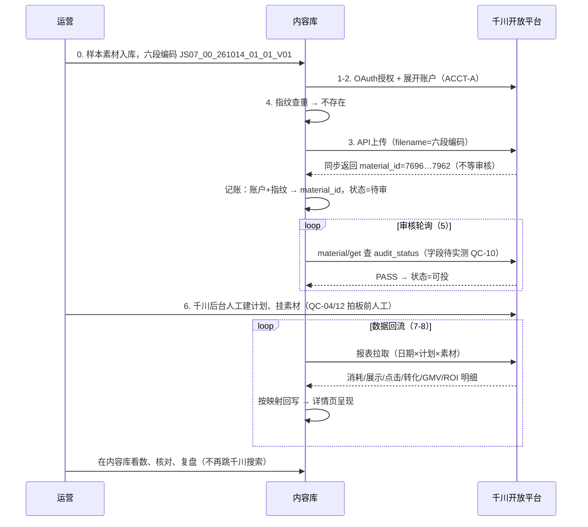

# 内容库素材 × 千川数据关联 · 全链路案例（v0.1）

> 客户：高乐捷 GOLOVE JOY ｜ 文档版本：v0.1 ｜ 编制日期：2026-10-15 ｜ 密级：内部资料，请勿外传
> 编制：高乐捷 FDE 交付团队
>
> **本件回答一个问题**：一条素材从内容库进入投放、再回收数据，全过程到底怎么走、靠什么标识建立对应、数据从哪里来进到哪里、最终在哪里查看核对。
> 配套阅读：[方案说明（件1）](内容库素材与千川数据关联-方案说明-v0.1-20261015.md) ｜ [字段及关联规则（件2）](内容库素材与千川数据关联-字段及关联规则-v0.1-20261015.md) ｜ [试点与验收计划（件4）](内容库素材与千川数据关联-试点与验收计划-v0.1-20261015.md)

---

## 一、真实性与脱敏声明（先读）

| 部分 | 真实性 | 依据 |
|---|---|---|
| §三 现状链路实走（12 步） | **真实证据**：千川后台截图 1–3＋运营口述（2026-10-14） | 现状流程未逐条实操验证，现场跟做挂试点 N1（件4 §五） |
| §四 改造链路模拟（8 步） | **明确标注为模拟**：接口路径与返回字段已按官方/第三方 SDK 源码逐项复核（真实），但全部输入输出取值为构造，未在客户账户实跑 | 逐行标注「已核验 / 待实测 / 模拟」三态 |
| 数据与账户 | 全部脱敏/构造：千川账户写作 `ACCT-A`；material_id 沿用调研底稿记载的真实格式示例；投放数字为构造，不代表任何真实账户表现 | — |

---

## 二、样本设定

| 项 | 取值 | 说明 |
|---|---|---|
| 样本素材 | `JS07_00_261014_01_01_V01` | 六段编码（款号_卖点_时间_作者_主题_版本，2026-10-14 拍板口径）：JS07 这款 · 卖点未梳理（00）· 2026-10-14 入库 · 01 号作者 · 01 号主题 · 第一版 |
| 款号来源 | P1 选品需求单 | 需求单字段含款号/卖点码/推广目标（《需求至内容库流程图》S1）；款号下拉挂聚水潭全量主数据（⚠️QC-13） |
| 上游生产 | P1–P6 走《需求至内容库流程图》S1–S10：需求 → 拆解 → 脚本 → 拍摄出片 → 编导细节审核＋主管整体审核 → 上传内容库生成六段编码 | 双审不通过均有返回修改路径 |
| 千川账户 | `ACCT-A`（高乐捷多账户之一） | 账户清单与归属待确认（⚠️QC-02） |

---

## 三、现状链路实走（12 步，真实证据）

| # | 谁 | 在哪 | 动作 | 产出/证据 | 痛点 |
|---|---|---|---|---|---|
| 1 | 运营部 | 需求单 | 提需求、填需求单 | 需求单（载体待确认 ⚠️QC-07）`口述` | |
| 2 | 编导 | 内容库/线下 | 拆需求、写脚本 | 脚本 `口述` | |
| 3 | 拍剪 | 剪辑工具 | 拍摄、剪辑、出片 | 成片文件（本地）`口述` | |
| 4 | 拍剪→内容部 | 内容库 | 交付入库 | 内容库记录＋视频名称 `口述` | |
| 5 | 内容部→运营 | 通道未确认 | 回传运营 | 运营拿到文件 ⚠️QC-06 `口述` | 🔴 通道不明 |
| 6 | 运营 | 本地磁盘 | 下载/另存目标文件 | 本地副本 `口述` | 🔴 人工搬运（断点 B1） |
| 7 | 运营 | 千川·工具→素材管理→视频库→上传视频 | 手工上传 | **千川素材 ID（如 7696328292677287962）**＋审核状态 `截图2` | 🔴 规格门槛（9:16/≥516kbps/≤1000M/720p–1440p/4s–300s）不合规传不上 |
| 8 | 运营 | 千川·投放 | 建计划、把素材挂上去、起量 | 计划 ID＋消耗 `口述` | |
| 9 | 运营 | 千川·数据→素材数据→素材分析 | 看单条素材消耗、支付 ROI 等 | 素材维度数据 `截图1` | |
| 10 | 运营 | 内容库 ↔ 千川 | **复制内容库视频名称 → 粘贴到千川搜索框 → 找到对应素材看数** | 人工对齐，不落库 `截图1` | 🔴 断点 B2/B3 |
| 11 | 运营 | 千川素材管理 | 修改千川素材名称或自定义标签，使其与内容库名称一致 | 名称/标签人工对齐 `截图3` | 🔴 无校验，改名/同名/错别字即断链 |
| 12 | 运营 | — | （无）投放动作无留痕 | — | 🔴 断点 B7 |

> 结论：现状**没有系统级关联**——唯一关联手段是「文件名一致＋人工复制搜索」，素材投得好坏回不到创作端，复盘只能靠人记（调研底稿 §一）。

---

## 四、改造链路模拟（8 步，逐行标注真实性）

### 4.1 步骤表

| 步 | 动作 | 接口 / 载体 | 输入（模拟） | 输出（模拟） | 真实性 |
|---|---|---|---|---|---|
| 1 | OAuth2.0 授权 | `/open_api/oauth2/access_token/` | auth_code（客户授权页生成，勾选 material_auth） | access_token / refresh_token | 接口路径**已核验**（`SDK复核`）；授权操作**待实测**（⚠️QC-08） |
| 2 | 展开授权账户 | `/open_api/oauth2/advertiser/get/` | token | 账户列表：`ACCT-A`、`ACCT-B`… | 路径**已核验**；我方账户数量**待实测**（⚠️QC-02） |
| 3 | 上传视频素材 | `/open_api/2/file/video/ad/` | `ACCT-A`、视频文件、**filename＝六段编码** | 响应同步返回 `id`/`video_id`/`material_id`/`url`/`signature`/`filename`/`create_time`——**不等审核** | **已核验**（`SDK复核` 5.4：响应体直接给 material_id）；编码作名称是否超限**待实测**（⚠️QC-19） |
| 4 | 指纹去重 | 本地 `advertiser_id+sha256` 映射 ＋ `/open_api/v1.0/qianchuan/file/video/original/get/`（查首发） | 文件指纹 3f2a…c9 | 已存在→复用 material_id；不存在→走步骤 3 | 规则**已核验**（去重接口）；配合逻辑为设计（件2 R4） |
| 5 | 审核状态轮询 | `/open_api/v1.0/qianchuan/material/get/` | `ACCT-A`、material_id | 素材列表含 `material_id`/`video_id`；第三方 Go SDK 另列 `audit_status`（PASS/REJECT/IN_PROGRESS）——官方 Java SDK 未检索到该字段 | **待实测**（⚠️QC-10）：字段以官方文档＋我方账号实测为准，按轮询兜底设计 |
| 6 | 建计划/挂素材 | 试点期：运营在千川后台**人工**建计划（`ad/create` 自动化待 QC-04/12 拍板）；计划↔素材关系读 `/open_api/v1.0/qianchuan/uni_promotion/ad/material/get/` | 预算/出价（人工设定） | 计划 ID；素材↔计划权威关系 | 关系接口**已核验**；建计划链路选择**待拍板**（⚠️QC-12） |
| 7 | 报表拉取 | 先 `/report/uni_promotion/config/get/` 确认可用主题 → 再 `/report/uni_promotion/data/get/`（或素材数据报表） | data_topic（素材维度）、dimensions=日期×计划×素材、metrics=消耗/展示/点击/转化/GMV/ROI、start/end_time | 明细行（样例见件2 §六 表三）；**回溯窗口约 30 天** | 主题与参数**已核验**（他方样本取数成功）；我方账户可用主题**待实测** |
| 8 | 回写与展示 | 内容库投放数据表 → 素材详情页 | 明细行按映射回写 | 详情页呈现：编码＋消耗＋ROI＋点击率＋计划列表；台账 A 第 13–17 字段自动填充 | 页面为**待开发**；字段口径见件2 §五 |

### 4.2 时序示意（编号对应上表）

---

## 五、结果在哪里看、怎么核对

| 动作 | 现状 | 改造后 |
|---|---|---|
| 找单条素材数据 | 复制名称 → 千川搜索框粘贴（截图1） | 内容库素材详情页直接呈现（编码＋消耗＋ROI＋点击率＋计划） |
| 找某款全部素材 | 逐条搜索 | 千川搜索框输 `JS07` 拉出该款全部素材；或内容库按款号筛选 |
| 核对数据对不对 | 无法核对（数据不落内容库） | 回刷窗口外数据与千川后台逐条比对（试点步骤 6，件4 §五） |
| 复盘 | 人肉汇总，编导不参与 | 五段式复盘会用同一张表；台账 A/B 承接结论闭环 |

**核对方法**（试点期）：任取样本素材，双向走一遍——内容库编码 → 映射表 → material_id → 千川后台素材分析找到该素材；反向由千川素材 ID 反查内容库编码与版本链（件4 §六 通过标准第 7 项）。

---

## 六、真实环境仍需验证的事项（未验证清单）

| # | 事项 | 挂号 | 验证方式 |
|---|---|---|---|
| 1 | 现状第 5 步「回传运营」的真实通道；上传操作人与入口 | ⚠️QC-06 / QC-02 | 现场跟一遍实操（试点 N1） |
| 2 | `audit_status` 审核状态字段是否存在、能否订阅推送 | ⚠️QC-10 | 我方账号实测 material/get；向平台确认推送主题 |
| 3 | 六段编码（24 字符＋下划线）作为千川素材名称是否超限 | ⚠️QC-19 | 上传实测 |
| 4 | 标签是否有写接口（冗余关联维度可用性） | ⚠️QC-05 | 联调验证；默认不依赖标签 |
| 5 | 素材维度报表主题在我方账户的可用性与必填过滤条件 | —（件2 §5.1） | config/get 实查 |
| 6 | 频控真实阈值（上传并发/绑定并发） | — | 按调研底稿 5.2 节流参数试跑校准 |
| 7 | 授权链路（material_auth 勾选、全量账户、全域授权周期） | ⚠️QC-08/11 | 授权实操＋审批周期记录 |
| 8 | 存量素材按文件名匹配的实际匹配率 | ⚠️QC-03 | 样本款试跑出基线 |
| 9 | 天猫侧：逛逛 API 权限包条件、内容数据开放接口 | ⚠️QC-16/17 | 本期不阻塞；过渡走 Chrome 插件 |

> 以上任何一项未实测前，本件 §四 仅证明「设计成立」；试点（件4）完成后补充实测记录，本件升 v0.2。

---

## 七、对照小结（定性）

| 场景 | 现在怎么做 | 改造后怎么做 |
|---|---|---|
| 素材上到千川 | 运营下载文件、手动上传（规格门槛自行排查） | 内容库 API 上传，规格前置校验，material_id 自动记账 |
| 找到这条素材的数据 | 复制文件名去千川搜索框粘贴 | 内容库点开即见；千川侧输款号段即拉全款素材 |
| 判断哪个卖点/版本行 | 凭印象、问运营 | 按编码字段聚合消耗与 ROI（复盘会四要素追问仍是人工） |
| 编导参与复盘 | 看不到数据，不参与 | 同屏看数，直接改脚本方向 |
| 数据口径 | 当天看到啥算啥 | 重刷策略＋回刷标记，窗口外才作结论依据 |
| 出问题 | 无记录可查 | 异常矩阵 8 类，提示/补正/重试/留痕有章可循（件2 §七） |

> 按评审口径明确：本表为**定性**对照，不量化提效比例；经营收益须试点取得基线后按 D3 口径另行定义。

---

*依据：调研底稿 v0.1（§2 现状步骤表、§3 断点 B1–B7、§5 接口清单与 SDK 复核结论 5.4/5.5、§5.3 最小可行切片）；流程 v0.9 交付件（截图 1–3 引用、公开资料附录）；件2《字段及关联规则》v0.1（三表模型、R1–R7、异常矩阵、脱敏样例）；件4《试点与验收计划》v0.1（N1–N6、验证步骤）。*
