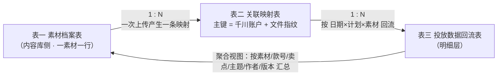

# 内容库素材 × 千川数据关联 · 字段及关联规则（v0.1）

> 客户：高乐捷 GOLOVE JOY ｜ 文档版本：v0.1 ｜ 编制日期：2026-10-15 ｜ 密级：内部资料，请勿外传
> 编制：高乐捷 FDE 交付团队
>
> 本文档是「四件套」中的**规则源头**：《方案说明》《全链路案例》《试点与验收计划》中的字段、口径、异常处置均以本文为准。
> 配套阅读：[方案说明](内容库素材与千川数据关联-方案说明-v0.1-20261015.md) ｜ [全链路案例](内容库素材与千川数据关联-全链路案例-v0.1-20261015.md) ｜ [试点与验收计划](内容库素材与千川数据关联-试点与验收计划-v0.1-20261015.md) ｜ [流程图 v0.9](内容库素材与千川数据关联流程-v0.9-20261014.md) ｜ [调研底稿 v0.1](../02-调研/素材-千川数据关联流程梳理-v0.1-20261014.md)
> v0.1 说明：正常链路规则多数为档位 A（已核验）；复杂场景与异常处置中的部分规则为档位 B/C（暂定条款 / 机制空白），逐项挂《待确认项统一编号》（§八），**闭环后升 v1.0**。

---

## 一、文档定位与编号口径

### 1.1 忠实性口径（沿用仓库档位规则）

- **档位 A**（原文明确＋已核验）→ 直接成文；
- **档位 B**（有依据但有歧义）→ 成文为暂定条款，⚠️ 挂待确认；
- **档位 C**（机制空白）→ 不硬写，只留接口与问题清单。

依据来源标注：`拍板`（2026-10-14 马亚鹏拍板，调研底稿 4.1）、`SDK复核`（调研底稿 §5，2026-10-14 按官方与第三方 SDK 源码逐项复核）、`口述`（2026-10-14 运营口述现状）、`截图N`（归档于 `01-输入/千川操作截图/`）、`公开资料[n]`（v0.9 交付件附录编号 1–18）、`官方核验`（巨量引擎开放平台官方页面已核实事项，2026-10）。

### 1.2 QC 统一编号规则（本版新增约定）

《流程梳理调研稿》（QC-01~17）与《流程 v0.9 交付件》（QC-01~09）编号不互对应（v0.9 已自知并挂出合并提醒）。自本套文档起：

- **主系列 = 调研底稿 QC-01~QC-17**（连续编号、含已锁定项），四件套及后续升版一律引用主系列；
- v0.9 交付件旧编号 → 主系列对照见 §8.2，v0.9 升版时同步替换；
- 新增待确认项自 **QC-18** 起编（§8.3）。

---

## 二、数据模型：三张核心表

### 2.1 三表关系

### 2.2 表一：素材档案表（内容库侧，改造前已部分存在）

| 字段 | 类型 / 取值 | 来源 | 必填 | 说明与依据 |
|---|---|---|---|---|
| 素材库ID | 内容库自有 ID | 系统 | ✔ | 数据库主键之一（编码**不是**主键，见 2.4）`拍板` |
| 六段编码 | 24 字符，`款号_卖点_时间_作者_主题_版本` | 录入生成 | ✔ | 人读身份证＋千川素材名称＋搜索键；**只增不改** `拍板`（调研底稿 4.1） |
| 款号 | 沿用商品款式编码（`JS07`、`YJ13`） | 下拉选择 | ✔ | 不允许手输；下拉挂聚水潭/商品主数据全量款号 ⚠️QC-13 `拍板` |
| 卖点码 | `01`–`99`，未梳理=`00` | 码表 | ✔ | 卖点码表未建，暂全 `00` ⚠️QC-14 `拍板` |
| 时间 | `YYMMDD` | 系统生成 | ✔ | 建议取**内容库入库时刻**（创作完成即定档）⚠️QC-15 |
| 作者码 | 2 位短码 | 码表 | ✔ | 另存钉钉 `userId` 作外键，改名/离职不影响历史编码 ⚠️QC-14 `拍板` |
| 主题码 | `01`–`99`，未定=`00` | 码表 | ✔ | 对应视频按哪段提示词/编导文案创作 ⚠️QC-14 `拍板` |
| 版本 | `V01`–`V99` | 系统递增 | ✔ | 同前缀迭代时递增，首版 `V01` `拍板` |
| 文件指纹 | sha256 | 上传时计算 | ✔ | 去重与映射主键的组成部分（调研底稿 §5 去重接口） |
| 文件规格 | 9:16、码率≥516kbps、≤1000M、720×1280~1440×2560、4s–300s | 前置校验 | ✔ | 千川上传硬性门槛，不合规直接传不上 `截图2`＋`公开资料` |
| 存储路径 | NAS / 内容库路径 | 系统 | ✔ | 天猫侧人工发布仍需经此取文件（QC-16/17 范围外） |
| 素材状态 | 待审 / 可投 / 投放在投 / 暂停 | 系统维护 | ✔ | `待审→可投` 以审核状态轮询为准 ⚠️QC-10 |

> 机器校验正则：`^(JS|YJ)[0-9]{2}_[0-9]{2}_[0-9]{6}_[0-9]{2}_[0-9]{2}_V[0-9]{2}$`（调研底稿 4.1，档位 A）。

### 2.3 表二：关联映射表（改造新增，链路核心）

| 字段 | 类型 / 取值 | 来源 | 必填 | 说明与依据 |
|---|---|---|---|---|
| 映射ID | 自增 | 系统 | ✔ | — |
| 千川账户 advertiser_id | 平台账户 ID | 授权/上传响应 | ✔ | **多账户下 material_id 不通用**（调研底稿 5.2）⚠️QC-02 |
| 素材ID material_id | 平台分配 | 上传响应同步返回 | ✔ | 上传成功即返回，**不等审核** `SDK复核`（调研底稿 5.4） |
| 视频ID video_id | 平台分配 | 上传响应 | ✔ | 同上 |
| 素材库ID | 外键→表一 | 系统 | ✔ | — |
| 六段编码 | 冗余展示 | 系统 | ✔ | 便于人工查表，不作为匹配依据 |
| 文件指纹 | sha256 | 上传时计算 | ✔ | **主键组成部分**；防重复上传（去重接口 `SDK复核`） |
| 上传时间 / 发起方式 | 时间；系统API / 人工后台 | 系统 | ✔ | 留痕字段（对应对断点 B7） |
| 审核状态 | PASS / REJECT / IN_PROGRESS | 轮询素材查询接口 | ✔ | 第三方 Go SDK 列有该字段、官方 Java SDK 未检索到——**以实测为准** ⚠️QC-10 `SDK复核` |
| 首发标记 | 是 / 否 | 素材查询接口 | — | 影响拿量（调研底稿 2.1） |
| 计划关系 | 计划ID 列表 | 计划下素材查询接口 | ✔ | 权威关系表（`SDK复核` §5 调用顺序） |
| 状态 / 备注 | 生效 / 失效 | 系统 | ✔ | 失效不删除，保留追溯 |

**主键设计：`advertiser_id + 文件指纹 → material_id`**（档位 A，调研底稿 4.2/5.2）。理由三点：

1. 文件名可变、同名允许存在，不能做键（断点 B2 成因）；
2. 多账户下 material_id 不通用，必须绑定账户 ⚠️QC-02；
3. 指纹相同说明是同一文件，可拦截重复上传、复用已有 material_id。

### 2.4 口径澄清：编码不是主键

六段编码承担**人读身份证＋千川素材名称＋搜索键**三重角色；数据库主键仍是「内容库素材库ID ＋ 千川 material_id」，两者同时落库，编码规则将来再变历史关联也不断（调研底稿 4.1 硬规矩 4，档位 A）。⚠️ v0.9 交付件中"编码承担内容库主键"的表述滞后，升版时按本条统一（见 §8.4）。

### 2.5 表三：投放数据回流表（改造新增）

**明细层粒度 = 数据日期 × 计划 × 素材**（唯一键，从结构上避免重复统计）；素材层汇总视图由明细聚合得出。

| 字段 | 类型 / 取值 | 说明与依据 |
|---|---|---|
| 数据日期 | 日期 | 报表按日粒度起 ⚠️QC-18 |
| advertiser_id | 账户 ID | 与映射表对账键 |
| 计划ID / 计划名称 | 平台 ID / 文本 | 明细层保留计划维度（多计划复用场景见 §四-A） |
| material_id | 平台 ID | 关联回映射表 |
| 消耗 / 展示 / 千次展示费用 | 数字 | `公开资料[3][10][11]` |
| 点击 / 点击率 | 数字 | `公开资料[3][9][10]` |
| 转化数 / 转化率 | 数字 | 转化口径（下单、成交等）以联调时报表主题定义为准 ⚠️ `公开资料[3][9][10]` |
| 支付GMV / 支付ROI | 数字 | `公开资料[9][10][12]` |
| 3秒播放率 / 完播率 | 数字 | 素材内容质量类；可用性经报表配置查询接口确认 ⚠️ `公开资料[6][9]` |
| 数据更新时间 / 回刷标记 | 时间戳 / 是否 | 回刷窗口内的数据带标记（见 5.2） |

---

## 三、正常链路关联规则（R1–R7）

| # | 规则 | 档位 | 依据 |
|---|---|---|---|
| R1 | **入库必编码**：未关联款号的素材不允许入库；六段编码通过正则校验后才生成 | A | `拍板`（调研底稿 4.1） |
| R2 | **上传即记账**：调上传接口成功后，material_id/video_id 在响应中同步返回，**不等审核**；映射表立即写入，素材状态置「待审」 | A | `SDK复核`（调研底稿 5.4） |
| R3 | **不靠名字匹配**：系统内一切关联以映射表为准；编码仅作千川素材名称与人工搜索键 | A | `SDK复核`＋调研底稿 4.2 |
| R4 | **上传前指纹去重**：同账户下指纹已存在则不再上传，复用已有 material_id 并在映射表加一条引用记录 | A | 去重接口 `SDK复核`（调研底稿 §5） |
| R5 | **报表按 material_id 回流**：明细层含计划维度，素材层汇总由明细聚合 | A | `SDK复核`（调用顺序 5.1） |
| R6 | **回刷重刷策略**：每小时刷当天、每日重刷近 7 天、每周重刷近 30 天，回刷窗口内数据带标记 | B（暂定，试跑确认） | 调研底稿 5.2 ⚠️QC-18 |
| R7 | **编码只增不改**：素材上传千川后编码不得回改，调整即升版本 | A | `拍板`（调研底稿 4.1 硬规矩 3） |

---

## 四、复杂场景与防错配规则（重点）

> 本节回答"同一素材多次投放、修改后重投、一素材多计划、多账户"等场景如何识别、如何避免错配或重复统计。A/B/D 为档位 A～B，C/E 为暂定条款。

### 场景 A：同一素材被多个计划复用、多次投放（现状断点 B4）

- **识别**：映射表一条 material_id 对应计划关系表中的 N 个计划；回流明细层按「日期×计划×素材」各记一行，天然不重复。
- **统计规则**：素材层消耗＝Σ明细行（同日同素材多计划相加）；**考核归责**（这条素材的消耗算哪个团队/哪个测试）属于经营口径，机制空白，不硬写 ⚠️QC-20。
- **防错配**：计划↔素材关系以平台「计划下素材查询」接口为权威，不读页面。

### 场景 B：素材修改后重新投放

- **识别**：修改后的成片是**新文件（指纹不同）**→ 走新编码版本 `V02`、新映射记录；旧版本映射**不覆盖、不删除**，按前缀可查版本链。
- **边界**：若仅改千川侧素材名称后重传同一文件（指纹相同）→ 被 R4 拦截复用 material_id，名称不参与关联，因此不会产生"伪新素材"。版本识别的完整判定规则（含错码作废流程）待确认 ⚠️QC-21。
- **意义**：这正是现状断点 B4 的解法——版本、作者、卖点在编码里天然可归因。

### 场景 C：一素材对应多计划的重复统计防护

- **规则（暂定）**：任何汇总口径必须声明统计层级（明细层 / 素材层 / 款号层）；素材层及以上一律由明细聚合，禁止跨层级直接相加。⚠️ 该规则为暂定条款，随 QC-20 一并拍板。

### 场景 D：多账户与换主体

- **识别**：映射主键含 `advertiser_id`，账户维度天然隔离；高乐捷侧存在多个千川账户（调研底稿 5.2）⚠️QC-02。
- **换主体**：换主体可能换 advertiser_id 且新账户素材库为空——映射按账户走，**历史数据不丢**（旧账户映射仍在），但需在新账户重新授权并重传新素材。官方规则：解除授权仅授权方单向操作，开发者无法主动解除 `官方核验`。
- **对冲**：授权 URL 带 `material_auth`（敏感物料授权）、授权范围选「当前用户全量账户」（含后续新增业务线账户）`官方核验`。

### 场景 E：改名、同名、复制搜索

- **规则**：不适用——系统不依赖名称字符串（R3）。存量素材未接入前的历史名称匹配仅用于一次性回填（QC-03），匹配结果仍以指纹复核。

---

## 五、回流指标口径与用途边界

### 5.1 指标口径表

| 指标 | 统计层级 | 时间范围 | 更新频率 | 来源 | 备注 |
|---|---|---|---|---|---|
| 消耗 | 明细层：日期×计划×素材；汇总层由聚合产生 | 日粒度起 | 见 5.2 | 素材维度报表（主题先经配置查询接口确认）`SDK复核` | 唯一金额口径以平台结算回刷后为准 |
| 展示 / 千次展示费用 | 同上 | 日 | 同上 | 同上 | `公开资料[3][10]` |
| 点击 / 点击率 | 同上 | 日 | 同上 | 同上 | `公开资料[3][9][10]` |
| 转化数 / 转化率 | 同上 | 日 | 同上 | 同上 | 转化口径以联调时报表主题定义为准 ⚠️ |
| 支付GMV / 支付ROI | 同上 | 日 | 同上 | 同上 | `公开资料[9][10][12]` |
| 3秒播放率 / 完播率 | 素材层 | 日 | 同上 | 同上 | 可用性经配置查询确认 ⚠️ `公开资料[6][9]` |

- **回溯窗口**：报表接口最多回溯约 30 天 `SDK复核`——**自建数据仓是唯一历史真源，授权接入每晚一天，历史数据少一天**（试点期即开始留存）。
- 素材/视频类主题已在他方生产样本取数成功（如 `ROI2_IMAGE_AGG_MATERIAL_ANALYSIS`）；另有主题开放但要求额外过滤条件，属参数确定问题而非能力缺失 `SDK复核`（调研底稿 5.1）。

### 5.2 更新与回刷（对应对断点 B5）

暂定策略（⚠️QC-18 确认后固化）：**每小时刷当天、每日重刷近 7 天、每周重刷近 30 天**；回刷窗口内的数据在内容库侧带「回刷中」标记，**窗口外的数据才作为结论依据**。当天看到的 ROI 不是最终口径（结算、退款、补贴类指标存在回刷，调研底稿 5.2）。

### 5.3 关联结果的用途边界（重要声明）

**能支持的分析**：

- 素材层聚合复盘：按款号 / 卖点码 / 主题码 / 作者码 / 版本维度看消耗、ROI、点击率（六段编码每段即一个复盘维度）；
- 复盘台账 A 字段自动填充：消耗、曝光、点击率、转化率、ROI（台账 A 第 13–17 号字段，高光帧/评论区字段仍人工填写）；
- 复盘会（五段式）素材盘点与逐条看片的数据底座：素材效果榜导出；
- 测试素材的生命周期跟踪（台账 A 测试标记 ↔ 回流数据互查）。

**不能据此下的结论**：

- ❌ **因果结论**：素材与表现关联起来≠证明素材导致了某个效果。计划、出价、时段、人群包、达人/直播间承接都是混杂变量；归因仍须走五段式复盘会的四要素追问（需求/情绪/理由/证据＋人群/供给侧）。
- ❌ **跨账户直接对比**：账户清单与归属未定（⚠️QC-02）前，不同账户的素材数据不可混比。
- ❌ **回刷窗口内的当日结论**（5.2）。
- ❌ **未到判定周期的测试结论**：对齐复盘会规则——「测试中」素材不提前下结论。

---

## 六、脱敏样例

> **声明：以下三表数据全部为构造示例（非真实投放数据），仅示范字段取值与格式；款号沿用真实编码规则中的示例（调研底稿 4.1）。千川账户以 `ACCT-A`、`ACCT-B` 脱敏。**

表一 素材档案（2 条示例）：

| 素材库ID | 六段编码 | 款号 | 卖点 | 时间 | 作者 | 主题 | 版本 | 素材状态 |
|---|---|---|---|---|---|---|---|---|
| CL-0001 | JS07_00_261014_01_01_V01 | JS07 | 00 | 261014 | 01 | 01 | V01 | 可投 |
| CL-0002 | JS07_03_261016_02_01_V01 | JS07 | 03 | 261016 | 02 | 01 | V01 | 待审 |

> 读法：`JS07_00_261014_01_01_V01` ＝ JS07 这款 · 卖点未梳理（00）· 2026-10-14 入库 · 01 号作者 · 01 号主题 · 第一版。

表二 关联映射（2 条示例）：

| 映射ID | advertiser_id | material_id | 素材库ID | 文件指纹(示意) | 发起方式 | 审核状态 | 首发标记 |
|---|---|---|---|---|---|---|---|
| M-0001 | ACCT-A | 7696328292677287962 | CL-0001 | 3f2a…c9 | 系统API | PASS | 是 |
| M-0002 | ACCT-A | 7696328292677287963 | CL-0002 | 8b1e…44 | 系统API | IN_PROGRESS | 是 |

表三 投放数据回流（3 行明细示例）：

| 数据日期 | advertiser_id | 计划ID | material_id | 消耗(元) | 展示 | 点击 | 点击率 | 支付GMV(元) | 支付ROI | 回刷标记 |
|---|---|---|---|---|---|---|---|---|---|---|
| 2026-10-20 | ACCT-A | (计划1) | 7696328292677287962 | 300.00 | 12,000 | 260 | 2.17% | 900.00 | 3.00 | 是 |
| 2026-10-20 | ACCT-A | (计划2) | 7696328292677287962 | 150.00 | 6,000 | 110 | 1.83% | 210.00 | 1.40 | 是 |
| 2026-10-14 | ACCT-A | (计划1) | 7696328292677287962 | 280.00 | 11,500 | 250 | 2.17% | 1,120.00 | 4.00 | 否 |

> 示例解读：素材 `CL-0001` 同日投在 2 个计划（场景 A）——明细层两行，素材层当日消耗＝450 元，**不重复统计**；10-14 行「回刷标记=否」表示已过窗口，可作为复盘依据；10-20 行仍处回刷窗口，只作过程参考。

---

## 七、异常与处置矩阵

> 处置责任人为**岗位建议**，最终以 D1（定责任与交接边界）拍板为准 ⚠️QC-22。所有异常处置在映射表/日志表留痕（时间、操作人、动作、前后状态）。

| # | 异常 | 系统表现 | 提示方式 | 补正责任人（建议） | 重试与恢复 | 依据 |
|---|---|---|---|---|---|---|
| E1 | 上传失败（规格不合规 / 权限点未开） | 接口报错 | 上传发起页回显具体原因 | 发起上传的运营（改文件重出）；权限点问题找 FDE | 前置校验拦截为第一道；接口超时自动重试 2 次后转人工 | `截图2`＋调研底稿 5.2（权限点） |
| E2 | 素材审核驳回（REJECT） | 轮询发现状态变化 | 内容库状态变「驳回」＋钉钉通知 | 编导/运营修改素材或申诉（计划审核建议接口可查驳回原因） | 不自动重投；人工处理后走新版本 ⚠️QC-10 | `SDK复核` 5.4 |
| E3 | 授权失效（token 过期 / refresh 失败 / 被解除授权） | 定时任务失败告警 | 钉钉通知 FDE＋运营 | FDE 排查；需客户授权管理员重新授权（**解除授权仅授权方可操作**） | token 过期自动刷新后重试 1 次；refresh 失败转人工 `官方核验` | `SDK复核`＋`官方核验` |
| E4 | 映射断裂（有 material_id 无编码，或反之） | 每日对账任务报差集 | 对账报告（FDE） | FDE 以文件指纹重新匹配；匹配不上的登记人工处理 | 自动重匹配 1 次 | R3/R4 推导（暂定） |
| E5 | 数据延迟 / 回刷 | 当日数据缺失或数值变动 | 回流表「回刷标记」＋看板标注 | 无需人工；到期自动重刷 | 按 R6 策略自动执行 ⚠️QC-18 | 调研底稿 5.2 |
| E6 | 重复上传（同指纹） | R4 指纹查重拦截 | 上传页提示「已存在，复用素材ID」 | — （拦截即完成） | 不产生重复记录 | `SDK复核`（去重接口） |
| E7 | 编码错误（不合正则/码表取值非法） | 录入校验拦截 | 录入页即时报错 | 录入人重新生成；**已上传千川的编码不回改**，走新版本 ⚠️QC-21 | — | `拍板`（硬规矩 1/3） |
| E8 | 跨账户错配 | 主键含 advertiser_id，结构性避免 | 对账任务日检 | 账户归属清单先行（⚠️QC-02） | — | 调研底稿 5.2 |

---

## 八、待确认项统一编号

### 8.1 主系列总表（QC-01~QC-23）

| 编号 | 事项 | 状态 | 档位 | 建议确认人 |
|---|---|---|---|---|
| QC-01 | 六段编码 `款号_卖点_时间_作者_主题_版本`（下划线分隔、时间 YYMMDD、作者短码另存钉钉 userId） | ✅ 已锁定（2026-10-14 拍板） | A | — |
| QC-02 | 千川账户清单与归属（多账户下 material_id 不通用） | ☐ | B | 运营/公司 |
| QC-03 | 历史素材回填 material_id（文件名批量匹配＋人工兜底） | ☐ | B | FDE＋运营 |
| QC-04 | 是否允许系统自动建计划花钱（涉及预算与责任的决策项） | ☐ | C | 管理层 |
| QC-05 | 千川「自定义标签」是否有开放接口可写（默认不依赖标签） | ☐ | C | 技术（联调） |
| QC-06 | 现状第 5 步「回传运营」的真实通道 | ☐ | B | 运营（现场核对 N1） |
| QC-07 | 需求单与脚本是否落内容库（决定「需求→素材→数据」能否全链路溯源） | ☐ | B | 绍杰/运营 |
| QC-08 | 开放平台应用由谁主体创建与持有（资质、账号安全、交接） | ☐ | B | FDE＋公司 |
| QC-09 | 编导侧看数据的权限与入口 | ☐ | B | 悟空/技术 |
| QC-10 | 审核状态字段与获取方式（`audit_status` 两 SDK 不一致；能否订阅推送） | ☐ | C | 技术（实测） |
| QC-11 | 全域投放授权由谁发起、审批周期 | ☐ | C | 公司 |
| QC-12 | 自动投放走全域（`uni_aweme/ad/create`，注释仅支持直播控成本）还是标准推广（`ad/create`） | ☐ | B | 绍杰＋技术 |
| QC-13 | 款号主数据以哪张表为准（销售榜 22 款≠全量款号池，编码下拉必须挂聚水潭/商品主数据） | ☐ | B | 运营＋FDE |
| QC-14 | 作者码表与主题码表由谁建、何时建 | ☐ | B | 内容部＋人事 |
| QC-15 | 编码「时间段」取哪个时刻（建议取内容库入库时刻） | ☐ | B | 绍杰/悟空 |
| QC-16 | 淘宝开放平台逛逛 API 权限包条件与周期（本期不启用，人工发布＋Chrome 插件过渡） | ☐ | C | FDE |
| QC-17 | 天猫内容数据是否有开放接口（本期数据侧人工看生意参谋/逛逛分析） | ☐ | C | FDE |
| QC-18 | **数据回流方式与时效**：API 定时拉取 vs SPI/RDS 推送；T+1 还是小时级；重刷窗口按 R6 确认 | ☐ | B | 悟空＋技术 |
| QC-19 | **六段编码作为千川素材名称的长度/字符限制**（24 字符＋下划线是否超限） | ☐ | C | 技术（联调实测） |
| QC-20 | **素材层统计口径**：同素材多计划/多次投放的聚合规则与考核归责 | ☐ | C | 悟空＋运营 |
| QC-21 | **修改后重投的版本识别边界**：指纹去重与版本递增（V02）判定、错码作废流程 | ☐ | B | 绍杰＋技术 |
| QC-22 | **异常处置权限与留痕**：§七矩阵中补正角色的任命（挂 D1）、重试策略确认、留痕保存期 | ☐ | C | 管理层 |
| QC-23 | **数据权限与可见范围矩阵**：编导/运营/管理层分别可见哪些指标与账户（关联 QC-09） | ☐ | C | 管理层＋悟空 |

### 8.2 v0.9 交付件编号对照表（升版时替换引用）

| v0.9 旧编号 | 事项 | 统一后引用 | 备注 |
|---|---|---|---|
| v0.9 QC-01 | 编码字段顺序 | **QC-01**（已锁定） | v0.9 仍写「款号-卖点-时间-作者-版本」五段待定，滞后于 10-14 拍板的六段口径 |
| v0.9 QC-02 | 自动投放范围 | **QC-04 ＋ QC-12** | 拆为「是否自动花钱」（决策）与「全域 vs 标准」（链路）两问 |
| v0.9 QC-03 | 需求单载体 | **QC-07** | 并入「需求单与脚本是否落内容库」 |
| v0.9 QC-04 | 上传操作人与 ID 口径 | **QC-02**＋已部分解决 | ID 口径已由 SDK复核 5.4 解决（material_id/video_id 上传即返回）；操作人归试点责任矩阵（D1） |
| v0.9 QC-05 | 授权主体与入驻 | **QC-08 ＋ QC-11** | 应用主体 ＋ 全域投放授权 |
| v0.9 QC-06 | 回流方式与时效 | **QC-18**（新增） | — |
| v0.9 QC-07 | 编码取值规则 | **QC-13 ＋ QC-14** | 款号主数据 ＋ 码表 |
| v0.9 QC-08 | 素材名称长度限制 | **QC-19**（新增） | — |
| v0.9 QC-09 | 存量素材迁移 | **QC-03** | — |

### 8.3 本套新增项说明（QC-18~23）

对应老板评审意见中「关联机制如何避免错配/重复统计（点2）」「异常与失败处理（点6）」「客户使用与维护（点10）」三类要求。均为**机制空白或待实测**的真实开放项，按档位规则不预设结论，逐项闭环后本件升 v1.0。

### 8.4 v0.9 交付件升版时需同步修订的口径

1. QC-01 编码段数：更新为六段锁定口径（§8.2 第一行）；
2. 「编码承担内容库主键」表述：统一为「编码不是主键，主键＝素材库ID＋material_id」（§2.4）。

---

## 九、升版路径

- 本件升 v1.0 条件：码表四张建齐（QC-13/14）＋ QC-10/18/19 联调实测完成 ＋ QC-20/21 口径拍板；
- 《方案说明》《全链路案例》《试点与验收计划》引用本件的字段与编号随之同步；
- 待确认项推进节奏与 D1–D4 共识（《待确认清单-四项共识落地》）合并推进，避免两套拍板会。

---

*本文档依据：调研底稿 v0.1（§2/§4/§5 全部接口与硬约束）、流程 v0.9 交付件（第二章对比与附录来源 1–18）、五段式复盘模板 v1.0（台账 A/B 字段）、《待确认清单-四项共识落地》（D1–D4）。凡标注 ⚠️ 处为待确认，不得作为已确认口径引用。*
