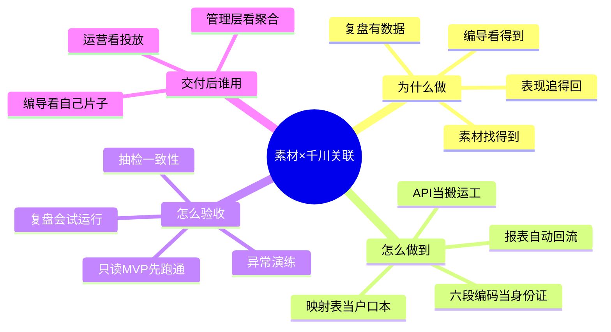
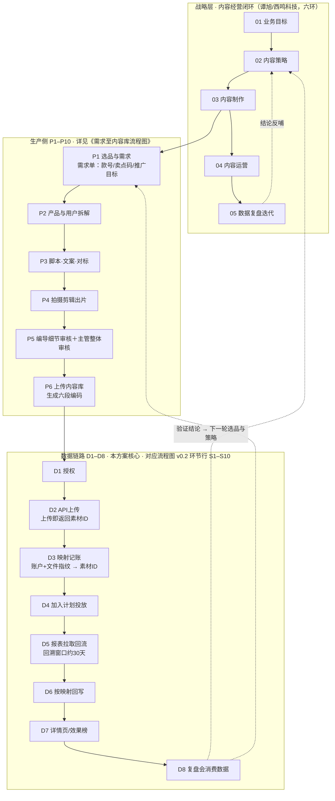

# 内容库素材 × 千川数据关联 · 方案说明（v0.1）

> 客户：高乐捷 GOLOVE JOY ｜ 文档版本：v0.1 ｜ 编制日期：2026-10-15 ｜ 密级：内部资料，请勿外传
> 编制：高乐捷 FDE 交付团队
>
> **文档定位**：四件套的入口件。流程图负责表达关系，本件负责解释规则——客户与管理者只读本件＋流程图即可理解「解决什么问题、怎么解决、交付后得到什么」；口径与字段细节见件2，落地与验收见件4，操作示例见件3。
> 配套阅读：[流程图 v0.2（双泳道）](../02-调研/内容库素材-渠道数据关联流程图-v0.2-20261014.html) ｜ [字段及关联规则（件2）](内容库素材与千川数据关联-字段及关联规则-v0.1-20261015.md) ｜ [全链路案例（件3）](内容库素材与千川数据关联-全链路案例-v0.1-20261015.md) ｜ [试点与验收计划（件4）](内容库素材与千川数据关联-试点与验收计划-v0.1-20261015.md)
> 忠实性声明：本件只描述已核验或已拍板的事实（依据随文标注）；未验证项一律挂《待确认项统一编号》（件2 §八），**不预设结论、不承诺未经试跑的收益**。

---

## 〇、一页导图

---

## 一、要解决的业务问题：三个现场场景

> 以下场景来自运营口述（2026-10-14）与千川后台截图（截图 1–3，归档于 `01-输入/千川操作截图/`），现状流程未逐条实操验证（现场跟做挂试点计划 N1）。

### 场景一：素材上平台——运营当搬运工

- **现在怎么做**：拍剪出片交付内容库后，运营要从内容库把文件下载到本地，再手动上传到千川后台（现状第 6–7 步）。上传还有硬性规格门槛：竖版 9:16、码率 ≥516kbps、大小 ≤1000M、分辨率 720×1280~1440×2560、时长 4s–300s，不合规直接传不上（`截图2`）——这正是「必须下载再上传」的真实原因之一。
- **容易出什么错**：版本传错（同款多版本易混淆）；当天片子当天投不上，时效差。
- **对业务的影响**：重复搬运；投放节奏被人肉环节卡住。
- **改造后**：内容库内直接调千川 API 上传，上传前按规格前置校验，素材 ID（material_id）在上传响应中同步返回并自动记账（件2 规则 R2/R4）。
- **仍需人工**：审核驳回后的素材修改与重新送审；「是否自动建计划花钱」属经营决策，管理层拍板（⚠️QC-04）前，建计划仍由运营在千川后台人工操作。

### 场景二：找数据——两个后台之间对名字

- **现在怎么做**：运营复制内容库里的视频名称，粘贴到千川搜索框主动搜索定位素材数据（`截图1`）；为了让两边对得上，运营还要在千川侧修改素材名称或打自定义标签，使其与内容库名称一致（`截图3`）。
- **容易出什么错**：关联键是人工维护的名称字符串——改名、同名、截断、错别字都会断链，且无校验（断点 B2）；谁在何时把哪条素材投到哪个计划没有记录（断点 B7）。
- **对业务的影响**：数据不回流内容库，复盘两张皮，无法按卖点/作者/版本聚合；历史数据无法批量对齐。
- **改造后**：六段编码（款号_卖点_时间_作者_主题_版本，✅2026-10-14 已拍板）当身份证，编码 ↔ material_id 系统级映射，不再依赖名字；数据按映射自动回流内容库。
- **仍需人工**：录入编码时的款号/卖点/主题选择是人工决策点；四张码表需客户建齐并维护（⚠️QC-13/14）。

### 场景三：编导看不到数——反向优化断在源头

- **现在怎么做**：编导侧没有千川入口（访谈已确认，断点 B6），「哪个卖点有效、哪条片子跑得好」主要凭印象和口口相传。
- **对业务的影响**：数据→内容的反向优化断在源头；复盘会上编导无法对着数据看片。
- **改造后**：内容库素材详情页同屏呈现消耗/ROI/点击率，复盘会（五段式）用同一张表开（件2 §5.3）。
- **仍需人工**：数据只回答「发生了什么」，**归因仍是人的工作**——五段式复盘会的四要素追问（需求/情绪/理由/证据＋人群/供给侧）不因数据回流而自动化。

---

## 二、方案目标与范围

### 2.1 一句话目标

**现状是「人当接口」（人搬素材、人对名称、人找数据），改造后是「系统当接口」（编码当主键、API 当搬运、数据自己回流）**——最终让内容库里的每一条视频，自带它在千川的身份证（material_id）和它的投放结果，单条素材全链路双向可溯源。

### 2.2 范围表

| 范围内（本期做） | 范围外（本期明确不做） |
|---|---|
| 抖音千川链路：统一编码 → API 上传 → 编码↔material_id 映射 → 数据定时回流 → 内容库详情页呈现 | 系统自动建计划/自动花钱（决策项，⚠️QC-04 拍板前不做；第一步先「只读打通」MVP） |
| 样本款存量素材回填 material_id（试点范围） | 天猫侧 API 自动发布（⚠️QC-16，本期走「人工发布＋Chrome 插件监听 content_id」过渡） |
| 异常提示、对账与留痕机制（件2 §七） | 天猫内容数据自动回流（⚠️QC-17，本期数据侧人工看生意参谋/逛逛分析） |
| 全量款号主数据接入编码下拉 | 直播间素材范围（书面确认首期不含，挂 G7） |
| 编导/运营看数权限与复盘会数据接入 | 存量全量回填（QC-03 拍板后另排） |

---

## 三、全景衔接：从需求到复盘

### 3.1 全景图

> 编号说明：生产侧 P1–P10 与谭旭《内容经营闭环》的执行 SOP 对应（P 编号详见《需求至内容库流程图》）；数据链路 D1–D8 与流程图 v0.2 的环节行 S1–S10 对应。两套编号分开命名，避免此前两图同为 S1–S10 引起的对话歧义。

### 3.2 涉及系统一览（客户视角）

| 系统 | 是什么（白话） | 在本方案里的角色 |
|---|---|---|
| 内容库（golovejoy.com.cn/apps/content） | 客户自建的素材管理系统，存成片和创作信息 | 方案的数据之家；改造后素材详情页直接呈现投放数据 |
| 千川 | 抖音的付费投放后台 | 素材投放发生地、投放数据产生地 |
| 千川开放平台（Marketing API） | 千川官方提供给外部系统的程序接口 | 改造后的「搬运工」：上传素材、拉取报表 |
| 聚水潭 | 客户的订单/商品主数据系统 | 全量款号主数据来源（编码第一段下拉挂这里，⚠️QC-13） |
| NAS | 客户内网文件存储 | 素材原件备份；天猫侧人工发布从这里取文件 |
| 钉钉 | 客户的 IM 与权限系统 | 数据权限、异常通知 |
| Chrome 插件（过渡方案） | 监听天猫逛逛发布时的接口报文，解析出内容 ID 回写关联 | 天猫链路本期过渡方案（⚠️QC-16 查证后可升级） |
| 千牛后台/万相台、生意参谋 | 天猫运营与数据看数入口 | 天猫侧现状看数方式（本期不做自动回流） |

### 3.3 输入与输出

- **输入**：通过双审的成片（带六段编码与款号/卖点码）＋千川账户授权；
- **输出**：① 素材详情页带投放数据（消耗/ROI/点击率/计划）；② 编码 ↔ material_id 映射表；③ 素材效果榜（复盘会输入，按款号/卖点/主题/作者/版本可聚合）；④ 复盘台账 A 第 13–17 号字段自动填充；⑤ 异常提示与操作留痕。

---

## 四、前置条件（开工前必须就位）

| # | 条件 | 状态 | 责任方 | 关联 |
|---|---|---|---|---|
| 1 | 六段编码规则拍板（款号_卖点_时间_作者_主题_版本） | ✅ 已锁定（2026-10-14 拍板） | — | QC-01 |
| 2 | 四张码表建齐（款号/卖点/作者/主题） | ☐ 待建 | 运营＋编导＋人事 | QC-13/14 |
| 3 | 开放平台开发者账户与应用入驻（一个公司主体只能认证 1 个开发者账户、通过后不可改；本方案走「提供第三方服务」应用路线，应用由词元引擎主体注册，客户授权使用——客户换主体不影响应用） `官方核验` | ☐ | FDE＋公司 | QC-08 |
| 4 | 客户完成授权（授权 URL 带 material_auth 勾选「允许开发者管理敏感物料」；范围选「当前用户全量账户」，含后续新增业务线账户） `官方核验` | ☐ | 客户授权管理员 | QC-02/08 |
| 5 | 千川账户清单与归属 | ☐ | 运营 | QC-02 |
| 6 | 接口逐项验权（上传/计划/计划下素材/报表/去重） | ☐ | FDE | N4 |
| 7 | 全域投放授权（仅自动投放阶段需要） | ☐ | 公司 | QC-11 |

> 催办提示：报表接口回溯窗口约 30 天（`SDK复核`）——**自建数据仓是唯一历史真源，授权每晚一天、历史数据少一天**。

---

## 五、能力分层清单（哪些已有、哪些要建）

> 评审提示：**不要把流程图中的连线直接视为已经打通的能力**。「待验证」列任何一项未实测前，链路只能视为设计成立，不能视为运行成立。

| 层 | 内容 | 备注 |
|---|---|---|
| **已有可用** | 千川后台人工链路（上传/改名对齐/搜索看数，截图 1–3）；内容库（素材存储与创作信息）；数据门户＋钉钉权限（阶段一已完成）；复盘台账 A/B 与五段式复盘会（运营使用中） | 现状链路本身可用，痛点在人工与断链 |
| **待配置** | 开发者账户与应用入驻；授权（material_auth＋全量账户）；四张码表；千川账户清单；编导看数权限 | 多为客户侧动作，见件4 §四 配合清单 |
| **待开发/联调** | 内容库投放模块（API 上传＋映射记账）；报表定时拉取与回写任务；详情页数据呈现；每日对账任务；异常提示与留痕 | 工程主体；频控参数按调研底稿 5.2（上传并发 2、绑定并发 3–5） |
| **待验证** | 审核状态字段与获取方式（⚠️QC-10，两 SDK 不一致）；编码作素材名称的长度限制（⚠️QC-19）；标签写接口（⚠️QC-05）；报表主题可用性与过滤参数（配置查询接口确认）；天猫插件报文解析（⚠️QC-16/17） | 联调第一步逐项实测，不预设结论 |

**工作量与节奏**：不在本文虚估人天，按调研底稿 §八 的动作口径推进——N1 现场实操（本周）、N2 账户清单（本周）、N4 验权（下周）、N5 只读 MVP（两周内）、N6 详情页展示（随 MVP）；详细时间盒与责任矩阵见件4 §九。

---

## 六、交付物与责任边界

| 侧 | 内容 |
|---|---|
| **我方交付（词元引擎 FDE）** | ① 内容库投放模块（上传/映射/回流/对账/告警）；② 样本款存量回填；③ 文档四件套（本件＋件2/3/4）；④ 培训（60 分钟操作培训＋一页操作卡）；⑤ 试点期支持与 QC 闭环跟进 |
| **客户责任（高乐捷）** | 账户提供与授权操作；码表与经营口径拍板（D1–D4）；编码录入时的人工决策（款号/卖点/主题）；投放决策（预算、目标、是否放开自动建计划）；异常第一响应（上传文件修正、编码重录） |
| **持续服务内容** | 千川侧接口/字段变更适配；数据仓留存与重刷任务维护；QC 闭环后的版本升级；复盘会主持支持（首月）；维护责任交接口径挂 ⚠️QC-22 |

---

## 七、与《内容经营闭环》的衔接

本链路在谭旭/西鸣科技《内容经营闭环》（库内存档：`02-调研/内容经营闭环-AI价值清晰版.xmind`、《需求至内容库流程图.png》）六环中，**卡在「04 内容运营 → 05 数据复盘迭代」之间，反哺「02 内容策略」**。三个具体衔接点：

1. **复盘下钻**：闭环 05 环要求「数据归因、带着假设结论分析」——没有素材级关联，归因只能到计划层；关联表让复盘能按六段编码的每个字段归因：**款号=哪个产品有效、卖点=哪个买点有效、主题=哪个内容模型有效、作者=谁的方法该推广、版本=哪个剪辑策略有效**。
2. **资产沉淀的前提**：闭环 06 环要沉淀「优质内容模型、正面/反面案例」——没有素材×数据关联，正反面只能靠主观判断；关联数据让「沉淀」有据可依。
3. **AI 工具效果验证的计量基础**：闭环三级为五个 AI 工具（flimo 素材短视频、达人筛选、Muse AI、自动上架、千川自动投流）各设了「效果验证＝比较同类任务成本/人效」的目标口径——这些比较全部依赖素材级/任务级数据关联。本链路同时是闭环里所有 AI 提效目标的验证仪表。

数据消费方式即五段式复盘会（目标 vs 实际 → 素材盘点 → 逐条看片·高光帧定位 → 归因 → 下周验证动作）＋台账 A/B——回流数据是会议的输入，验证结论经台账 B 闭环后反哺 02 内容策略与 P1 选品。

> 注：《内容经营闭环》原作者署名按内部沟通为谭旭（西鸣科技）；库内 xmind 中达人筛选工具负责人记载为「谭绪」，两处写法待与本人核对后统一（转写变体风险，同绍杰/少杰/邵杰情形）。

---

## 八、待确认与升版路径

- 待确认项统一编号：**主系列 QC-01~QC-23**，总表与 v0.9 旧编号对照见[件2 §八](内容库素材与千川数据关联-字段及关联规则-v0.1-20261015.md)；
- 本件升 v1.0 条件（与件2 一致）：码表四张建齐（QC-13/14）＋ QC-10/18/19 联调实测 ＋ QC-20/21 口径拍板；
- 推进节奏：与《待确认清单-四项共识落地》（D1–D4）合并推进，避免两套拍板会；试点与验收安排见[件4](内容库素材与千川数据关联-试点与验收计划-v0.1-20261015.md)。

---

*依据：运营口述（2026-10-14）与截图 1–3；调研底稿 v0.1（断点 B1–B7、接口清单与硬约束、最小可行切片、QC-01~17）；流程 v0.9 交付件（公开资料附录 1–18）；六段编码拍板记录（调研底稿 4.1，2026-10-14）；谭旭/西鸣科技《内容经营闭环》（AI价值清晰版 xmind＋需求至内容库流程图）；五段式复盘模板 v1.0。*
