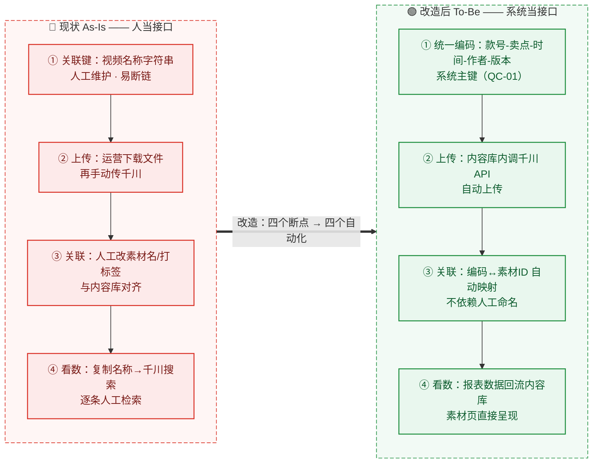
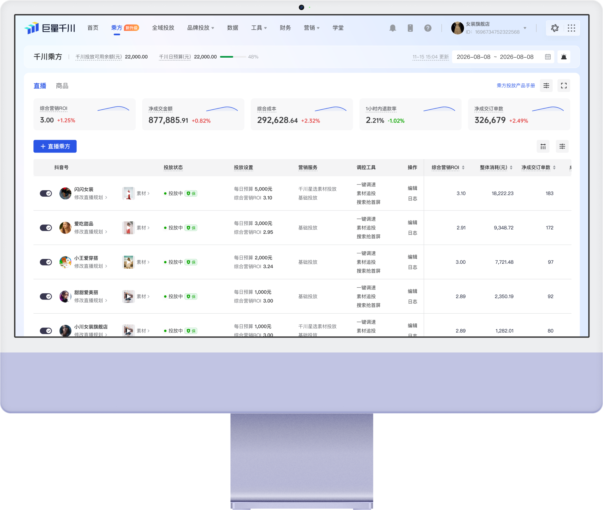
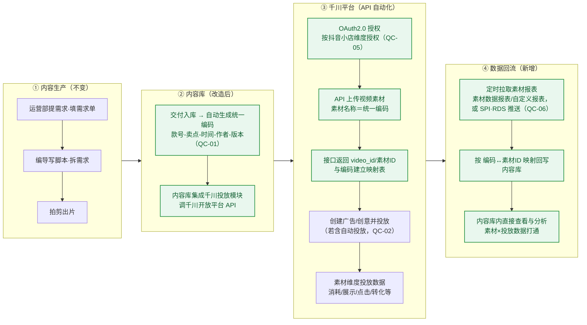
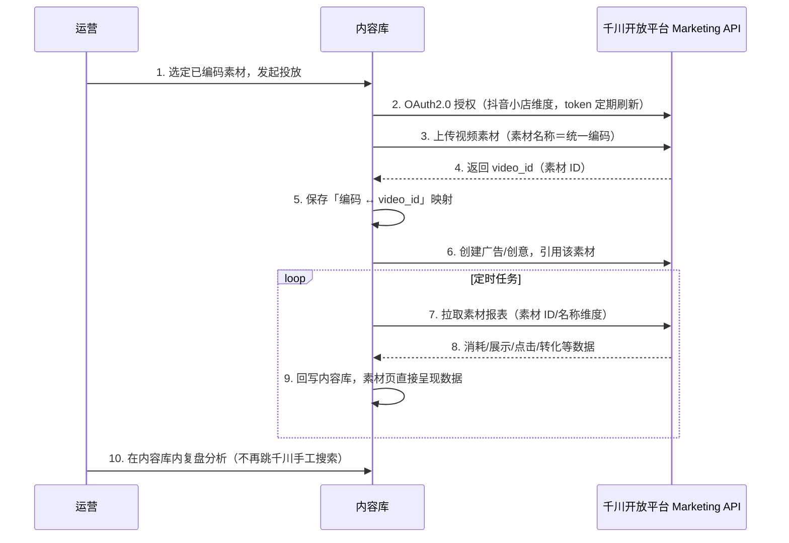
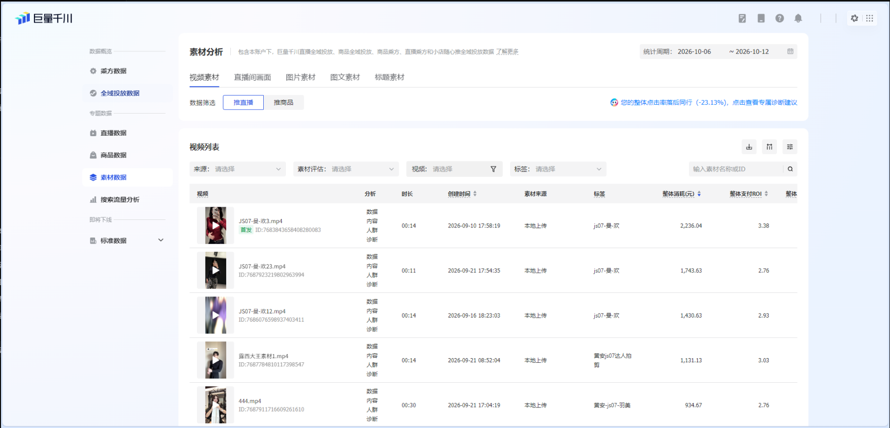
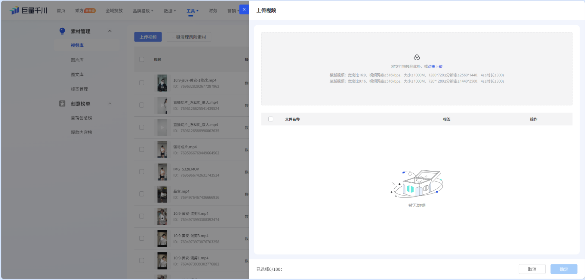
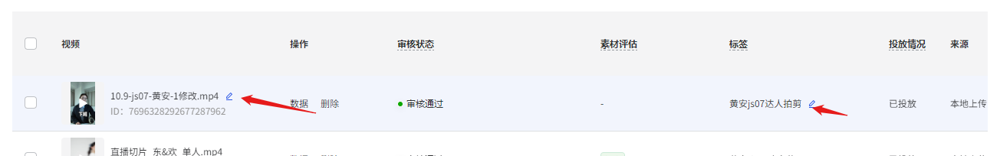

# 内容库素材 × 千川数据关联流程梳理（现状 As-Is × 改造 To-Be）

> 客户：高乐捷 GOLOVE JOY ｜ 文档版本：v0.9 ｜ 编制日期：2026-10-14 ｜ 密级：内部资料，请勿外传
>
> 服务于阶段二核心目标：**内容库素材 × 千川投放数据强关联，跑通最小闭环**（见 [golo/README.md](../README.md) 待办 2）。
> v0.9 说明：现状流程含运营口述成分，平台机制来自公开资料检索（来源见附录）；待确认项挂《待确认清单》（第六章），逐项闭环后升 v1.0。

---

## 一、文档定位与口径

- **要回答的问题**：内容库（`www.golovejoy.com.cn/apps/content/`）里的素材，和巨量千川的素材数据，现在是怎么"接"上的；改造后怎么"焊死"。
- **现状（As-Is）**：素材生产 → 入内容库 → 运营手工搬运到千川 → 数据靠**人工名称对齐 + 跨系统搜索**查看，内容库侧无千川数据。
- **改造（To-Be）**：内容库视频 ID 统一编码（款号-卖点-时间-作者-版本），内容库集成千川投放模块（调千川开放平台 API），**编码 ↔ 千川素材 ID 自动映射，投放数据回流内容库**。
- **阅读路径**：给老板/相关人 → 只看第二章（对比总览）；业务与落地细节 → 第三、四、五章；推进排期 → 第六章待确认清单。
- **配套调研底稿**：[02-调研/素材-千川数据关联流程梳理-v0.1](../02-调研/素材-千川数据关联流程梳理-v0.1-20261014.md)，含上传规格门槛、具体接口路径与实测坑、断点 B1–B7 拆解、只读打通 MVP 切片。⚠️ 该件的待确认编号（QC-01~09）与本文件 QC 系列内容重叠但**序号不互对应**（如"自动投放范围"本文件为 QC-02、彼件为 QC-04），两件合并升版时需先统一编号。
- **忠实性约定**：每个环节标注依据——`口述`（2026-10-14 运营口述）、`截图N`（归档于 `01-输入/千川操作截图/`）、`公开资料[编号]`（附录）。平台机制凡未能从官方原文核实的，不写死，挂待确认。

名词对齐：本文「素材」指用于千川投放的视频成片；「素材 ID」以千川侧为准（API 上传接口返回 `video_id`，后台素材库展示素材 ID，截图 2 所示）；「素材报表」指千川按素材维度聚合的投放效果数据。

---

## 二、一图看懂：改造前后对比

**一句话总结：现状是"人当接口"（人搬素材、人对名称、人找数据），改造后是"系统当接口"（编码当主键、API 当搬运、数据自己回流）。**

### 2.1 四个关键变化

| 关键变化 | 现状 | 改造后 |
|---|---|---|
| ① 关联靠什么 | 视频名称字符串（人工维护） | 统一编码（系统主键） |
| ② 素材怎么上千川 | 运营手动下载再上传 | 内容库内调 API 自动上传 |
| ③ 关联怎么建立 | 人工改素材名/打标签对齐 | 编码↔素材ID 系统自动映射 |
| ④ 数据怎么看 | 跳到千川复制名称搜索 | 报表回流，内容库直接呈现 |

### 2.2 改造前后对比总览图

> 图例：🔴 红底＝现状人工/断链环节　🟢 绿底＝改造后的自动化环节　粗箭头＝改造动作

### 2.3 千川投放后台长什么样（参考图）

素材投放发生在巨量千川后台。下图为千川官网产品页所示的投放管理界面（乘方·计划列表 + 数据概览，演示账户），仅示意平台形态；客户实际操作界面见 `01-输入/千川操作截图/` 截图 1–3。

*参考图：巨量千川后台投放管理界面（来源：巨量千川官网 shoppingads.cn，图片检索于 2026-10-14，演示账户数据）*

---

## 三、现状流程（As-Is）

### 3.1 全链路流程图（横向：左→右为阶段推进，阶段内自上而下）

> 图例：🔴 红底＝人工搬运/人工关联等断链环节

```mermaid
flowchart LR
    classDef pain fill:#fdeaea,stroke:#d93025,stroke-width:1.5px,color:#7a1c18;

    subgraph P["① 内容生产侧（口述）"]
        direction TB
        A1["运营部提需求<br/>填需求单"] --> A2["编导写脚本<br/>抖音内容运营 ＋ 内容部拍剪·拆需求"]
        A2 --> A3["拍剪出片"]
    end

    subgraph L["② 内容库 golovejoy.com.cn/apps/content"]
        direction TB
        B1["交付入库<br/>视频获得内容库视频名称/ID"] --> B2["回传运营"]
        B2 --> B3["运营下载目标文件"]
    end

    subgraph Q["③ 千川平台（公开资料＋截图佐证）"]
        direction TB
        C1["千川后台上传素材<br/>上传后可见素材ID（截图2）"] --> C2["素材加入广告计划/创意<br/>开始投放"]
        C2 --> C3["投放后产生素材数据<br/>消耗/展示/点击/转化等（素材报表）"]
    end

    subgraph M["④ 现状关联方式：人工·单向"]
        direction TB
        D1["名称对齐：修改千川素材名称/<br/>自定义标签＝内容库视频名称（截图3）"]
        D2["运营复制内容库视频名称"]
        D3["粘贴到千川搜索框主动搜索<br/>（截图1）"]
        D4["人工比对，查看该素材数据"]
        D2 --> D3 --> D4
    end

    P --> L
    L --> Q
    Q -. 人工对齐名称/标签 .-> M
    L -. 复制名称去千川搜索 .-> M

    class B3,C1,D1,D2,D3,D4 pain;
```

### 3.2 分步说明

| # | 环节 | 动作 | 角色 | 平台/系统 | 产出 | 依据 |
|---|------|------|------|-----------|------|------|
| 1 | 提需求 | 运营部填写需求单 | 运营部 | 需求单载体待确认（QC-03） | 需求单 | 口述 |
| 2 | 写脚本 | 编导写脚本：抖音内容运营 ＋ 内容部拍剪，拆解需求 | 编导/内容部 | — | 脚本 | 口述 |
| 3 | 出片 | 按脚本拍摄、剪辑出片 | 拍剪 | — | 成片视频 | 口述 |
| 4 | 入库 | 成片交付内容库 | — | 内容库 | 内容库视频条目（视频名称/ID） | 口述 |
| 5 | 回传 | 入库信息回传运营 | — | 内容库 | 运营侧可感知、可领取 | 口述 |
| 6 | 取素材 | 运营下载目标文件 | 运营 | 内容库 | 本地视频文件 | 口述 |
| 7 | 上传 | 千川后台上传素材，素材获得素材 ID | 运营（操作人与入口待确认，QC-04） | 千川后台 | 千川素材 ID | 口述＋截图2＋公开资料[1][7] |
| 8 | 投放 | 素材加入广告计划/创意，开始投放 | 运营 | 千川 | 投放中的计划/创意 | 公开资料[2][14][15]推导，细节待确认 |
| 9 | 生数 | 投放后按素材聚合数据（消耗、展示、点击、转化等） | — | 千川素材报表 | 素材维度投放数据 | 公开资料[3][8][9][10][11][16] |
| 10 | 分析 | 运营在千川素材报表查看/分析 | 运营 | 千川 | 人工分析结论 | 口述＋截图1 |
| 11 | 对齐 | 修改千川素材名称或自定义标签，使其与内容库视频名称一致 | 运营 | 千川素材管理 | 名称/标签人工对齐 | 口述＋截图3＋公开资料[6] |
| 12 | 检索 | 复制内容库视频名称 → 粘贴到千川搜索框 → 主动搜索比对 | 运营 | 千川 × 内容库跨系统 | 定位单条素材数据 | 口述＋截图1 |

### 3.3 关键机制（依据公开资料核实）

1. **上传与 ID**：千川后台上传视频素材后，素材进入素材库并展示素材 ID（截图 2；素材库入口见公开资料[7]，官方 API 上传接口返回 `video_id`[1][14]）。
2. **数据何时产生**：素材本身不带数据；素材被加入广告计划/创意并**开始投放后**，才在素材报表中聚合出消耗、展示、点击、转化等数据[3][8][9][10][11][16]。未投放的素材在报表中无投放数据。
3. **自定义标签**：千川/巨量体系的素材中心-视频库支持 100% 自定义维度的标签管理，可为素材单个/批量打标，并按标签查看素材效果数据（标签分析指标含点击率、3 秒播放率、完播率、转化率、转化成本、消耗；2023-01 手册口径：单组织标签上限 1000 个、单素材 50 个、标签超 10 字符失败，现行以平台实际为准）[6]。现状运营正是用"素材名称 + 自定义标签"承载内容库视频名称（截图 3）。
4. **现状关联的本质**：**以"名称字符串"为关联键的人工单向检索**——内容库 ←名称复制→ 千川搜索框。内容库内没有任何千川数据字段，数据不回流。

### 3.4 现状断点（改造要解决的问题）

| # | 断点 | 后果 |
|---|------|------|
| 1 | 关联键是人工维护的名称字符串 | 改名、同名、截断、错别字都会断链，无校验 |
| 2 | 检索单向：只能"内容库 → 千川" | 看数据必须跳平台手工搜，无法在内容库内直接看素材表现 |
| 3 | 无数据回流 | 内容库只是素材仓，不是"素材×数据"经营看板；批量复盘靠人肉 |
| 4 | 版本与衍生素材难区分 | 同一款视频的多剪辑版本在千川侧难以归因到具体"哪个版本、谁做的、什么卖点" |

---

## 四、改造后流程（To-Be）

### 4.1 设计要点

1. **统一编码**：内容库视频 ID 重新编码，格式 **款号-卖点-时间-作者-版本**（2026-10-14 口述口径；与 golo/README 待办 3 的"时间-货号-卖点-人-版本"顺序不一致，QC-01 待锁定）。编码同时承担：内容库主键、千川素材名称、关联键三重角色。
2. **内容库集成千川投放模块**：通过千川开放平台（巨量引擎 Marketing API）实现"上传-映射-投放-回流"自动化，编码与千川素材 ID 建立系统级映射，不再依赖人工命名。
3. **数据回流**：定时拉取（或接收推送）素材维度报表，按映射回写内容库，素材详情页直接呈现投放数据。

### 4.2 改造后全链路流程图（横向）

> 图例：🟢 绿底＝改造新增的自动化环节

*闭环说明：④ 数据回流后，复盘结论反哺 ① 内容生产（需求单与脚本），形成「生产 → 投放 → 数据 → 再生产」的循环；为保持横向版面清晰，图中不画回边。*

### 4.3 编码自动关联机制（时序）

### 4.4 千川开放平台能力盘点（To-Be 依赖的接口）

| 环节 | 能力/接口 | 说明 | 来源 |
|------|-----------|------|------|
| 授权 | OAuth2.0：auth_code → access_token / refresh_token | 千川账户绑定抖音小店，**授权以小店为单位**；refresh_token 有效期约一个月，需定期刷新否则失效 | [13] |
| 上传素材 | 上传视频素材接口（`advertiser_id` 必填；`upload_type`＝文件上传/网址上传） | 上传时**素材名称＝统一编码**；返回 `video_id` | [1][14] |
| 素材查询 | 获取千川素材库视频、获取抖音号下视频、获取抖音主页视频对应素材库视频 | 拉取素材库视频与 ID、对账 | [1][14] |
| 更新素材 | 更新视频接口（修改素材名称等） | 存量素材改名补对齐可用 | [14]（巨量广告口径，千川侧需验证） |
| 投放创建 | 创建广告（v3 promotion）、创建自定义/程序化创意 | 若"自动投放"含自动建计划/创意，用这组接口 | [15] |
| 数据回流-拉取 | v3 素材数据报表、自定义报表（含"可用指标和维度查询"接口）、旧版视频素材报表、异步报表任务 | 按素材维度定时拉取 | [3][15] |
| 数据回流-推送 | SPI / RDS 数据推送方案 | 近实时、适合大数据量场景，比轮询稳 | [4] |
| 素材管理 | 素材中心-视频库标签管理（100% 自定义维度） | 可作编码之外的冗余关联维度（如按款号、卖点打标） | [6] |

> 说明：官方文档站页面为动态渲染，本次检索未抓到接口正文全文，上表接口能力以官方目录页 + 开源 SDK 接口总表 + 实战文章交叉佐证；**字段与参数以联调时官方文档为准**。

### 4.5 素材报表常用指标（回流字段建议）

仅列公开资料反复出现的常用指标，**不设任何阈值**（阈值属客户经营决策，归《待确认清单》闭环后另行定义）：

| 指标 | 说明 | 来源 |
|------|------|------|
| 消耗 | 该素材投放花费 | [3][10][11] |
| 展示次数 / 千次展现费用 | 曝光量与 CPM | [3][10] |
| 点击次数 / 点击率 | — | [3][9][10] |
| 转化数 / 转化率 | 下单、成交等转化口径 | [3][9][10] |
| ROI / 投产 | 成交 GMV 与消耗之比 | [9][10][12] |
| 3 秒完播率 / 完播率 | 素材内容质量类指标 | [6][9] |

---

## 五、现状 vs 改造对照

| 维度 | 现状 As-Is | 改造后 To-Be |
|------|-----------|-----------|
| 关联键 | 名称字符串（人工维护） | 统一编码（系统主键） |
| 关联建立方式 | 运营改素材名/打标签 | API 上传时自动建立 编码↔素材ID 映射 |
| 上传方式 | 运营手动下载再上传 | 内容库内发起，API 自动上传（QC-02 范围待确认） |
| 数据获取 | 复制名称→千川搜索框人工检索 | 报表拉取/推送回流，内容库直接呈现 |
| 分析场所 | 千川后台，逐条人肉 | 内容库内，素材详情页带投放数据 |
| 版本区分 | 难以区分 | 编码含版本/作者/卖点字段，天然可归因 |

---

## 六、待确认清单（闭环后升 v1.0）

| 编号 | 事项 | 背景 | 建议确认人 |
|------|------|------|-----------|
| QC-01 | 编码字段顺序：款号-卖点-时间-作者-版本（2026-10-14 口述）vs 时间-货号-卖点-人-版本（golo/README 待办 3） | 两处口径不一致，影响编码规范落地 | 绍杰/悟空 |
| QC-02 | "自动投放"的范围：仅自动上传＋关联，还是含自动创建广告计划/创意 | 口述为"集成自动投放的功能"，实现成本与权限差异大 | 绍杰 |
| QC-03 | 需求单载体与字段（现状步骤 1） | 口述未及载体（钉钉表单/文档/表格？） | 运营部 |
| QC-04 | 千川上传的操作人与具体入口；截图 2 所示 ID 的准确字段口径（视频 ID/素材 ID） | 截图已归档但未标注后台菜单路径 | 运营/投放操作人 |
| QC-05 | 授权主体与开发者入驻：哪个抖音小店/千川账户授权；自研应用 or 服务商代开发；审批周期 | 授权按小店为单位[13]，涉及账户权限与合规 | 绍杰/管理层 |
| QC-06 | 数据回流方式与时效：API 定时拉取 vs SPI/RDS 推送；T+1 还是小时级 | 决定架构与接口选择 | 悟空/技术 |
| QC-07 | 编码字段取值规则：款号字典、卖点枚举、时间格式、作者命名、版本号规则 | 档位 C（机制空白），不硬写，需客户定义 | 绍杰/悟空 |
| QC-08 | 编码作为千川素材名称的长度/字符限制 | 公开资料无统一口径，联调时以平台实际校验为准 | 技术（联调） |
| QC-09 | 存量素材迁移：历史素材是否补编码、补关联 | 决定迁移工作量与旧数据连续性 | 绍杰/运营 |

---

## 七、附录：来源与证据

**口述与截图（内部）**

- 运营口述现状流程，2026-10-14 对话记录（本文档成文依据）。
- 截图归档：`01-输入/千川操作截图/`（原件为证据链，下方为内嵌引用）

*截图 1：运营在千川侧按名称检索素材数据*

*截图 2：上传后可见素材 ID*

*截图 3：以素材名称/自定义标签承载内容库视频名称*

**公开资料（检索日期 2026-10-14）**

| 编号 | 来源 | 链接 |
|------|------|------|
| [1] | 官方·上传视频素材 API（巨量引擎商业开放平台） | https://open.oceanengine.com/docs/1697466676592651 |
| [2] | 官方·素材管理接口目录 | https://open.oceanengine.com/labels/44 |
| [3] | 官方·自定义报表（数据报表，含"API 参数生成"） | https://open.oceanengine.com/labels/7/docs/1741387668314126 |
| [4] | 官方·获取投放账户数据（SPI/RDS 数据推送） | https://open.oceanengine.com/labels/12/docs/1697466393573376 |
| [5] | 官方·Marketing API 入门指南（接入全流程） | https://open.oceanengine.com/changelog/1 |
| [6] | 素材中心标签管理及分析能力说明手册（巨量广告平台，2023-01-31） | https://www.tui39.com/jd/4985.html |
| [7] | 巨量纵横用户手册·视频库（视频资产/自定义标签/共享） | https://school.oceanengine.com/product_help/content/668400000010/105352 |
| [8] | 巨量千川帮助中心 | https://qianchuan.jinritemai.com/help/content/root?graphId=397 |
| [9] | 知乎·巨量千川怎么判断素材能不能爆量 | https://zhuanlan.zhihu.com/p/17432040748 |
| [10] | 艾瑞网·如何分析巨量千川平台上的素材效果 | https://column.iresearch.cn/b/202407/985432.shtml |
| [11] | tui39·创意管理产品介绍 | https://m.tui39.com/jd/5058.html |
| [12] | 蝉妈妈·千川素材跑量趋势分析 | https://www.chanmama.com/yunyingquan/article/1944.html |
| [13] | CSDN·巨量千川 M-API 实践（授权按抖音小店） | https://blog.csdn.net/m0_48772106/article/details/136966013 |
| [14] | GitHub·oceanengine-sdk-php 素材管理接口文档 | https://github.com/westng/oceanengine-sdk-php/blob/main/docs/MATERIALS.md |
| [15] | GitHub·oceanengine Go SDK 接口总表（report/v3、promotion、creative） | https://github.com/bububa/oceanengine/blob/master/marketing-api/OCEANENGINE.md |
| [16] | ai-indeed·千川报表体系介绍（含素材维度） | https://www.ai-indeed.com/encyclopedia/31154.html |
| [17] | 抖音电商学习中心·短视频/素材诊断 | https://school.jinritemai.com/doudian/wap/article/aJXFPbWWNceA |
| [18] | 参考图·千川投放管理界面（巨量千川官网 shoppingads.cn，图片检索 2026-10-14，见 2.3 节） | https://www.shoppingads.cn |

> 检索局限说明：官方文档站（open.oceanengine.com）为动态渲染页面，正文未能直接抓取，接口细节经官方目录页、两个开源 SDK 接口总表与实战文章交叉佐证；正式开发前应以官方文档与沙箱联调结论为准。
